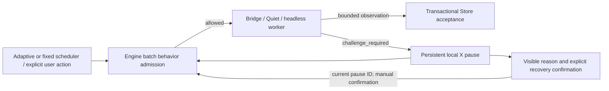

# Batch behavior and access challenges

## Goal and ownership

Batch behavior bounds work and respects source access decisions. It does not
simulate human identity or promise that automated access will be accepted.
The scheduler decides when content is needed; Engine admission decides whether
capture is allowed; workers implement readiness and bounded DOM acquisition.

## Implemented challenge boundary

- Shared `AkuBridge/capture-primitives.js` detects Cloudflare security verification
  and the X phone-app verification screen. Content and headless extractors use
  the same helper before capture actions. Post and quote text is excluded from
  page-level challenge matching.
- Challenge errors retain the canonical `challenge_required` code through the
  internal collector converter and Bridge transport. Only the allowlisted
  categories `cloudflare` and `x_human_verification` are retained. Store replaces
  page/worker messages and arbitrary diagnostic details with a fixed message.
- `internal/engine/batch_behavior.go` owns X admission and cancellation registration.
  `internal/store/source_capture_pause.go` persists the latch in existing metadata;
  no schema migration is required. The scope is conservatively all X capture in
  this Sidecar database, because not every lane has a verified account identity.
- A valid claimed command failure atomically records the first pause and makes
  outstanding X capture commands terminal. Recapture failure does the same.
  Queued X capture runs stop; already accepted observations and active reasoning
  remain available. Other sources are unaffected by the X latch.
- Store checks admission before new commands, follow-ups, claims and observation
  acceptance. Revoked commands cannot submit results after recovery.
- Managed internal capture contexts are cancelled after a durable failure. No
  user browser window is closed. Bridge capture stops on its own challenge checks;
  durable command revocation rejects any late result.
- A persistent banner is visible even with Auto Update disabled. Confirmation
  requires the current pause ID, cannot silently enable Auto Update, and permits
  a new attempt rather than certifying the website is healthy. Restart and timers
  do not clear the latch. Stale failure callbacks cannot pause a completed command.

The private, default-off native pilot and its enrollment/authorization policy are
not enabled or replaced by this change. This is not a qualification of that pilot
against live X. An older binary does not enforce this new metadata latch; do not
downgrade and resume X capture while a pause is unresolved.

## Existing pacing and proposed consolidation

`internal/engine/adaptive_update.go` already uses consumption, reading grace,
queue pressure, supply backoff and technical backoff. Its refill and standby
cadences are five and fifteen minutes. The headless worker currently defaults
to four scrolls (maximum six), a 0.75 viewport step and 900 ms settle.
The jitter in `AkuBridge/native-runtime-scheduler.js` belongs to runtime checks,
not feed acquisition, and remains separate.

The next bounded policy increment belongs in the same admission layer:

| Concern | Responsibility | Constraint |
| --- | --- | --- |
| Schedule | Existing adaptive/fixed scheduler | Generate demand; do not bypass admission |
| Concurrency and spacing | Engine admission | One capture per scope and a minimum interval |
| Optional scheduling jitter | Admission clock/RNG | Add delay after the minimum, never shorten it |
| Scroll and readiness | Worker | Existing post/scroll/time caps; bounded readiness wait |
| Temporary failure | Scheduler | Bounded backoff; honor a source retry deadline when available |
| Challenge or login requirement | Access admission | No automatic retry, profile fallback, reseed, or timer resume |
| Audit | Safe structured status | Policy reason, budgets, phase and durations; no session secrets |

These additional pacing rules are a design proposal, not new runtime defaults.
No mouse imitation, fingerprint modification, CAPTCHA automation, or clearance
cookie reuse is part of this policy. Timing changes are load controls, not a
method of concealing automation.

## Validation and current operation

Tests use synthetic DOM, mock transports, temporary SQLite databases, and injected
contexts. Cover both screens, quoted-text false positives, typed error transport,
first-cause retention, restart persistence, stale recovery IDs, late results,
cross-source isolation, and explicit recovery without enabling Auto Update.

During this change Auto Update was explicitly disabled using the running local
API; no active batch existed at readback. Browser profiles, credentials, the
retained QA profile, and the paused session-integration feature were not accessed.
Source changes still require a coordinated build/activation before the running
application can enforce the new latch.
