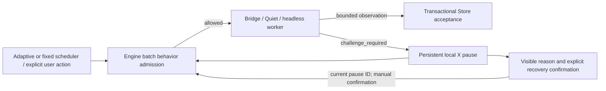

# Batch behavior and access challenges

## Goal and ownership

Batch behavior bounds work and respects source access decisions. It does not
simulate human identity or promise that automated access will be accepted.
The scheduler decides when content is needed; Engine admission decides whether
capture is allowed; workers implement readiness and bounded DOM acquisition.

## Implemented challenge boundary

- Shared `AkuBridge/capture-primitives.js` detects Cloudflare security verification
  and the X phone-app verification screen. Content and headless extractors use
  the same helper before capture actions. Post and quote text is excluded from
  page-level challenge matching.
- Challenge errors retain the canonical `challenge_required` code through the
  internal collector converter and Bridge transport. Only the allowlisted
  categories `cloudflare` and `x_human_verification` are retained. Store replaces
  page/worker messages and arbitrary diagnostic details with a fixed message.
- `internal/engine/batch_behavior.go` owns X admission and cancellation registration.
  `internal/store/source_capture_pause.go` persists the latch in existing metadata;
  no schema migration is required. The scope is conservatively all X capture in
  this Sidecar database, because not every lane has a verified account identity.
- A valid claimed command failure atomically records the first pause and makes
  outstanding X capture commands terminal. Recapture failure does the same.
  Queued X capture runs stop; already accepted observations and active reasoning
  remain available. Other sources are unaffected by the X latch.
- Store checks admission before new commands, follow-ups, claims and observation
  acceptance. Revoked commands cannot submit results after recovery.
- Managed internal capture contexts are cancelled after a durable failure. No
  user browser window is closed. Bridge capture stops on its own challenge checks;
  durable command revocation rejects any late result.
- A persistent banner is visible even with Auto Update disabled. Confirmation
  requires the current pause ID, cannot silently enable Auto Update, and permits
  a new attempt rather than certifying the website is healthy. Restart and timers
  do not clear the latch. Stale failure callbacks cannot pause a completed command.

The private, default-off native pilot and its enrollment/authorization policy are
not enabled or replaced by this change. This is not a qualification of that pilot
against live X. An older binary does not enforce this new metadata latch; do not
downgrade and resume X capture while a pause is unresolved.

## Configurable capture pacing

`internal/engine/adaptive_update.go` already uses consumption, reading grace,
queue pressure, supply backoff and technical backoff. Its refill and standby
cadences are five and fifteen minutes. The headless worker currently defaults
to four scrolls (maximum six), a 0.75 viewport step and 900 ms settle.
The jitter in `AkuBridge/native-runtime-scheduler.js` belongs to runtime checks,
not feed acquisition, and remains separate.

The optional `capture.behavior` startup configuration now enables a shared
pacing policy for ordinary Bridge, Quiet and Headless commands and media
recapture. It is independent of the persistent challenge guard. Older
configuration files omit this block and retain the existing pacing behavior.

Admission is checked in the same Store transaction that claims an operation.
An operation waiting for pacing remains queued and has no `claimed_at` or lease.
Durable claimed rows reserve one slot per local source across sessions and
recapture. Reasoning does not hold that slot. Accepted results, failures,
cancellation and existing lease-expiry handling complete the exact operation;
a stale callback cannot release a newer claim.

Cooldown is computed from claimed operations' durable terminal history:

`notBefore = completion + max(minimum interval, temporary backoff) + added jitter`

The jitter sample is stable for the completed operation. Polling and restart
do not redraw it. It never shortens the minimum interval. Success ends a
temporary-failure streak; explicitly classified temporary timeouts/transport
failures back off exponentially up to the configured base-backoff cap, with
jitter added afterward. Unknown errors, login requirements and challenges are
not classified as temporary recovery. Existing login failures stay nonretryable;
this change adds no login recovery API or authentication retries.

The policy reads durable history and claim state, so process restart retains
the cooldown and current occupancy. It does not repair orphaned claims: the
existing cancellation and lease-expiry mechanisms remain responsible for them.

| Setting | Default | Valid values |
| --- | --- | --- |
| `enabled` | `false` | Explicit opt-in; challenge guard remains active when false |
| `minCaptureIntervalMs` | `5000` | `1000..900000` |
| `additionalJitterMs` | `0` | `0..60000`, added after the minimum/backoff |
| `scrollFraction` | `0.75` | `0.5..1`, shared Bridge/worker range |
| `scrollSettleMs` | `900` | `100..2000`, shared Bridge/worker range |
| `temporaryBackoffBaseMs` | `10000` | `1000..300000` |
| `temporaryBackoffMaxMs` | `120000` | At least base, at most `900000` |

Zero values for minimum interval, scroll tuning and backoff select the stated
defaults; zero additional jitter disables added delay. Invalid values and unknown
startup configuration fields are rejected. These are engineering bounds, not
platform-approved rates or a claim of safe/undetectable automated access.

Copy the `capture.behavior` block from
[`config/capture-behavior.example.json`](../config/capture-behavior.example.json)
into the intended instance's existing configuration, preserving all other
settings. The example is a fragment, not a complete launch configuration. An
explicit coordinated restart is required to apply changes; this implementation
has not edited the running instance's configuration or enabled Auto Update.

Configured scroll fraction/settle values are stamped into ordinary capture
payloads before persistence. Existing scroll/post/time limits still apply;
recapture's zero-scroll behavior and follow-up continuation remain intact.
The private native pilot's closed payload projection and original 60-second
authorization are unchanged; this is not activation or live qualification of it.

`AutoUpdateStatus.captureBehavior` exposes enabled/source/allowed/reason and an
optional `notBefore`, without operation identifiers, session values, or raw
failure details. Scheduler diagnostics show source spacing, active capture,
temporary backoff, or manual verification. These projections are not authority.

Responsibilities remain separate:

| Concern | Responsibility | Constraint |
| --- | --- | --- |
| Schedule | Existing adaptive/fixed scheduler | Generate demand; do not bypass admission |
| Concurrency and spacing | Engine admission | One capture per scope and a minimum interval |
| Optional capture jitter | Admission policy | Stable added delay after minimum/backoff |
| Scroll and readiness | Worker | Existing post/scroll/time caps; bounded readiness wait |
| Temporary failure | Admission policy | Bounded backoff for explicitly classified temporary errors |
| Challenge | Access admission | No automatic retry, profile fallback, reseed, or timer resume |
| Audit | Safe structured status | Policy reason, budgets, phase and durations; no session secrets |

No mouse imitation, fingerprint modification, CAPTCHA automation, or clearance
cookie reuse is part of this policy. Timing changes are load controls, not a
method of concealing automation.

## Validation and current operation

Tests use synthetic DOM, mock transports, temporary SQLite databases, and injected
contexts. Cover both screens, quoted-text false positives, typed error transport,
first-cause retention, restart persistence, stale recovery IDs, late results,
cross-source isolation, and explicit recovery without enabling Auto Update.
Pacing tests additionally cover deterministic clock/sample boundaries, typed
configuration loading, invalid settings, concurrent claims, follow-up deferral
without consuming a lease, recapture sharing, restart-stable cooldown and stale
callbacks. No real-account traffic is needed for these tests.

During this change Auto Update was explicitly disabled using the running local
API; no active batch existed at readback. Browser profiles, credentials, the
retained QA profile, and the paused session-integration feature were not accessed.
Source changes still require a coordinated build/activation before the running
application can enforce the new latch.
