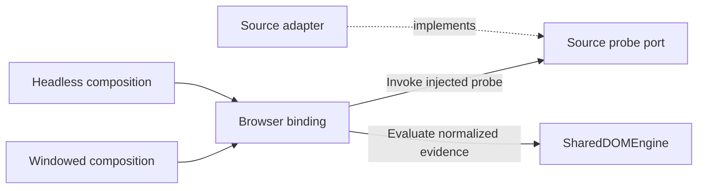

# SharedDOMEngine design

**Status** Proposed design for review. X is the first integration pilot.

## Context

The [X wrapped feed incident](headless-windowed-capture-parity.md#x-wrapped-feed-markup-8-november-2026)
exposed a gap between the two consumers. Windowed uses the adapter's wrapper
permalink evidence. Headless loads the same adapter and still derives its
primary X identity from timestamp anchors. It also counts DOM candidates for
readiness before applying its extraction checks. The same parser version can
therefore produce different admission and diagnostic decisions.

## Dependency boundary

SharedDOMEngine is a standalone, deterministic evaluator of normalized DOM
evidence. Its input and output are plain data. A caller can use it in a Node
test with no browser, application registry, or production adapter loaded.



| Layer | Responsibility |
| --- | --- |
| Source adapter | Read source markup, recognize known layouts, bind each candidate to its owner, and emit normalized identity and field evidence. It owns selectors, native identity formats, URL canonicalization, and layout names. |
| Consumer composition | Select the registered adapter and policy and project the result into the consumer's existing readiness and observation records. |
| Browser binding | Receive the selected probe and document context explicitly. Map its output to the engine contract and invoke the evaluator. Both consumers can reuse this binding with their own measurements and projections. |
| SharedDOMEngine | Validate the evidence envelope, resolve candidate identity from normalized claims, enforce common ownership rules, and classify readiness and diagnostics. |
| Windowed and Headless controllers | Own browser and page authority, route and epoch fences, deadlines, visibility, continuation, recovery execution, cancellation, and cleanup. Sidecar keeps persistence and dedup authority. |

The browser binding invokes the injected probe and the evaluator. The engine has no dependency on
the adapter registry, catalog, selectors, DOM globals, Chrome, CDP, storage,
network, clocks, or capture controllers. Source keys stay in consumer
composition and run diagnostics. Layout keys are opaque to the engine.
Adding a source means implementing the probe port and registering
it at the consumer boundary. Source-specific changes to application routing,
permissions, or transport remain the responsibility of that application.
The Headless source loader currently selects assets by source name. Future
onboarding can move that selection to an allowlisted consumer registration
without adding source names to the evaluator or allowing runtime code loading.

## Proposed API

The engine exposes one synchronous entry point. The browser binding calls the
probe separately, under the controller's existing page and operation bounds.

```ts
interface SourceDOMProbe {
  probe(context: ReadonlyDOMContext): NormalizedDOMEvidence;
}

assessDOM(input: AssessmentInput): DOMAssessment;
```

The probe port belongs at the binding boundary. `ReadonlyDOMContext` is a
read-only contract for trusted application adapters. It is not a sandbox for
third-party code. The evaluator does not execute the probe or accept callbacks.

`AssessmentInput` contains a current sample, an optional earlier sample, and a
versioned data-only evidence policy. The binding combines the controller's
access, route, and sample scope with the adapter's structure and candidate
facts. The first version needs these fields.

| Field | Meaning |
| --- | --- |
| `schemaVersion`, `policyVersion` | Contract and policy versions. The consumer records source and adapter identity when it projects diagnostics. |
| `scope`, `sampleSequence`, `complete`, `settled` | Opaque operation and document scope plus an ordered sample. The consumer changes scope when the route, adapter, or assets change. A bounded or interrupted sample reports incomplete coverage. The controller supplies settled status using its existing readiness budget. |
| `access` | Observed page or navigation state, including unknown, wrong route, login required, challenge, and unavailable. |
| `structure` | Feed root, loading and explicit empty signals, recognized layout keys, named marker counts, and visible or offscreen structural counts. |
| `candidates` | Bounded records with a sample-local reference, visibility, own and related identity claims, field availability, and their ownership provenance. |

Layout and marker keys come from the registered adapter contract. They are
bounded, opaque labels rather than values collected from page content. The
policy declares recognized field keys and modality combinations as data, so
adapters can add supported layouts without adding branches to the evaluator.

A candidate identity claim carries a source-normalized key, optional canonical
permalink, ownership scope, and a provenance label. Scope distinguishes
primary, quote, other, and unknown evidence. A field carries its availability
and ownership, including text, author, media, attachments, and quote evidence.
The engine works on evidence facts and references. Authored text, media URLs,
and DOM nodes remain in the consumer's extraction path. The evaluator can
validate the relationship between supplied claims. Browser fixtures must
independently verify that each adapter binds those claims to the correct nodes.

The engine groups equivalent primary claims by normalized identity key. It
rejects contradictory primary keys and incompatible bindings. Quote identity
stays separate and cannot supply the primary key, author, or body. The
integration pins the policy for accepted modalities and required primary
fields before calling the probe. It can also supply an expected normalized
identity when a controller has an explicit target. The adapter supplies
evidence for that policy.
Media-only and quote-only posts can qualify with the applicable ownership and
identity proof. A timestamp is optional when the source can establish identity
another way. Existing text-based fallback policies remain in their legacy paths
until an explicit compatibility decision for each migrated source.

`DOMAssessment` returns an access, rendering, layout, and integrity assessment,
candidate decisions, and a bounded diagnostic projection. The projection uses
closed reason codes and counters. It excludes identity values, raw HTML,
selectors from the page, URLs, content, and exception text. An unsupported
schema, malformed probe output, or probe failure yields its own diagnostic and
never becomes evidence of DOM drift. The consumer keeps freshness and dedup
outcomes separate from this result.

A discovery or document-level probe failure makes the sample unavailable.
A candidate-local probe failure rejects that candidate and preserves other
independently validated candidates. Neither case can produce a successful
empty-feed result. The binding uses bounded inputs and cooperative limits for
trusted probes. A hard execution timeout belongs to the host that runs them.

For example, the X adapter can emit a normalized owner claim from either a
legacy timestamp anchor or a wrapped status route. Both claims for the same
post resolve to the same key. A nested quote emits a separate key and its own
evidence. An additional primary claim with a different key rejects the
candidate. An adapter for a synthetic future source can supply opaque keys
with a different format and get the same decision without adding a branch to
the evaluator.

## Diagnosis and recovery

| Evidence | Assessment and controller response |
| --- | --- |
| Positive login, challenge, route, or navigation failure | Report the observed access or navigation condition. The controller applies its existing policy. |
| A loading signal or evidence progressing across comparable samples | Report hydration and permit another read-only sample within the existing budget. At deadline, report the timeout with the evidence still available. |
| A known layout supplies a valid candidate | Accept that evidence, including a tested alternate layout. Continue with valid candidates when other records are rejected. |
| A settled, complete sample exposes persistent post-shaped structure with no compatible layout or repeated missing required fields | Mark possible DOM drift. Corroborate with a second comparable settled sample before reporting `dom_contract_suspected`. Hold unvalidated candidates. |
| A recognized empty signal | Report observed empty. Zero candidates without such a signal yield `empty_unverified`. An incomplete sample cannot prove absence. |
| Competing primary identities or cross-post field ownership | Reject the affected candidate and record the integrity reason before dedup. |

Comparable samples belong to the same operation, document, route, source,
adapter, and policy. A route, document, or asset change discards the comparison.
Marker counts alone do not establish drift. Layout evidence comes from named
structural predicates, independent of post count and scroll position. Variant
matching is per candidate so a mixed feed can use more than one known layout.
`document.readyState === "complete"` alone does not establish a settled feed.
When the readiness budget cannot establish comparable settled samples, retain
an inconclusive diagnostic and let the controller finish the operation.

The evaluator returns facts and a suggested disposition. Controllers own the
decision to wait, use an already qualified fallback, or finish the source run.
Any action must respect the active route, lease, mutation authority, cancellation,
and deadline. Recovery cannot bypass the round-two anchor or mint a new identity
to evade dedup. An unknown layout is diagnosed and handled through an adapter
change with a fixture. Automated selector generation is outside this design.

## Artifact and rollout

Use one dependency-free JavaScript module with a public contract and its own
tests. Keep its initial source alongside AkuBridge's shared assets in a
self-contained package directory. This avoids a new repository for the pilot
and leaves an extraction path if another product needs the module. The release
packaging step emits one classic-script artifact for both browser consumers.
Windowed loads that artifact in its content-script context. Headless injects
the exact same bytes through its existing asset loader. The artifact wrapper
exposes the API in that context. The evaluator itself reads no globals.
One build emits `core.mjs` for standalone use, `browser-runtime.js` for both
browser consumers, and an artifact manifest. The evaluator has one maintained
source across those outputs.

Validate engine contract version and artifact SHA-256 in both package manifests
and receipts. Reuse the Headless source asset provenance and extend the Bridge
package verifier for the corresponding artifact. Keep adapter, consumer, and
policy versions distinct. A mismatched or missing asset cannot be reported as
an equivalent pair. Promotion or rollback uses a compatible version tuple.

1. **Shadow diagnostics and parity fixtures.** Run both real consumer entry
   points with the same synthetic DOM and collect the normalized assessment
   alongside their existing decisions. Preserve admission and recovery in this
   stage. Record the known X wrapper discrepancy as a characterization case.
   Reuse a single probe sample where possible. Shadow mode must never repeat
   capture effects such as expansion or reveal. Compare each consumer against
   its current baseline before proposing a unified target policy.
2. **X identity pilot.** Supply timestamp and wrapper claims through the same
   probe. Switch both consumers to the shared primary identity result after
   the fixture matrix passes. Preserve route, deadline, anchor, and dedup guards.
3. **Adapter onboarding.** Add Facebook, Instagram, and LinkedIn bindings one
   at a time against the same contract and their own fixture cases. Keep
   unsupported capabilities explicit. Qualify each mode separately before any
   live rollout.

## Acceptance criteria

- The evaluator imports and runs in a test process without a DOM or application
  package. A synthetic source with unfamiliar layout and identity formats
  uses the same evaluator by implementing the port and registering at the
  boundary. Use a non-URL identity such as `entry:opaque-17` and custom elements
  without `article` or `time`. The engine and its public enums need no
  source-specific edit. A dependency check rejects application imports and
  browser globals in the evaluator.
- A shared X fixture exercises legacy and wrapped layouts, mixed layouts, nested
  quotes, media-only posts, placeholders, delayed hydration, and conflicting
  identity. Include known empty, access failure, wrong route, interrupted
  samples, and adapter error cases.
- Run the same fixture through Windowed and Headless. For equivalent inputs
  and policy, compare canonical identity, primary versus quote ownership,
  candidate verdicts, and diagnosis. Document intentional controller
  differences, including visibility, recovery, and continuation limits.
- Adding a neutral wrapper or unrelated link, or nesting a valid quote, does
  not reassign the primary identity. Route or epoch changes invalidate a
  previous sample. Shadow mode does not produce a second observation for Store.
- Contract and artifact identity match across both packaged consumers. Keep
  implementation, fixture verification, live verification per mode, and
  release qualification as separate milestones.
