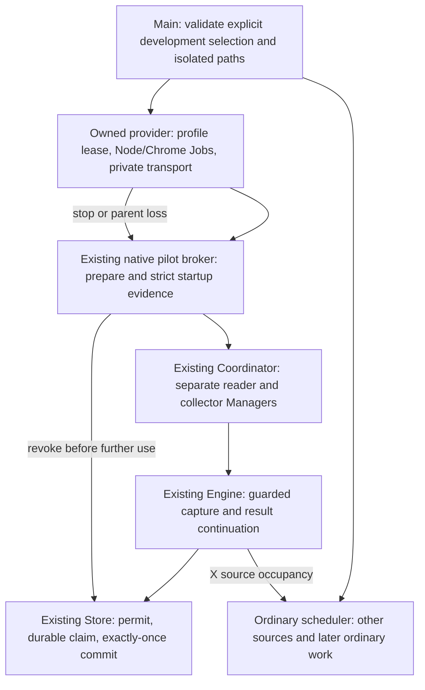

# X manual pilot: development provider integration

**Current target:** [daily X concurrency in ordinary development](x-daily-development-design.md).
The selected policy is now process-lifetime derivation authorization and a
60-second ceiling per batch, with restart-required `capture.xMode` selection.
The bounded one-use/QA composition below remains historical implementation
background and reusable evidence; it is not the daily-use MVP endpoint.
Increment 1 adds ordinary selection and unavailable-adapter admission fencing;
increment 2 still owns persistent reader and repeated native batch integration.

Prepared 2026-10-25, after native capture acceptance on `5964a24`.
Status: shared ownership/transport, application owner/profile lease, packaged
driver and QA native overlap acceptance are implemented. The ordinary development
entry now has source wiring and offline/synthetic tests; runtime activation is
separate. See the [current entry](x-manual-development-entry.md) and
[readiness checkpoint](concurrency-dev-readiness.md). Dated sections below retain
their historical implementation scope.

## Application owner factory and profile lease (2026-10-26)

`internal/ownedprofile` supplies an OS-held lease over existing canonical root
and profile directories. Expected physical IDs are checked before the reserved
lock file is opened. Directory pins deny delete sharing, and an exclusive empty
`.aku-x-manual.lock` stays held for the lease lifetime. Content remains writable;
the pinned root/profile cannot be renamed. Closing retains the empty lock file
to avoid a lock-file replacement race. This is an application-root lease, not
account enrollment or compatibility with the retained-QA manifest lock. A future
retained-QA adapter must hold its existing lease as well; descriptors alone do
not authorize sharing that profile.

The Windows/dev-only `startXApplicationOwner` is private and disabled by default.
It verifies and holds the explicitly supplied asset files/digests before taking
profile leases. It uses the existing `appshell.StartOwnedCommand` suspended-start,
launcher-lifetime and per-tree Job implementation instead of starting Node and
assigning it after readiness. The driver must answer a strict nonce-bound
`aku.x.application-owner.v1` handshake. Only existing manual owner operations
can use the private correlated pipe. No public decoder, CLI provider selection,
environment opt-in, retained profile discovery or real-session transfer is added.

The worker receives a limited Windows environment and dedicated temporary root;
it cannot inherit `NODE_OPTIONS`/`NODE_PATH` or Node startup overrides that execute
code before the pinned driver. Complete native driver packaging remains required:
the production bundle/import graph must be pinned by trusted composition, not
selected from a frontend path or treated as trusted because a handshake passed.
This increment tests a standalone synthetic driver and supplies no production
native driver artifact.

Startup request cancellation and the Sidecar/owner lifetime are distinct. The
single configured startup budget is clipped by the request and parent contexts;
asset/lease phases cannot reset it. Completing/canceling a successful startup
request does not retire the still-owned reader. Parent cancellation, pipe loss
or explicit full-owner disposal closes admission and the exact owned Job.
Existing manual broker abort remains responsible for preserving a reader during
ordinary pilot stop; full-owner disposal is not a substitute for that operation.

A PID announcement is only a candidate. `bindRole` checks creation/image,
process parent links, exact Job membership, lease scope, physical directory pins
and collector window state through the existing Windows adapter. Role/collector
facts remain separate from account/login evidence and cannot issue a Store
permit. Leases and asset/role pins are released only after Job cleanup and the
pipe reader are verified complete. The first cleanup cause is retained. An
unverified post-spawn startup can return a quarantined owner plus an error; its
leases stay held, with no automatic retry or in-process recovery proof. The
application must retain that owner until host disposal/recovery is explicit.

Run `scripts/test-x-application-owner.ps1`. It uses new synthetic directories,
an accountless Node driver and hidden test executables as browser stand-ins.
Its OS binding acceptance is not native Chrome/account acceptance. The helper
also runs existing application session/worker-command regressions. Symlink
cases remain unverified when Windows symlink privilege is unavailable.

## Extraction checkpoint (2026-10-25)

`internal/ownedrpc` now owns concurrent pipe correlation, serialized writes,
pending progress retirement and bounded diagnostic replies. The fixture bridge
delegates to that client while retaining its own framing, handshake, safe code
mapping, Chrome exit handling and cleanup ordering. Reserved correlation fields
cannot be overridden; a failed/short write closes the corrupted lane. The
correlation client does not launch a process or interpret an account proof. Its
owner must still close/retire the actual pipe and process tree; canceling a
pending correlation is not evidence that an external operation stopped.
An already delivered terminal reply survives immediate EOF, so closure cannot
hide its operational cause. Domain receipt, owner and deadline checks still
decide whether that reply may be used.

`internal/ownedprocess` now owns Windows process creation identity, physical
directory identity, lifetime Job creation/assignment/membership/accounting and
read-only window inventory. Existing fixture wrappers call those primitives.
Job handles remain noninheritable and kill their children on close. Directory
and image pins, process parent checks and full window accounting remain part of
the native owner adapter, rather than being replaced with status flags.

The Windows X owner adapter now builds with `auth_session_dev` without the
fixture tag. Its transport and held-profile scope arrive through a private
trusted Go port, not a concrete fixture bridge or JSON flag. The QA bridge
implements that port with its existing QA-root policy. The application factory
in the newer checkpoint above now supplies the lease-backed implementation.
Neither compiled adapter registers an available application provider by itself.

Named-file staging records hashes of the imported shared-package sources and
module files. Prepared plans include those dependencies before their existing
one-shot execution checks. No real transfer was performed for this extraction.

Run `scripts/test-owned-browser-core.ps1` for the shared primitives, synthetic
Engine/Store compatibility and actual accountless Node/Go pipe diagnostics.
The runner compiles both owner-only and retained-capture staging modes; it never
executes their browser/profile entry points. Main-dispatch and Coordinator
regressions remain in `scripts/test-x-manual-runtime-integration.ps1`.

The remaining increment packages the accepted manual X lane into a development
provider. It does not create a new account verifier, controller, Store permission
model, renewal prerequisite or scheduler. Native capture acceptance is closed;
see the [accepted run and limits](concurrency-dev-readiness.md#native-x-capture-accepted-2026-10-25).

## Composition and responsibility

### Implementation checkpoint: package and routing (2026-10-26)

The private application pipe entry now exists under
`internal/collection/headless/worker/native-pilot`. The offline builder seals its
module graph, timing policy and parser/capture assets into one pinned CJS file.
Only the narrow owner protocol is dispatched; QA commands and arbitrary CDP,
scripts, URLs and executable selection are not exposed through it. Initialization
is one-use, and Go verifies both returned PID candidates against actual owned OS
processes. Initialization alone grants neither session nor Store authority.

Application session seed code is now implemented under explicit source-only
approval. Its private one-use grant reuses the retained recipe without setting
QA environment flags or exposing the QA dispatcher. The manifest advertises
`sessionSeed=true` as code capability, not operational permission. The Go seed
entry checks live OS/profile ownership, the exact seven-field private receipt,
and the original attempt deadline; no cookie value crosses into Go. Failure
retires the owner and cannot trigger another transfer. Generic seed/open bypasses
still reject. Legacy QA gates retain the same requirements for QA callers.

The Windows/dev-only `xApplicationNativeFactory` composes the pinned owner,
initialization, seed, existing native broker and exact fixed-role Managers. Its
runtime builder runs after startup document binding. Store issuance remains a
separate final step through the existing native issuer; the backend's revocation
callback is installed there for both application and retained QA construction.
Private consent is tied to the complete pinned owner configuration and consumed
once before acquisition. Status, saved settings and package metadata cannot
construct this consent. Startup disposal follows publication state, not a reason
string that could be replaced by an earlier broker error.

`native-x-manual` continues rejecting before ordinary config/database access.
Do not enable the selector merely because the driver builds or synthetic tests
pass. Activation still needs isolated instance/profile selection validation and
an owned post-target preparer supplied to the private factory under the existing
OS broker's request/foreground contract. No such runtime activation or real
transfer was authorized or executed in this increment.

`startXManualApplication` is private trusted Go composition, used by synthetic
tests. It reserves X before invoking a factory, refuses an already claimed source,
and publishes active routing only after existing broker evidence and Store
issuance pass. The source gate covers ordinary command/media claims and skips X
when choosing ordinary pending work, preserving non-X routes. Existing Store
transactions remain the final occupancy/authority check. No new permit model,
database migration or acceptance-result writer is introduced.

The injected factory must honor context cancellation and return partial-resource
disposal even after failure. Its preflight is bounded by the shared
`collectorHomeReadyMS`; paired sampling then uses the existing `startupTotalMS`.
These contexts derive separately from the same canceled-on-stop parent scope;
unused preflight time does not become a shorter paired sampling deadline.
Evidence age and original attempt deadline are still checked by the broker and
Store. Uncooperative/unknown startup cleanup keeps X reserved; it cannot silently
release the source or select fallback. No automatic retry or second attempt is
available in this process.

The direct reader preparation hook runs only after the existing split-action
conversation attaches its authenticated helper. A selected X route borrows its
private reader Manager, checks ownership around preparation and returns the
existing target/foreground/navigation contract. It does not replace Windows
foreground checks or infer foreground success from a browser window count.

`GET /api/collection/runtime` adds the safe `xManual` projection. Development-only
`POST /api/development/x-manual/stop` accepts an empty JSON object and the current
`X-Aku-Split-Epoch`, under existing loopback/origin checks. Stop cancels work and
revokes the existing permit through broker cleanup. The projection separates its
first stop reason and cleanup state. Verified cleanup can release source routing;
unknown cleanup keeps it fenced. Reader ownership survives ordinary opt-out;
parent shutdown disposes the full owner tree. Neither API can start or seed it.
The Engine marks shutdown and cancels existing work before calling external
owner cleanup outside its mutex. A stop deadline remains an explicit uncertain
cleanup state until the original resource operation finishes; it never authorizes
retry. An already stopped broker's first cause takes precedence over a later
manual stop even when no status endpoint was read in between.
Pilot capture runs as a one-use owned task rather than blocking the ordinary
collector loop. Both explicit stop and autonomous broker invalidation require
browser cleanup plus completion of any started result reconciliation before
reporting verified cleanup or releasing X routing. The capture publishes its
reconciliation completion before calling stop after failure, avoiding self-wait.

Run `scripts/test-x-application-routing.ps1` for synthetic Engine/Store lifecycle,
reader, status/stop security and actual main builds. Run
`node --test scripts/x-native-owner.test.mjs` for accountless protocol/package
checks. These do not execute Chrome, transfer credentials, access retained/main
profiles or change runtime settings.

| Responsibility | Existing implementation to reuse | Provider integration delta |
| --- | --- | --- |
| Process tree and private RPC | `internal/ownedprocess`, `internal/ownedrpc`, `internal/ownedprofile`, application owner factory | Shared primitives, launcher/handshake and physical leases are implemented. Package the minimum native driver and register the application composition; keep fixture grants/fault hooks outside it. |
| Native Windows ownership | `internal/engine/development_x_manual_pilot_owner_windows.go` | The private application owner now implements the transport/lease port and verifies announced role candidates. Wire that owner into the existing startup/broker path without changing its proof checks. |
| Enrollment and two-cookie derivation | Retained setup recipe and `scripts/auth-session-fixture/x-native-metadata-probe-driver.mjs` | Move the minimum reviewed owner operations behind a packaged private driver. Preserve startup-document binding, exact two-cookie manifest and one-use consent. Do not expose the full QA command set. |
| Startup authority | `development_native_pilot_broker.go`, `development_x_manual_pilot_owner.go`, `development_native_pilot_adapter.go` | Construct existing typed ports from the owned provider. Keep source provenance private and fixed by code. |
| Concurrent borrowing/capture | `development_native_pilot_runtime.go`, `internal/collection/manual_concurrent_session.go` | Bind the two Managers and the exact admitted collector backend; reuse reader borrow rather than exclusive replacement. |
| Claims/results and pacing | `development_native_pilot_store.go`, `development_native_pilot_x_capture.go` | Route manually initiated X work through the existing Engine entry. Keep permit, pacing, challenge and transactional occupancy checks. |
| App composition | `cmd/akusidecar/main.go` | Validate selection before ordinary state access, then attach the provider after Engine construction and before collection starts. The synthetic early-exit dispatcher remains a fixture. |

The remaining construction must not merely broaden `auth_session_fixture`
build constraints: the fixture bridge still validates a loopback origin and a QA-specific root,
while its caller supplies test grants, fault hooks and retained-QA lease objects.
Those are construction policies, not an ordinary development owner factory.
Keep compatibility wrappers for existing fixtures so successful regression
evidence remains useful and tests continue exercising the shared primitives.

The target provider is Windows plus `auth_session_dev`; fixture scenarios retain
their additional `auth_session_fixture` gate. Default builds have no native
factory. No third-party telemetry extraction is required for this increment.

## Opt-in and construction order

Use the existing development-provider selector, not a saved general-purpose
boolean. The native selection must continue rejecting until its complete owner
factory, packaging and isolation validation exist. The planned selector is
`--dev --dev-session-reuse=native-x-manual`; it is not available in current main.

The first provider validation target is a separate development instance:

1. Before `config.Load` or `Store.Open`, validate the selected build, `--dev`,
   explicit instance root/config/database/port and a trusted dedicated profile
   lease. Missing paths never fall back to normal main-dev defaults. Reject
   aliases/reparse points and overlap with an active profile or instance root.
2. Load only that instance's configuration/database. Create the ordinary Engine
   and provider registry without starting a browser, acquiring a profile lease
   or transferring credentials. An omitted selector follows existing startup.
3. An explicit manual start supplies the one-use consent and original attempt
   scope privately. Acquire the exact reader profile lease, create a fresh
   collector directory, start Job-owned processes, and establish private pipes.
   Do not infer permission from a QA success report, status flag or saved opt-in.
4. Reuse the accepted enrollment/seed/startup recipe once. The original attempt
   clock starts before acquisition or seed, whichever comes first. Both initial
   account/login vectors and final ownership checks must pass before issuance.
5. Bind the existing broker/runtime/Coordinator to the existing trusted Store
   issuer and the exact manually selected X run. Only then expose active routing.

The established bounds remain: total startup at most 18 seconds, initial samples
less than six seconds old at publication, absolute attempt at most 60 seconds.
The shared timing asset remains authoritative. A new start cannot inherit a
prior permit, vector, attempt deadline or transfer consent after restart.

Do not select a main profile from browser history, duplicate its directory, move
it, use a default Chrome profile, or adopt an arbitrary running Chrome. Initial
provider QA uses only the dedicated QA profile, and real-session execution still
requires its own bounded authorization. Main-dev profile enrollment/activation
is a separate explicit operational decision after isolated acceptance.

## Source routing and Auto Update

The provider selects a capture route; it never changes the saved Auto Update
preference or stops the global scheduler. Keep non-X sources on their existing
routes. Use existing transactional source occupancy for pilot and ordinary X
claims; a check in the frontend or an in-memory availability flag is insufficient.

Apply a temporary X routing gate before constructing the attempt so this
Engine's ordinary X dispatch cannot race startup. An already claimed ordinary
X operation reports busy before acquisition; do not cancel it, replace its
process or add an automatic waiting/retry loop. The gate is route selection,
not Store authority. The existing transactional active-source check remains the
final arbiter if a claim races the preliminary check. The 60-second attempt
starts at its established acquisition/seed boundary, not at an earlier harmless
availability check.

Once the original attempt starts, waiting, browser operations, Store claims and
commits all spend that same deadline. A failed pilot command remains fenced;
ordinary routing cannot automatically recapture that command. On verified
provider cleanup, release only the provider's source reservation so newly
eligible ordinary work can proceed through normal pacing/challenge checks.
No automatic exclusive fallback, reseed, retry or attempt extension is added.

Keep the app's ordinary Coordinator in place for non-X work. The private manual
Coordinator currently binds an X-only backend; replacing the global Coordinator
with it would incorrectly change other sources' routing. The Engine selector
and native reader broker must route X to the private runtime explicitly, before
ordinary claim/dispatch. Media recapture and unsupported acquisition rounds
remain excluded from the pilot.

Reuse `ClaimManualPilotWithBehavior`, `activeSourceCaptureCount` and existing
ordinary claim fencing. The routing gate must cover every Engine/bridge dispatch
entry; it must not become another independent capture lock or a new permit.
This is application wiring to resolve inside the provider increment, not a new
native-proof experiment or an approved Store schema/policy change.

## Status, stop and rollback

Expose read-only status separately from authority. Fixed states are `disabled`,
`unavailable`, `starting`, `active`, `stopping`, `stopped` and `failed`. Include
the fixed X source, remaining original time and closed operational reason when
known. Startup, capture, persistence and cleanup outcomes stay separate; ordinary
traffic completeness remains optional diagnostics. Never publish account IDs,
profile paths, private document pins, credentials, raw headers or response bodies.
Status cannot issue a permit or select an alternate owner.
Reuse the existing authenticated local application API and reader-broker checks;
do not add an unauthenticated listener or expose private owner RPC operations.
Do not expose a start control until the provider is constructed and available.

An explicit stop, expiry, observed challenge, last-reader loss, ownership drift
or parent cancellation first closes admission and cancels in-flight work, then
revokes the existing Store permit before owned cleanup. Reuse the broker's
first-cause handling and result receipt reconciliation; cleanup failure cannot
rewrite a committed result or cause recapture.

Stop retires the collector and its capture target. A still-visible reader may
remain under the live Sidecar's ownership, consistent with existing broker abort
semantics; opt-out must not close user reader windows implicitly. Sidecar exit
closes the Job and kills its entire child tree. Children cannot outlive Sidecar.
Do not release profile pins or restore source admission while cleanup is unknown.
Keep challenge pause state until the existing explicit recovery action succeeds.

Rollback removes the process-scoped provider selection on the next launch and
uses the ordinary collection route. Do not reset database schema 30, erase
fenced commands, clear challenge state or change Auto Update as rollback.

## Acceptance within the remaining provider increment

Start with offline/synthetic checks around the extracted boundary: no owner
factory call without opt-in; rejected selection before config/database access;
one source owner; non-X routes unaffected; stop during startup/capture; parent
loss; cleanup uncertainty; duplicate result; expiry; restart without inherited
consent; unchanged account/cookie guards and unchanged Auto Update. Build default,
dev, fixture and combined modes. Reuse existing guard and Store suites rather
than invent another verifier test matrix.

Then run the complete provider in an isolated instance with fresh synthetic
profiles/database, including reader-open during held capture and verified child
cleanup. A retained native run, if needed to validate the new construction,
requires a new explicit one-shot permission. Do not repeat the accepted native
capture experiment merely because documentation or packaging changes.

Only after isolated acceptance prepare a concrete main-dev activation/rollback
command for separate operational approval. This plan does not execute it, modify
saved user configuration, migrate a user database or authorize another transfer.
