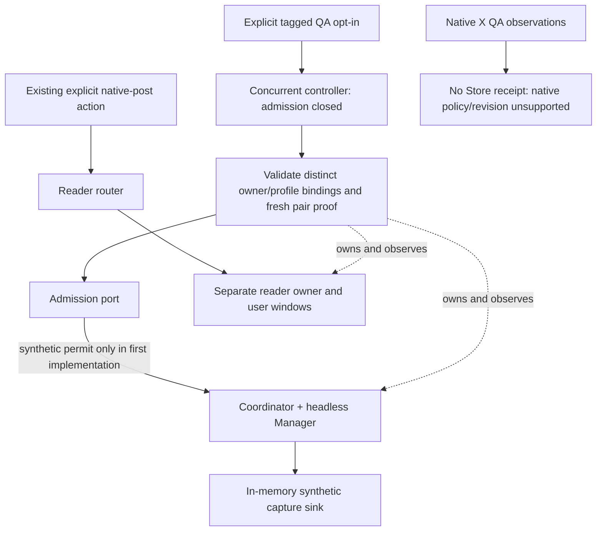

# X concurrency MVP-2 integration design

Status: the first offline synthetic controller increment was reviewed and
published as `e87c1b27e730b61d0d4c99a819b43035332a40d8`, with origin/main
verified. On 2026-10-21 the user additionally authorized default-off
main/broker/Coordinator wiring and integrated synthetic testing. That increment
was reviewed and published as `dfbb08d9a8fb5fff3b4273a69600b5cc8e7dd301`, with
origin/main verified. The user then authorized a fresh-profile, loopback-only
Chrome adapter and tests on this routing; its eight synthetic scenarios are now
validated as recorded below.
Native observation/session transfer, database access, Store
modification, installation and user-runtime operations remain excluded. Proposed
native integration surfaces below remain unavailable. This document does not
itself grant execution permission.

The documentation-only decision on 2026-10-21 fixes the
[production pair and evidence-renewal contract](#production-pair-and-evidence-renewal-contract-2026-10-21).
It does not implement a provider, change Store policy, qualify native continuity,
authorize a transfer or activate the feature.

## Accepted baseline and immediate outcome

Commit `2fbf338bf0258140f56cb1da567a1145834c5fd8` publishes the reviewed
16-file synchronized-QA delta; origin/main was verified. Reuse native run
`90f3e12182b2494ba7933511ac3150a5`: one exact two-cookie seed, four fresh
same-account/login checkpoints, 447.68 ms of protected-request overlap, preserved
reader target/window and verified complete owned cleanup. No second login was
needed. Its preflight passed 184 Node and 14 Go top-level tests.

This closes the short feasibility milestone inside MVP-1. It does not qualify
durable continuity, refresh, all worker/startup coverage, production enrollment,
native provider revisions or Store admission. Those dimensions remain explicit;
do not repeat the accepted login/source/tuple/overlap work merely to advance the
integration. The three macro stages remain MVP-1, MVP-2 and MVP-3.

MVP-2's immediate deliverable is a separate, default-off controller and routing
contract: one X reader owner and one true-headless collector owner can coexist.
Opening a reader while a verified collector is working must not pause its batch,
release its leases, change its generation, replace it or close user windows.
The first implementation proposal uses invented identities and an in-memory
admission/sink harness, with no Store access. Native queue writes stay unavailable.

## Current seams and selected topology

The current Engine has one capture manager; attaching a second is rejected.
Coordinator reconciles that manager between drivers. The tagged exclusive hooks
pause collection before reader use and resume after handoff. They remain intact
as a separately selected fallback; they are not the concurrent implementation.

| Existing seam | Proposed concurrent use |
| --- | --- |
| `internal/engine/capture_runtime.go`: `AttachCaptureRuntime`, owner stamps and result validation | Keep `Engine.captureOwner` dedicated to the headless collector. Preserve its existing epoch/generation/driver and durable checks. |
| `internal/collection/coordinator.go` and `exclusive_session.go` | Keep batch reconciliation on the collector manager. Do not invoke exclusive hooks for a concurrent reader open. Reject simultaneous binding of both strategies. |
| `internal/captureruntime/manager.go` and `profile_lease.go` | Reuse per-process lifecycle and generation guards, with distinct physical-profile ownership. One manager must never adopt both profiles. |
| Tagged reader/broker dispatch | Route concurrent native-post opens to a separate reader owner through the new controller. Reader responses cannot enter capture-result ingestion. |
| `internal/engine/development_session.go` and `development_policy_controller.go` | Preserve the single-profile synthetic contract. A new pair-proof interface must not impersonate it or silently widen its provider/domain. |

Use a small proposed `ConcurrentSessionController` with an owner-pair registry,
not a second Engine or a second batch queue. Coordinator continues to own one
collector manager; the controller separately owns reader lifecycle and routing.
This avoids making reader activity look like a capture-driver replacement or
changing persisted queue stamps just to open a post.



Both browser trees remain children of Sidecar's lifetime, under kill-on-close
ownership. A future runtime backend must support closing/verifying only the
collector tree while reader windows remain, as well as killing/verifying the
entire owned Job when Sidecar exits. Root-process exit alone is insufficient.
Reuse the existing process-close contract, but do not claim the standalone QA's
whole-Job result proves selective runtime cleanup. Failure to establish the
required ownership/cleanup capability keeps the new path unavailable.

## Private pair contract

The proposed pair registry holds the following private values, never public UI,
HTTP status, logs or caller-supplied attestation:

| Dimension | Required binding |
| --- | --- |
| Scope | Provider/version, source X, expected enrolled account reference, attempt ID, controller epoch and monotonic pair generation |
| Reader | Physical profile identity and directory identity, role, PID plus process creation identity, parent ownership, reader generation and tracked windows/targets |
| Collector | A different physical profile identity, disposable context, PID/process identity, parent ownership, headless manager generation and driver |
| Proof | Exact per-role challenge and scope, fresh account/login observation, private same-account comparison, source result and coverage/continuity status |
| Admission | A separate permit authority with explicit capability/result; observation, human confirmation and Chrome readiness are not permits |

Attempt IDs, epochs and pair generations are local fencing identifiers, not
authentication/session lineage revisions. No cookie hash, timestamp, successful
HTTP response or ordinary UUID may be substituted for `Revision`.

For the first synthetic implementation, an invented verifier may provide a
synthetic revision to the in-memory admission port. The native QA adapter must
retain unknown continuity and return unsupported for Store/native authorization.
The first synthetic harness handles no real account ID or cookie value. For a
future separately authorized native adapter, those values remain inside its
trusted private boundary; only fixed comparisons/diagnostics leave it. Do not
change the existing enrollment identity representation in this stage.

The transfer boundary remains exactly the reviewed reader-to-headless manifest
in [the experiment plan](x-concurrency-mvp-experiment.md#reviewable-one-way-transfer-ceiling).
One seed per disposable collector context; no reverse merge, profile copy,
cookie database read, expanded cookie list or automatic second login. A restart
gets a new attempt and no inherited permit. Reusing a valid login does not imply
reusing authorization. Future native runs require their own explicit scope and
permission; the prior one-repeat authorization has been consumed.

## Default-off and startup sequence

The proposed first executable surface is a dual-tag Windows fixture entrypoint
(`auth_session_dev` and `auth_session_fixture`), with `config.Dev`, a private
owner/controller grant, a new explicitly selected synthetic-concurrency provider
and isolated fixture paths. Its eventual option name must be documented when
implemented. Dispatch must precede ordinary config, saved database, real provider
and app-shell startup, as existing fixture entrypoints do.

Ordinary builds must reject that option; tagged builds without all grants reject
it. Default startup performs no enrollment, profile lookup, Chrome launch,
credential read, guard migration or configuration write for this feature. No
setting, HTTP/native IPC toggle, environment-only switch or saved opt-in can
activate native concurrency. The new strategy is mutually exclusive with the
existing exclusive binding. Reject mixed-source configuration for the X-only
pilot; do not rewrite active sources to make it fit.

Proposed first-start order:

1. Validate the explicit isolated synthetic grant and choose the concurrent
   strategy. Close the in-memory admission port before creating any owner.
2. Acquire distinct profile leases. Establish Sidecar/Job ownership before
   permitting Chrome work; reject path aliases, replaced directories or foreign
   ownership. Create the collector empty, verify its process image/ownership,
   then perform the allowed synthetic seed.
3. Obtain independent, correctly challenged per-role evidence and compare the
   same expected account privately. A saved identity or ready bridge is not proof.
4. Bind the collector manager and reader route once. Open synthetic admission
   only if the separate synthetic permit port agrees. Attach exit/revocation
   callbacks before exposing work. Native authorization remains unsupported.

The current verifier has a five-second evidence-age ceiling and a two-second
binding deadline. The standalone experiment's total duration does not establish
compatibility with that binding deadline. Do not enlarge those limits or replay
an old QA report to fit them. Native integration must separately demonstrate a
fresh challenge/consumption path within the applicable limits before admission.

## Reader opens, claims and failures

| Event | Selected behavior |
| --- | --- |
| Open an X reader during active collection | Validate the existing post-open request and obtain a reader-only lease. Reuse/create its tracked window. Do not touch collector generation, batch admission or active leases. |
| Capture completes while reader remains open | Release only the capture lease. Reader windows retain their own owner/profile lease. Count every window, including bootstrap windows. |
| Another reader window opens/closes | Update the owned reader inventory. Closing one tab is not proof that its window or profile owner exited. |
| Last reader closes naturally | Retire the reader role and verify its full tree/lease release. Do not replace the collector. The initial native contract disables independent continuation: revoke dependent admission and retain queued work. The synthetic independent-authority case remains fixture evidence only. A future capability needs separate qualification and approval. Never reopen a window or log in automatically. |
| Account mismatch, logout, challenge, proof expiry, required coverage loss or owner/context change | Close admission, increment the pair fence, revoke permits and reject late results. Preserve unstarted work. Classify the actual failure; unknown source data is not logged out. |
| Collector dies | Close admission and reject its generation. Keep user reader windows. No implicit reseed, reverse transfer or switch to exclusive mode. |
| Reader dies unexpectedly | Revoke any authority depending on that reader; collector activity cannot silently prove its own lineage. Keep batch work pending until the separate permit authority can establish a permitted continuation. |
| Sidecar dies | The owned Job terminates all helpers/readers/collectors. No child outlives the parent. Restart begins closed and re-verifies; it does not necessarily require login again. |

Keep the collector's existing epoch/generation/driver stamps. Associate each
synthetic command with its current pair generation in the private controller;
reader IDs cannot masquerade as capture IDs. Recheck the pair at dispatch and
before accepting results. The in-memory harness can test that race atomically
with its sink, but this does not replace Store's transactional fence or prove
atomic durable ingestion. Native writes stay closed until that exact integration
contract is reviewed. Do not change command rows, reassign pending work to another
account, revive cancellation or accept stale/duplicate results.

Do not use the QA rendezvous in ordinary collection: it is a measurement tool,
not a required pause before every reader open. No background campaign, periodic
login or automatic retry is part of this design.

## Store/provider compatibility and rollback boundary

The current development capability, challenge and receipt use one `ProfileID`.
The documented policy format accepts provider `synthetic-fixture`; it requires
accepted revisions and fresh owner-bound proof. Two physical profiles cannot be
represented as that same profile merely because their account IDs match. The
new controller must not call existing synthetic authorization with native values
or manufacture a native revision from the experiment.

Selected first step: keep the entire pair-controller exercise outside Store,
using the in-memory admission/sink port. This is runnable synthetic controller
qualification, not queue persistence or main-dev activation. No Store source,
schema, policy, API, database or guard key changes are proposed for that increment.

The production pair contract below selects separate enrollment, physical owner
and per-role revision bindings. It requires a distinct versioned authorization
interface rather than relabeling a collector in the single-profile interface.
Before real ingestion, a separately authorized Store compatibility review must
still specify persistence encoding, guard-aware APIs, migration and downgrade
behavior for that contract. No Store change is authorized here. Cookie-writer
qualification is not a prerequisite for designing the controller, but unknown
lineage cannot satisfy the unchanged production permit gate.

Opt-out closes admission and revokes the pair first, drains/cancels active work
according to its existing ownership rules, then closes and verifies only the
collector tree. Preserve existing user reader windows until the user closes them
or Sidecar exits. Report disabled-with-reader-retained separately from complete
cleanup; do not start an exclusive owner against a profile still held by a reader.
Unverified cleanup blocks replacement and disposable-profile deletion.

Real-provider rollback must retain guard metadata and queued work, reject older
unaware builds, and never delete required markers to make collection resume.
The exact future format needs its guard-aware upgrade/downgrade matrix before
native activation. No rollback, migration or runtime opt-out is executed here.

## Production pair and evidence-renewal contract (2026-10-21)

Decision: use design contract `aku.x.concurrent-authorization.v1`, with proposed
provider identifier `x-concurrent` and an explicit provider/evidence-schema
version. These are design identifiers, not registered providers, implemented
DTOs or Store schema versions. Preserve all existing synthetic interfaces and
formats. Reject unsupported versions; never dispatch native values through
`synthetic-fixture` or convert a QA report into an authorization receipt.

The accepted eight Chrome scenarios establish synthetic routing and ownership.
They do not implement this contract. In particular, the current fixture compares
both roles against one invented `ExpectedRevision`, has no normal evidence-renewal
operation, and serializes result/revocation only against an in-memory sink.
Those limitations remain explicit until separately authorized implementation.

### Enrollment, owner pair and derivation

| Private record | Required binding and meaning |
| --- | --- |
| Enrollment | Provider/version, X source, database scope, enrollment/policy generation, confirmed stable account reference and enrolled reader profile identity. Persisted intent is not current login or a permit. Changing the account or enrolled reader profile requires the explicit enrollment workflow. |
| Reader owner | Enrolled reader profile plus pinned physical directory identity, process image/handle/creation identity, Sidecar lifetime, context, reader generation and complete window inventory. A matching path or PID alone is insufficient. |
| Collector owner | Distinct fresh profile/directory, disposable context, process/Job identity and collector Manager epoch/generation/driver. This is a derived runtime owner, not a second permanent enrollment. |
| Pair | Controller/Sidecar epoch, unique attempt, monotonic pair generation, exact enrollment/policy snapshot and both owner records. Equal accounts must not collapse the two physical identities. |
| Derivation receipt | Trusted private record of one approved one-way seed from the exact reader owner/baseline into the exact empty collector context, bound to this pair and the reviewed transfer manifest version. It records scope and successful application without retaining cookie values or fingerprints. It proves the relationship of that seed, not login, continuity or authority to capture. |

Use only the existing reviewed two-cookie transfer ceiling if native execution
is separately authorized. No profile/database copy, expanded credential set,
reverse merge, reseed or automatic login is implied by the derivation record.
Collector replacement starts a new attempt and requires new authorization;
it cannot inherit the previous owner's seed receipt or permit.

The trusted owner adapter supplies these bindings out of band. Page content,
broker callers and public RPC cannot choose or attest profile, process, account,
coverage, revision or permit fields. Credentials and raw response bodies never
enter enrollment, pair metadata, result stamps, logs or public status. Stable
account IDs remain private; public diagnostics expose fixed reason categories.

### Evidence and session revisions

Each role supplies a separate one-use challenged vector. Bind it to the exact
contract/provider/schema, source and selected origin/operation, enrollment,
attempt, pair generation, role, owner/context/frame/request and observation
times. Preserve the existing bounded source projections, provenance, cache and
correlation checks; caller declarations do not establish coverage.

Identity must equal the confirmed enrolled account in both roles. Authentication
must be freshly established by the qualified source predicate in that role.
Enrollment, cookie possession and the other browser's successful response cannot
substitute for either check. Missing, ambiguous, unsupported or conflicting
evidence closes admission and retains its actual reason; unknown is not logout.

Keep `ReaderSessionRevision` and `CollectorSessionRevision` as separate accepted
native-lineage bindings. Do not require them to be equal merely because a seed
was copied, and do not ignore a later change within either role. A qualified
provider must establish each revision's meaning, baseline and covered transitions,
as well as the derivation relationship. Local epochs, permit/evidence numbers,
timestamps and cookie equality/hashes are not session revisions. Native continuity
remains unknown today; no native accepted revision is created by this document.

Coverage must extend from the accepted baseline through each required claim,
renewal and result-acceptance barrier. An unobserved startup, detach, overflow,
relevant unsupported worker or context replacement is a gap, not an unchanged
session. Equal account/login snapshots after a gap do not repair that interval.
This retains the strict production continuity requirement. A limited pilot that
accepts weaker guarantees needs a separate explicit policy decision and version;
it cannot satisfy this contract by silently treating unknown as proven.

### Collector permit and evidence renewal

Only the separate trusted permit authority may grant a collector permit.
It must validate enrollment/policy enablement, both physical owner bindings,
derivation, fresh account/login proof and qualified per-role continuity. Bind the
permit to provider/version, database/source/account scope, enrollment/policy
generation, current durable hold/fence, pair generation, collector owner,
accepted per-role revisions, evidence version, permitted operations and expiry.
Only supported X collection and its matching result ingestion are in scope;
reader actions cannot become collector results or native-site write authority.

Use the following renewal rules; they are requirements, not implemented behavior:

1. Start with admission closed before either owner starts. Register exit and
   revocation observers before exposing work. Initial authorization consumes a
   complete per-role vector, not the fixture's unconditional permit grant.
2. Keep the five-second evidence-age ceiling and two-second binding deadline,
   measured from starting challenged-vector acquisition through permit publication.
   Each evidence item must remain valid at consumption. Permit expiry
   must be no later than the earliest evidence-age, qualified coverage or
   provider-specific validity deadline; no long-lived permit extends old proof.
   Use monotonic elapsed-time checks for deadlines and reject inconsistent time
   bindings. These ceilings are not evidence that the native sources can meet them.
3. Before expiry, a single serialized renewal obtains new challenges and fresh
   per-role evidence, with uninterrupted qualified coverage connecting the prior
   accepted vector to the new vector. It does not reopen Chrome, reseed cookies,
   repeat login, invoke exclusive handoff or change the collector Manager.
   Source observation must be supported without disrupting reader windows or
   active capture; inability to obtain it is unavailable evidence, not a fallback
   to synthetic proof or permission to reload user windows.
4. Immediately before publishing renewed authority, recheck the exact owners,
   context, enrollment/policy, durable fence, pair generation and pending
   revocations. Atomically replace the permit/evidence version only while its
   predecessor remains valid. Concurrent readers of authority must see one
   coherent version. Renewal cannot race past opt-out or revive a revoked permit.
5. Successful renewal advances a distinct monotonic evidence version. It leaves
   pair generation, accepted session revisions and collector epoch/generation/
   driver unchanged. A work ticket retains its original authority version; a
   newer version may support that work only through an explicitly recorded,
   uninterrupted renewal chain for the same pair and revisions. Never retag old
   results as though they were dispatched under a newer permit.
6. Expiry, failed renewal, changed session/account, required coverage loss or
   owner drift closes admission, advances the pair fence and revokes authority.
   Reject unfinished results under that invalidated fence and preserve pending
   work. No successful later probe retroactively authorizes the gap. Recovery
   begins a separately verified authorization attempt; a real session/account
   change follows the explicit recovery/confirmation contract, not automatic
   revision replacement. No automatic reseed, relogin or retry loop is selected.

A long capture is acceptable only if qualified coverage and valid renewal
authority span dispatch through result acceptance. A fresh final snapshot alone
cannot authorize a capture that crossed an invalid interval. Expiry/revocation
must close admission on time; checks at claim and acceptance additionally reject
stale work even if notification is delayed. Exact renewal scheduling and native
source latency still require implementation/qualification; the design does not
solve them by enlarging the current deadlines.

### Claims, results and lifecycle boundaries

Claim and result acceptance must bind the same database/source/enrollment scope,
policy/hold, pair generation, collector identity and capture epoch/generation/
driver. Include the work/command identity, dispatch authority version and current
valid renewal chain. Account equality alone cannot adopt another pair's work.

Durable result ingestion and durable revocation must share an atomic fence
decision: either a result commits under still-valid authority or it is rejected
after invalidation. A controller mutex followed by an independent database write
is insufficient. Cancellation and duplicate protection remain mandatory. Exact
transaction/API/schema mapping is reserved for a separately authorized Store
review and synthetic-database acceptance; no existing durable guarantee is
claimed or changed here.

For the initial native capability, `independentCollector` is unsupported. Last
reader closure or unexpected reader death revokes dependent authority and leaves
unstarted work pending; it must not reopen reader windows or switch to exclusive
mode. The fixture's successful independent-continuation scenario does not enable
that capability for X. Opening or closing an ordinary non-final reader window
does not revoke a healthy pair or replace/pause the collector.

Opt-out revokes/closes admission first, invalidates unfinished result authority,
then cancels/drains owned work and closes only the collector tree with verified
cleanup. Preserve reader windows until user closure or Sidecar exit. Persisting
opt-out failure must be reported; local closure is not proof of durable global
disablement. Unknown cleanup blocks replacement and profile retirement.

Both trees remain children of Sidecar. Restart inherits neither owner permits
nor renewal chains; begin closed, reload confirmed expectations and obtain new
owner proofs under a new attempt. A still-valid reader login may be reused only
under its separately authorized profile policy; verification is not a demand for
another login. Collector creation/seed still requires its own authorization.
Persisted guards and pending work survive opt-out/rollback, with supported-binary
compatibility established before any native migration or main-dev activation.

### Acceptance boundary for the next increment

The next executable proposal is offline, invented-data qualification of this
contract, not a native provider or Store integration. Required cases include:
distinct-profile enrollment mapping; forged/cross-role/replayed evidence; unknown
or changed per-role lineage; renewal through several five-second windows without
collector replacement; valid long-capture completion through its renewal chain;
expiry during capture; final snapshot after a gap; owner/policy/revocation races;
stale permit/version/duplicate/canceled results; and unsupported independent
continuation. Offline atomicity tests qualify an in-memory model only.

Separate future gates remain native source/continuity and timing qualification,
approved Store compatibility plus disposable-database race/upgrade/downgrade
acceptance, and explicitly authorized default-off main-dev activation. Reuse the
accepted MVP-1 overlap and MVP-2 Chrome ownership evidence where unchanged.
This section authorizes none of those implementation, test or runtime actions.

## Offline pair authorization implementation checkpoint (2026-10-21)

The user subsequently authorized publishing the design decision and implementing
its offline synthetic contract. Design commit
`86d69b20781c18b1fb491409534c604dc8fb1b31` was pushed and origin/main verified
before implementation. This increment adds only the private dual-tag
`development_concurrent_authorization.go` authority and its separate tests,
`scripts/test-concurrency-authorization.ps1`, and documentation. The existing
controller, Chrome adapter, main/broker routing and Store remain unchanged.

The authority accepts only the invented `synthetic-x-concurrent` provider and
explicit private fixture grants; `x-concurrent` is rejected. Its model supports
immutable enrolled account/reader scope, distinct owners, instance-bound one-shot
derivation, challenged per-role identity/authentication/lineage evidence,
separate reader/collector revisions, serialized renewal and an uninterrupted
evidence-version chain. Original tickets are never retagged. Claims and memory
sink commits require lifecycle checkpoints through their actual fake-clock
barriers, not merely an unexpired permit. Non-final reader inventory changes
preserve stable owner identity; final loss revokes dependent authority.

Evidence acquisition uses a cooperative two-second context and publication
rechecks the five-second age ceiling, provider-specific earlier deadlines,
owner/policy/fence state and predecessor validity. Expiry is driven by explicit
clock checks in this offline model, not by a production deadline scheduler.
Revoke/opt-out and memory commits share one mutex. This does not establish
durable transaction behavior, real process ownership, native continuity or
non-disruptive native observation latency. All public-facing qualification
flags remain false; the component is not wired into any runnable provider.

The canonical helper executes only the two named Go files, inspects source/test
inclusion in four build-tag modes and compiles the combined dual-tag Engine
package without executing its initializers or package tests. It uses project-local
temporary/cache paths, disables dependency network access and opens no browser,
Store/database, profile, native session or user runtime. Synthetic logs are
retained under `runtime/qa/auth-session-sidecar/concurrent-authorization-<run>.log.txt`.

Accepted run `40b28739e91f4dff9d2d7127c05d7463` passed 19 top-level tests and
28 subtests, all four source/test tag gates and combined dual-tag Engine
compilation. The owned temporary build root was removed. Coverage includes a
twelve-second synthetic capture across three uninterrupted renewals, distinct
per-role revisions, cross-instance derivation/evidence replay, exact frame/request
binding, provider-specific earlier expiry, missing barrier coverage, coverage
gaps, cancellation, reader inventory changes and stale/canceled/duplicate results.
Blocked-renewal tests let revoke, policy change and owner drift win before
publication. Commit-before-revoke and revoke-before-commit are tested as ordered
in-memory outcomes; no race detector or durable transaction claim is made.

## Synthetic controller authorization wiring (2026-10-21)

The five-file offline authority increment was reviewed and published as
`2363080e87bcf98f5de932d2c386a6d3ff037861`, with origin/main verified. The user
then authorized connecting that authority to the existing synthetic controller
and running offline regression tests, still excluding Store, browsers, native
sessions and user-runtime operations.

The new private `newAuthorizedConcurrentController` constructor explicitly
selects a fixture-only adapter in `development_concurrent_authorized_controller.go`.
It requires the existing dev/fixture/controller grants plus the authority's
private synthetic grant. The old constructor retains its legacy verifier/permit
path. No main option, native provider, broker endpoint, runtime setting or Chrome
adapter binding is added. Ordinary and single-tag builds exclude the component.

Startup keeps controller admission closed while the adapter pins the actual
synthetic controller/attempt/epoch/pair and both returned owner snapshots. It
checks the independently configured enrolled account/reader profile, maps
`synthetic:` references injectively to the authority's `synthetic-` namespace,
records one invented derivation receipt and consumes challenged per-role evidence.
No cookie read or transfer occurs. Fixture startup inventory entries are model
state, not evidence of a physical Chrome window or native startup coverage.
The selected path accepts distinct role revisions and never calls the legacy
verifier or unconditional permit grant to authorize work.

`RenewEvidence` calls the authority outside the controller's state and window
operation locks, then validates owner/controller fences before publication and
before returning. Renewal preserves the collector PID, generation and driver,
controller pair and original ticket evidence version. Revoke, Disable, policy
change, owner drift and parent cancellation can invalidate blocked renewal.
Expiry is driven by injected-clock checks, including Snapshot; no production
renewal/deadline scheduler or native observation latency is qualified.

Claim, completion and cancellation use local callbacks under the controller's
already-held mutex and the authority mutex, in that order. Callbacks may neither
re-enter those locks nor perform external work. Result validation and both memory
sink transitions share the authority commit point; callback failure commits
neither sink. Operation/parent cancellation is rechecked at this final mutation
barrier, including after waiting for authority. This is an in-memory guarantee,
not a database transaction or proof of durable Store fencing.

Non-final window changes retain authority. Last reader closure revokes dependent
admission and denies independent continuation. After Disable has retained reader
windows, closing the final reader completes cleanup without requesting a new
collector permit. Unknown ownership or cleanup still blocks replacement.

The canonical helper is `scripts/test-concurrency-authorized-controller.ps1`.
Accepted run `4ebf169674ee491fb051999a89074b8b` passed 48 top-level tests and
78 subtests across the legacy controller, authority and integrated bridge, all
four source/test tag gates, standalone named-file compile compatibility for both
original components, and combined dual-tag Engine compilation. Its log is
`runtime/qa/auth-session-sidecar/concurrent-authorized-controller-4ebf169674ee491fb051999a89074b8b.log.txt`;
the owned temporary build root was removed.

The integrated suite includes a twelve-second fake-clock capture with three
renewals and unchanged collector stamps, replay/cross-work/cross-controller
rejection, missing coverage and expiry, blocked-renewal invalidations,
commit/revoke ordering at both sinks, cancellation at a blocked mutation barrier,
and Disable followed by final-reader cleanup. A legacy parent-cancellation test
was made deterministic: the fake probe observes `ctx.Done()` before its release
channel is closed, instead of racing asynchronous `context.AfterFunc` delivery.
Production cancellation behavior was not changed to accommodate that test.

No Chrome or main/broker acceptance was rerun or newly claimed for this wiring.
Earlier Chrome runs remain their scoped historical baseline. Native source,
continuity/timing, separately approved Store compatibility and durable acceptance,
and main-dev activation remain outside this increment. Qualification flags stay
false and the feature remains unavailable to ordinary runtime startup.

## First implementation and acceptance boundary

The first implementation is an offline synthetic pair controller with fake
processes, verifier, reader router and in-memory capture sink. Its private tagged
source is `internal/engine/development_concurrent_session.go`, with a separate
regression test file. No existing single-profile contract is modified to accept
two profiles.

Required behavioral cases are: default/unsupported mode has zero side effects;
distinct profile ownership; admission closed before startup; reader opens during
an active synthetic capture without replacement/pause; captures finish without
closing readers; bootstrap/multiple-window accounting; stale owner/pair results
rejected; mismatch/challenge/unknown proof closes admission; last-reader-close
follows the provider capability; collector failure preserves reader; opt-out
retains windows; parent death leaves no child; failed cleanup blocks replacement.
Reuse existing lease/queue/Job evidence where unchanged, but do not claim a fake
backend tests Chrome locking, foreground behavior or durable Store transactions.

The controller qualified and the user subsequently authorized tagged
main/broker/Coordinator wiring and integrated synthetic acceptance. Any use of a
disposable database, Store interaction or new native transfer still requires an
explicit scoped approval; none is inferred from that authorization. The native provider/metadata
compatibility decision remains a release gate, not a reason to repeat completed
MVP-1 experiments. MVP-3 still owns focused integrated acceptance and separately
approved main-dev activation. No calendar estimate is implied by these milestones.

## Offline controller implementation checkpoint (2026-10-21)

The authorized increment contains only private synthetic controller/test sources
under both `auth_session_dev` and `auth_session_fixture`, plus the local regression
helper `scripts/test-concurrency-controller.ps1`. There is no new main option,
HTTP/native activation endpoint, environment switch or production binding. The
first harness uses invented values, fake owner/process/verifier ports, memory
work state and a memory result sink. No browser/profile/database is opened.

The helper checks source inclusion in ordinary, development-only, fixture-only
and dual-tag builds. It then runs named-file tests for just the new controller
and its test file, deliberately excluding other Engine/Store tests and package
initializers. Named-file testing alone would not establish build-tag exclusion;
the separate four-mode source inspection supplies that check. Build artifacts
stay in a unique project-local QA root, with a retained synthetic log and guarded
temporary-root cleanup. There is no native-run mode in this helper.

Accepted offline run `106377b1916348b3b40b0b81c32f1322` passed all four tag
gates, 14 top-level tests and 34 subtests. The retained evidence is
`runtime/qa/auth-session-sidecar/concurrent-controller-106377b1916348b3b40b0b81c32f1322.log.txt`;
the unique temporary build root was removed. Coverage includes reader opens
during active work, bootstrap/multiple-window ownership, fresh independent
collector continuation, proof/challenge/account/revision rejection, owner and
cross-controller ticket fencing, duplicate/cancelled/stale results, collector
loss, opt-out, parent cancellation during a blocked probe, foreign-owner safety
and cleanup failure. Pending permit revocation blocks continuation; late failure
atomically fences admission and active results. Negative cleanup cases explicitly
expect unverified cleanup instead of accepting an uncertain owner as absent.

These tests qualify the new in-memory state machine and lifecycle contract.
They cannot qualify actual Manager/Coordinator/main wiring, Windows Job behavior,
Chrome profile locking, foreground UI, durable queue transactions, real provider
revision semantics or native authorization. Existing accepted X overlap evidence
is unchanged and must not be rerun merely for this increment.

This increment has no automatic proof refresh, collector replacement or reader
reopening after its owner has retired. Ticket issuance, claims, reader opens and
result acceptance check proof freshness; expiry holds admission rather than
refreshing credentials. Last-reader closure fences active work before retirement;
only the explicit synthetic independent-collector capability plus a fresh proof
and permit can reopen collection. It does not establish native session continuity.
Parent cancellation exercises the fake ownership contract, not actual process
termination. Queued work is retained only in memory, without restart durability.

## Main, broker and Coordinator synthetic wiring (2026-10-21)

The next authorized increment adds the exact provider
`--dev --dev-session-reuse=synthetic-concurrent-fixture` to the existing early
Windows fixture dispatch. It requires both `auth_session_dev` and
`auth_session_fixture`; ordinary and single-tag executables reject the provider.
The dispatch runs before `config.Load`, Store initialization, provider startup
and app-shell launch. The strict, size-limited input selects only built-in
synthetic scenarios. Its fixture grant is an explicit synthetic selector, not a
native credential or an account/session attestation. No environment-only switch
or saved setting activates this path.

The Engine facade reuses the private controller with two actual capture Managers
backed by invented in-memory Processes. Coordinator's new route defaults to nil;
its binding API exists only in the dual-tag fixture. The separate reader Manager
supplies native-reader leases while the collector's Manager and generation stay
fixed. Concurrent binding rejects exclusive/development strategies, browser
collection and non-X source selection. A blocked synthetic CaptureBackend and
memory sink exercise the dispatch/result boundary without Store access.

The tagged broker adapter reuses the existing bounded frame and Request
validation, then calls the synthetic reader route. Its reply contains only a
synthetic acceptance flag. It does not expose a native target or claim foreground
activation, and opens no OS pipe, native messaging host, registry key or listener.
The invented X post URL is validated as data and is never navigated.

`scripts/test-concurrency-integration.ps1` builds actual main executables in four
tag modes under a unique project-local QA root. Explicit rejection cases and
positive synthetic scenarios use missing configuration/database sentinel paths;
those paths must stay absent. This tests early executable dispatch and real
Coordinator/Manager code with fake owners. It cannot establish Chrome behavior,
OS child/Job termination, durable ingestion or native provider authority. Source
publication and these synthetic tests do not activate the user's dev runtime.

Run the integration helper from the repository root:

```powershell
.\scripts\test-concurrency-integration.ps1
```

The helper executes built-in scenarios for active capture/reader overlap,
bootstrap and multiple-window accounting, fresh independent continuation and
dependent denial after last close, expired proof, cancellation, revocation,
parent cancellation, opt-out, collector exit and strategy/broker rejection. It
checks that a parent cancellation reaches the blocked backend, and that the real
Manager exit observer fences an unexpectedly exited fake collector. Success is
emitted only after capture/reconciliation drain and verification of fake process,
window, owner and lease cleanup. No model result is promoted to native authority.

Accepted integrated run `e7e4f5da31f442a59fcf09ce3c00a2a0` passed four actual-main
build modes, 11 early-dispatch rejection cases, 11 synthetic scenarios, the
absent-config/database sentinel check and three focused ordinary Coordinator
regressions. The retained log is
`runtime/qa/auth-session-sidecar/concurrent-integration-e7e4f5da31f442a59fcf09ce3c00a2a0.log.txt`;
the owned temporary executable/build root was removed. The unchanged controller
source and controller-only helper retain their earlier accepted evidence.

Both strategy bind directions and the legacy headless-backend setter/alias reject
mutation after concurrent binding. The next ownership-backend increment must
qualify actual Chrome behavior on this routing without treating the fake PID or
Done event as OS tree cleanup. Native provider/profile/revision compatibility
still needs its separate decision before Store-backed or real-session ingestion.

## Chrome ownership adapter increment (authorized 2026-10-21)

The user authorized a loopback-only Chrome adapter on the published synthetic
routing, with fresh profiles and automatic synthetic login. The implementation
now adds the exact early-dispatch provider
`--dev --dev-session-reuse=synthetic-concurrent-chrome-fixture`, available only in
Windows dual-tag fixture builds. The topology uses two independently owned fixture
bridges/Windows Jobs, one per role, and distinct new profile directories. This
retains the existing single-owner bridge cleanup contract and makes selective
collector cleanup observable without closing the reader's Job.

The adapter must reuse the same private controller, Coordinator, capture Managers
and framed broker route. It must bind real process handles, creation identity,
image, Job membership and directory identity to the synthetic role registry.
Proof still has the existing five-second age and two-second binding limits.
The controlled server supplies one synthetic reader login and one narrowly scoped
invented-cookie seed to the empty collector profile. Neither retained QA nor
native account/session data is part of this adapter.

Acceptance requires independent server evidence that a protected collector
request remains active while the broker opens a reader window and that reader
makes its own authenticated loopback request. Preserve the collector's actual
PID, generation, driver and lease throughout. All reader windows, including the
bootstrap and every target within a window, count toward ownership.

Selective close, role failure and final cleanup must verify the full owned Job
boundary. A parent-death test must observe the child's browser/helper trees gone
before emergency outer-Job cleanup; fallback termination cannot make that test
pass. Unknown cleanup rejects acceptance and retains disposable roots. These
tests still grant no Store access, native provider authority, foreground claim,
registry change or main-dev/user-runtime activation.

The canonical helper is `scripts/test-concurrency-chrome-integration.ps1`.
Without switches it runs offline command/input, actual-main build and rejection
gates. `-VerifyChrome` additionally runs the eight built-in Chrome scenarios;
`-Scenario` restricts that set for a causal recheck. Chrome paths are normalized
to their real image locations; profile/root paths must remain new ordinary
directories under the exact project QA parent, with pinned directory identities.
The command accepts no native origin, account ID, profile reuse, cookie name or
cookie attributes. The seed is exactly one server-generated `fixture_session`
value passed privately to the empty collector, with loopback-only attributes.
The broker's invented X URL is validated but never navigated; browser requests
go only to the controlled loopback server.

Duplicate login/seed calls must reject and leave the same private synthetic
account/revision evidence intact. Reports contain only the fixed scenario,
acceptance/cleanup/overlap flags and login/seed counts. `canAuthorize` and
`nativeQualified` must both remain false. Expiry uses a controlled clock offset;
it does not alter the production proof-age or binding deadlines.

Profile retirement requires more than empty Job accounting. After terminating
an owned role, the adapter also waits for the existing bridge's `Process.Done`
publication, which follows pinned-handle/window release, then rechecks cleanup
before walking and deleting the exact owned root. An intentional last-reader
exit must leave its bridge alive until the close-window RPC has returned.
The existing shared Chrome launcher/driver and accepted standalone X feasibility
evidence are unchanged.

Accepted actual-main Chrome cases, with no real account login or cookie transfer:

| Run | Qualified cases |
| --- | --- |
| `43ee70a67f9342e6ad1909b0ca96bf94` | Protected overlap, bootstrap/multiple windows, reader retention after capture, final-reader close and fresh independent collector capture (`overlap-last-close`) |
| `3932122bc03645128931a851a68da108` | Opt-out, actual collector bridge death with reader retention, denied dependent continuation, account mismatch, proof expiry and parent cancellation |
| `5af9217aba664ddd96fa256fe1b0fd7a` | Actual Sidecar QA child death: empty outer Job observed before fallback termination, pinned peer handles signaled, strict profile retirement |

Logs use `runtime/qa/auth-session-sidecar/concurrent-chrome-integration-<run>.log.txt`.
The first log's old generic completion sentence mentions parent death; only its
explicit `overlap-last-close` PASS line qualifies that run. The six accepted cases
in the second log remain valid even though the then-unfixed final parent-death
retirement case failed. The third run independently closes that remaining case.
The helper now names only selected scenarios in its completion sentence. Narrow
later corrections changed only parent-handle wait budgeting and offline receipt
validation; accepted role/backend behavior is unchanged and is reused.

Default-sandbox Chrome exited before `Browser.getVersion`; the authorized
outside-sandbox comparison reached actual Chrome. Accepted live runs used that
environment, without changing the shared launcher. Offline gates cover command,
seed, input and report boundaries, four actual-main build modes, required dev
opt-in, existing-root rejection and lexical canonical-path alias rejection.
A physical junction-negative case was unavailable under sandbox permissions;
the actual no-reparse/directory-identity guard remains enforced.

Final offline run `7f37e0d6a6e043a6bea0cb58cd0413f4` passed three Node tests,
one named-file Go input test, 17 malformed-report cases plus a valid report,
four actual-main builds and seven early rejection/root gates. It includes strict
string types for provider/scenario, preventing PowerShell array comparison from
accepting a one-element array as a matching scalar. No Chrome launched in that
final run; its helper build root was removed. Its retained log follows the same
`concurrent-chrome-integration-<run>.log.txt` convention above.

Successful acceptance roots were removed only after full cleanup. Four earlier
failed-run roots remain retained because profile retirement lacked its required
proof at that time: `run-concurrent-chrome-26ad1e90b24d4d15bde9148915616595`,
`run-concurrent-chrome-2f5f014562474091ba6a8f82ab386ea5`,
`run-concurrent-chrome-3f1da0c3296845389744c2a77c3b36d5` and
`run-concurrent-chrome-ce81a77b60094b8fb852fb02e3629db9`, all under the project
QA parent. Metadata inspection did not read cookie/database file contents.
Do not promote later successful cleanup to proof for those failed runs or remove
the retained roots by bypassing the retirement guard.
