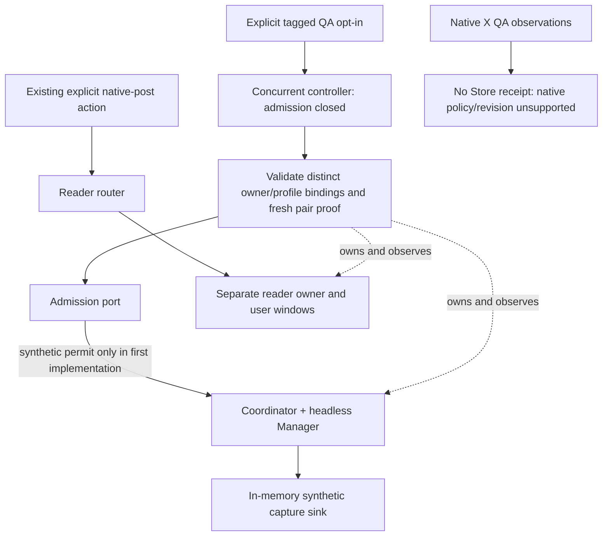

# X concurrency MVP-2 integration design

Status: design only, 2026-10-20. No implementation, native observation, session
transfer, database access, Store modification, installation or user-runtime
operation is authorized by this document. All names marked proposed below are
future interfaces, not available flags or endpoints.

## Accepted baseline and immediate outcome

Commit `2fbf338bf0258140f56cb1da567a1145834c5fd8` publishes the reviewed
16-file synchronized-QA delta; origin/main was verified. Reuse native run
`90f3e12182b2494ba7933511ac3150a5`: one exact two-cookie seed, four fresh
same-account/login checkpoints, 447.68 ms of protected-request overlap, preserved
reader target/window and verified complete owned cleanup. No second login was
needed. Its preflight passed 184 Node and 14 Go top-level tests.

This closes the short feasibility milestone inside MVP-1. It does not qualify
durable continuity, refresh, all worker/startup coverage, production enrollment,
native provider revisions or Store admission. Those dimensions remain explicit;
do not repeat the accepted login/source/tuple/overlap work merely to advance the
integration. The three macro stages remain MVP-1, MVP-2 and MVP-3.

MVP-2's immediate deliverable is a separate, default-off controller and routing
contract: one X reader owner and one true-headless collector owner can coexist.
Opening a reader while a verified collector is working must not pause its batch,
release its leases, change its generation, replace it or close user windows.
The first implementation proposal uses invented identities and an in-memory
admission/sink harness, with no Store access. Native queue writes stay unavailable.

## Current seams and selected topology

The current Engine has one capture manager; attaching a second is rejected.
Coordinator reconciles that manager between drivers. The tagged exclusive hooks
pause collection before reader use and resume after handoff. They remain intact
as a separately selected fallback; they are not the concurrent implementation.

| Existing seam | Proposed concurrent use |
| --- | --- |
| `internal/engine/capture_runtime.go`: `AttachCaptureRuntime`, owner stamps and result validation | Keep `Engine.captureOwner` dedicated to the headless collector. Preserve its existing epoch/generation/driver and durable checks. |
| `internal/collection/coordinator.go` and `exclusive_session.go` | Keep batch reconciliation on the collector manager. Do not invoke exclusive hooks for a concurrent reader open. Reject simultaneous binding of both strategies. |
| `internal/captureruntime/manager.go` and `profile_lease.go` | Reuse per-process lifecycle and generation guards, with distinct physical-profile ownership. One manager must never adopt both profiles. |
| Tagged reader/broker dispatch | Route concurrent native-post opens to a separate reader owner through the new controller. Reader responses cannot enter capture-result ingestion. |
| `internal/engine/development_session.go` and `development_policy_controller.go` | Preserve the single-profile synthetic contract. A new pair-proof interface must not impersonate it or silently widen its provider/domain. |

Use a small proposed `ConcurrentSessionController` with an owner-pair registry,
not a second Engine or a second batch queue. Coordinator continues to own one
collector manager; the controller separately owns reader lifecycle and routing.
This avoids making reader activity look like a capture-driver replacement or
changing persisted queue stamps just to open a post.

Both browser trees remain children of Sidecar's lifetime, under kill-on-close
ownership. A future runtime backend must support closing/verifying only the
collector tree while reader windows remain, as well as killing/verifying the
entire owned Job when Sidecar exits. Root-process exit alone is insufficient.
Reuse the existing process-close contract, but do not claim the standalone QA's
whole-Job result proves selective runtime cleanup. Failure to establish the
required ownership/cleanup capability keeps the new path unavailable.

## Private pair contract

The proposed pair registry holds the following private values, never public UI,
HTTP status, logs or caller-supplied attestation:

| Dimension | Required binding |
| --- | --- |
| Scope | Provider/version, source X, expected enrolled account reference, attempt ID, controller epoch and monotonic pair generation |
| Reader | Physical profile identity and directory identity, role, PID plus process creation identity, parent ownership, reader generation and tracked windows/targets |
| Collector | A different physical profile identity, disposable context, PID/process identity, parent ownership, headless manager generation and driver |
| Proof | Exact per-role challenge and scope, fresh account/login observation, private same-account comparison, source result and coverage/continuity status |
| Admission | A separate permit authority with explicit capability/result; observation, human confirmation and Chrome readiness are not permits |

Attempt IDs, epochs and pair generations are local fencing identifiers, not
authentication/session lineage revisions. No cookie hash, timestamp, successful
HTTP response or ordinary UUID may be substituted for `Revision`.

For the first synthetic implementation, an invented verifier may provide a
synthetic revision to the in-memory admission port. The native QA adapter must
retain unknown continuity and return unsupported for Store/native authorization.
The first synthetic harness handles no real account ID or cookie value. For a
future separately authorized native adapter, those values remain inside its
trusted private boundary; only fixed comparisons/diagnostics leave it. Do not
change the existing enrollment identity representation in this stage.

The transfer boundary remains exactly the reviewed reader-to-headless manifest
in [the experiment plan](x-concurrency-mvp-experiment.md#reviewable-one-way-transfer-ceiling).
One seed per disposable collector context; no reverse merge, profile copy,
cookie database read, expanded cookie list or automatic second login. A restart
gets a new attempt and no inherited permit. Reusing a valid login does not imply
reusing authorization. Future native runs require their own explicit scope and
permission; the prior one-repeat authorization has been consumed.

## Default-off and startup sequence

The proposed first executable surface is a dual-tag Windows fixture entrypoint
(`auth_session_dev` and `auth_session_fixture`), with `config.Dev`, a private
owner/controller grant, a new explicitly selected synthetic-concurrency provider
and isolated fixture paths. Its eventual option name must be documented when
implemented. Dispatch must precede ordinary config, saved database, real provider
and app-shell startup, as existing fixture entrypoints do.

Ordinary builds must reject that option; tagged builds without all grants reject
it. Default startup performs no enrollment, profile lookup, Chrome launch,
credential read, guard migration or configuration write for this feature. No
setting, HTTP/native IPC toggle, environment-only switch or saved opt-in can
activate native concurrency. The new strategy is mutually exclusive with the
existing exclusive binding. Reject mixed-source configuration for the X-only
pilot; do not rewrite active sources to make it fit.

Proposed first-start order:

1. Validate the explicit isolated synthetic grant and choose the concurrent
   strategy. Close the in-memory admission port before creating any owner.
2. Acquire distinct profile leases. Establish Sidecar/Job ownership before
   permitting Chrome work; reject path aliases, replaced directories or foreign
   ownership. Create the collector empty, verify its process image/ownership,
   then perform the allowed synthetic seed.
3. Obtain independent, correctly challenged per-role evidence and compare the
   same expected account privately. A saved identity or ready bridge is not proof.
4. Bind the collector manager and reader route once. Open synthetic admission
   only if the separate synthetic permit port agrees. Attach exit/revocation
   callbacks before exposing work. Native authorization remains unsupported.

The current verifier has a five-second evidence-age ceiling and a two-second
binding deadline. The standalone experiment's total duration does not establish
compatibility with that binding deadline. Do not enlarge those limits or replay
an old QA report to fit them. Native integration must separately demonstrate a
fresh challenge/consumption path within the applicable limits before admission.

## Reader opens, claims and failures

| Event | Selected behavior |
| --- | --- |
| Open an X reader during active collection | Validate the existing post-open request and obtain a reader-only lease. Reuse/create its tracked window. Do not touch collector generation, batch admission or active leases. |
| Capture completes while reader remains open | Release only the capture lease. Reader windows retain their own owner/profile lease. Count every window, including bootstrap windows. |
| Another reader window opens/closes | Update the owned reader inventory. Closing one tab is not proof that its window or profile owner exited. |
| Last reader closes naturally | Retire the reader role and verify its full tree/lease release. Do not replace the collector. Continue collection only if the provider's collector authority remains valid independently; otherwise close admission and retain queued work. Native continuity for this case is not qualified by short QA. Never reopen a window or log in automatically. |
| Account mismatch, logout, challenge, proof expiry, required coverage loss or owner/context change | Close admission, increment the pair fence, revoke permits and reject late results. Preserve unstarted work. Classify the actual failure; unknown source data is not logged out. |
| Collector dies | Close admission and reject its generation. Keep user reader windows. No implicit reseed, reverse transfer or switch to exclusive mode. |
| Reader dies unexpectedly | Revoke any authority depending on that reader; collector activity cannot silently prove its own lineage. Keep batch work pending until the separate permit authority can establish a permitted continuation. |
| Sidecar dies | The owned Job terminates all helpers/readers/collectors. No child outlives the parent. Restart begins closed and re-verifies; it does not necessarily require login again. |

Keep the collector's existing epoch/generation/driver stamps. Associate each
synthetic command with its current pair generation in the private controller;
reader IDs cannot masquerade as capture IDs. Recheck the pair at dispatch and
before accepting results. The in-memory harness can test that race atomically
with its sink, but this does not replace Store's transactional fence or prove
atomic durable ingestion. Native writes stay closed until that exact integration
contract is reviewed. Do not change command rows, reassign pending work to another
account, revive cancellation or accept stale/duplicate results.

Do not use the QA rendezvous in ordinary collection: it is a measurement tool,
not a required pause before every reader open. No background campaign, periodic
login or automatic retry is part of this design.

## Store/provider compatibility and rollback boundary

The current development capability, challenge and receipt use one `ProfileID`.
The documented policy format accepts provider `synthetic-fixture`; it requires
accepted revisions and fresh owner-bound proof. Two physical profiles cannot be
represented as that same profile merely because their account IDs match. The
new controller must not call existing synthetic authorization with native values
or manufacture a native revision from the experiment.

Selected first step: keep the entire pair-controller exercise outside Store,
using the in-memory admission/sink port. This is runnable synthetic controller
qualification, not queue persistence or main-dev activation. No Store source,
schema, policy, API, database or guard key changes are proposed for that increment.

Before real ingestion, a separate compatibility decision must specify the exact
mapping of authority enrollment and physical collector proof, native provider
version and accepted revision semantics. It must determine whether existing
guard-aware APIs can express that mapping truthfully or require an explicitly
approved versioned extension. This design does not assume that no Store change
will ever be needed, nor authorize one now. Cookie-writer qualification is not
a prerequisite for designing the controller, but unknown lineage cannot satisfy
the unchanged production permit gate.

Opt-out closes admission and revokes the pair first, drains/cancels active work
according to its existing ownership rules, then closes and verifies only the
collector tree. Preserve existing user reader windows until the user closes them
or Sidecar exits. Report disabled-with-reader-retained separately from complete
cleanup; do not start an exclusive owner against a profile still held by a reader.
Unverified cleanup blocks replacement and disposable-profile deletion.

Real-provider rollback must retain guard metadata and queued work, reject older
unaware builds, and never delete required markers to make collection resume.
The exact future format needs its guard-aware upgrade/downgrade matrix before
native activation. No rollback, migration or runtime opt-out is executed here.

## Small implementation proposal and acceptance

The next proposed change is an offline synthetic pair controller with fake
processes, verifier, reader router and in-memory capture sink. Likely new tagged
files are `internal/engine/development_concurrent_session.go` and its tests;
final locations should follow the actual interface extraction. No existing
single-profile contract is modified to accept two profiles.

Required behavioral cases are: default/unsupported mode has zero side effects;
distinct profile ownership; admission closed before startup; reader opens during
an active synthetic capture without replacement/pause; captures finish without
closing readers; bootstrap/multiple-window accounting; stale owner/pair results
rejected; mismatch/challenge/unknown proof closes admission; last-reader-close
follows the provider capability; collector failure preserves reader; opt-out
retains windows; parent death leaves no child; failed cleanup blocks replacement.
Reuse existing lease/queue/Job evidence where unchanged, but do not claim a fake
backend tests Chrome locking, foreground behavior or durable Store transactions.

After that controller qualifies, separately authorize tagged main/broker/Coordinator
wiring and integrated synthetic acceptance. Any use of a disposable database,
Store interaction or new native transfer requires an explicit scoped approval;
none is inferred from approval of this design. The native provider/metadata
compatibility decision remains a release gate, not a reason to repeat completed
MVP-1 experiments. MVP-3 still owns focused integrated acceptance and separately
approved main-dev activation. No calendar estimate is implied by these milestones.
