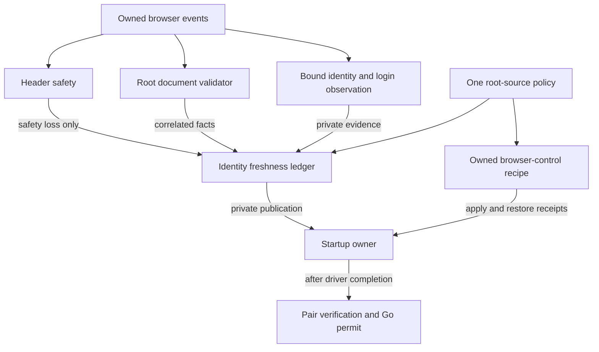

# X startup evidence, freshness, and browser-control responsibilities

Status: implemented and offline-verified in the default-off Manual V2 fixture path.
This refactor separates existing policy decisions from observation and browser
effects. It does not authorize a native run, session transfer, main-profile
access, Store mutation, user-runtime operation, or automatic recovery.

## Why the separation is necessary

At `90bf954`, the ledger owned evidence age, generation, and private publication,
but the cookie guard still decided whether a root response's cache class was
acceptable. A root policy rejection also incremented the cookie ambiguity count.
The ledger received a precomputed `accepted` boolean, after the observation had
already been invalidated. This was not a single authority for freshness policy.

Retained attempt `fad333f8489b49d296a40f97aeee1b8a` rejected its reader root with
`root_response_service_worker`: disk cache false, service worker true, prefetch
cache false. That identifies the rejecting predicate in that run, not a stale
response or the unknown predicate of older runs. Final Job/lease cleanup was
verified without retry; the disposable root was removed and the retained profile
remained clean with its exclusive lock released.

The producer/consumer contract also differed: native preparation disabled cache,
while its consumer rejected service-worker responses. Disabling cache and
bypassing a service worker are distinct CDP controls. A separate synthetic driver
already used both, but that did not establish native recipe compatibility.

## Responsibility contract

| Component | Sole responsibility | Output |
| --- | --- | --- |
| Header safety | Inspect owned-session headers for candidate session-cookie writes, ambiguous syntax, and inspection coverage loss | Header safety verdict and header-only counters |
| Request provenance | Track first requests, prior responses, redirects, and reused IDs independently of header diagnostics | Bounded request-selection eligibility |
| Root document validation | Correlate the selected request, response, frame, loader, commit, ExtraInfo, and completion conditions | Immutable root facts and structural failure |
| Bound identity/login observation | Validate the default execution context and exact account projection; select and validate settings evidence | Private document/context-bound identity and login facts |
| Root-source policy | Define allowed source classes and the browser recipe required to obtain them | Versioned source verdict and required controls |
| Identity freshness ledger | Apply that policy, age limits, generation binding, atomic updates, and sticky invalidation | Ready/pending/excluded state and one-use private publication |
| Owned browser driver | Execute the policy's authorized recipe and restore its controls | Apply/restore receipts; successful return only after restoration |
| Owner and Go controller | Bind the startup challenge and both independent roles, match accounts, and enforce admission/lifetime | Permit or rejection |
| Diagnostics | Project the originating domain, phase, condition, and independent cleanup outcome | Closed, bounded explanations with no authority |

Root or source-policy failures never become cookie attempts. Conversely, a
harmless header cannot qualify a root, supply identity, or repair a previous
failure. Genuine transport, ownership, context, or inspection loss can invalidate
the affected evidence across domains; that propagation must preserve its cause.

An explicitly named startup observation may fan out one owned event to the
independent consumers. A legacy export retained for compatibility is an
orchestration adapter, not permission for the header component to own root policy.
Request-selection eligibility belongs to its provenance registry, not to header
classification, diagnostic queue eviction, or cookie attempt counts.

## Data flow and authority

No diagnostic projection is an authorization input. Root facts are not account
identity, a settings success does not identify a different bootstrap document,
and a command ACK does not prove that a particular response came from the network.

The root-source policy has one immutable version and one implementation of source
classification. The driver consumes its required controls; the ledger consumes
its verdict. Neither the header guard nor a second driver-side predicate may
silently duplicate that decision.

Implementation map:

- `x-manual-header-safety.mjs`: header inspection and header-only counters.
- `x-manual-root-document.mjs`: selected root facts and structural validation.
- `x-manual-root-source-policy.mjs`: `manual-root-source.v1` verdict and recipe.
- `x-manual-root-controls.mjs`: fresh-session control capability and restoration.
- `x-manual-startup-cookie-guard.mjs`: explicitly named
  `ManualStartupObservation`, its request registry, and a legacy export alias.
- `x-identity-freshness-ledger.mjs`: bound evidence age and publication authority.

The strict source policy continues to reject disallowed cache/service-worker
classes. Missing or malformed metadata is represented honestly. Existing allowed
absent/undefined root attributes do not become proof of server-fresh identity;
settings independently retains its strict three-false cache requirement. This
change does not implement a weaker sixty-second identity policy or blanket
acceptance of service-worker responses.

## Private binding, age, and publication

A ledger belongs to one owner/profile/session/target/frame/role generation.
Document loader and default context are installed only from their validated
owners; root facts must match that same generation and document. Reuse across
restart, document replacement, peer role, or another guard/observer is forbidden.

Every mutation uses the current revision and generation. Identity capture time
remains the first valid capture. An atomic update associates the selected
settings request, validated login facts, root facts, source policy, and age anchors.
Reading, receiving cache metadata, or acknowledging a command never rejuvenates
old identity.

The immutable view keeps policy eligibility separate from proven source freshness,
sample age, identity capture age, cache facts, and missing proof. Unknown is not
false or zero. Reads are side-effect free. The bound observer owns monotonic event
time; a detected clock regression invalidates rather than fabricating a fresh age.

The existing limits retain their separate owners:

- Ten seconds: one browser observation lifetime.
- Five seconds: identity/settings evidence age and their allowed separation.
- Two seconds: startup challenge/source and paired acquisition.
- Sixty seconds: the explicitly authorized manual pilot horizon.

The ledger owns no browser, credentials, network client, timers, storage, login,
reload, or recovery. Private publication remains process-local, role-bound, and
one-use. Copies, JSON roundtrips, replay, invalidation, and scope mismatch cannot
manufacture it. The existing private wire and strict Go account matching remain
the downstream boundary.

## Browser-control and restoration contract

Controls belong only to the original startup session of a fresh, owned QA
browser/target with a known baseline. A retained profile does not make its newly
launched process a borrowed user browser. A second lifecycle-observer session is
not the control session. Unknown borrowed-target baselines must not be guessed.

The driver establishes the required cache-disable and service-worker-bypass
controls through its command gate and validates their acknowledgments before the
navigation that supplies startup evidence. Scope includes owner, role, target,
session, and attempt generation. Wrong-session commands, replay, unsupported
parameters, and out-of-order effects remain rejected.
The earlier pre-enrollment cache attempt joins that same restoration obligation
before its command is sent. An error before checkpoint construction or a lost
acknowledgment cannot leave that earlier effect outside control ownership.

Restoration is part of successful startup, not optional cleanup. The control
owner must acknowledge restoration before its driver run can return success and
before a receipt can reach Go or a manual reader can be handed back. The existing
owner already awaits the complete driver run before encoding the external startup
receipt; an internal private sink is not the externally granted permit.

Apply failure, timeout, cancellation, or uncertain restoration must not release
admission. A cleanup path cannot swallow a restoration failure and convert the run
to success. If safe restoration cannot be established, owned resources must be
retired rather than returning an unknown control state. There is no automatic
navigation retry, reseed, alternate source, login attempt, or fallback.
The reader retirement path enforces this obligation even when the broker requests
reader preservation. Final process exit must be verified before retirement can be
reported as successful.

## Diagnostics and acceptance

Keep header safety, root structure, source policy, browser-control lifecycle,
transport/ownership, and final cleanup as separate failure domains. Record the
first cause with its original phase and closed condition; later peer cancellation
or cleanup trouble cannot overwrite it. Cleanup remains independently reportable.

The existing bounded private diagnostic wire and backward decoding remain
compatible. Report no raw URLs, request IDs, account IDs, cookies, tokens, headers,
accessor results, or arbitrary browser error strings. Source metadata is projected
to closed enums; unavailable data remains unknown.

Acceptance requires tests of the actual orchestration as well as pure components:

- Header-only counters are invariant under root-source policy changes; candidate
  and ambiguous session-cookie writes reject across every root-source class.
- Structural root contradictions reject regardless of source class, and a valid
  structure alone does not qualify identity or login.
- The shared policy and the driver recipe agree on source requirements, including
  absent, undefined, malformed, disk, service-worker, and prefetch facts.
- Apply/ACK/restore order, exact session, timeout, cancellation, and restore failure
  cannot produce a successful external startup receipt.
- Account mismatch, stale age, context loss, generation/revision mismatch, replay,
  and peer failure preserve admission closure.
- Default-off build/runtime gates remain intact; offline preparation reaches no
  retained profile, network session transfer, Store, or user runtime.

Historical `90bf954` validation was 269 Node tests plus four tag gates, standalone
Windows compilation, Go/RPC checks, and twelve differential binder cases. That
proved preservation of the older acceptance envelope, not native recipe fitness.
Current validation evidence must name the refactored source and its exact scope.

The responsibility split passed canonical preparation
`28265789e76c4982bfa9b42f459d2678`: 277 Node tests, all four build-tag gates,
source-pinned Windows compilation, and the selected default-off, diagnostic, and
Node/RPC/Go tests. All 47 prepared source hashes matched the reviewed source.
Actual reader and collector orchestration was exercised with synthetic
transports, including both restoration commands, each apply/restore failure,
strict ACK shape, wrong-session/default-off rejection, pre-enrollment obligations,
and forced reader retirement despite preservation requests. An internally
published sample cannot become an external receipt after a restoration failure.

Closed diagnostic catalogs retain the V7 wire bound and legacy decoding, while
the Go formatter distinguishes header, coverage, root structure, root policy,
control, lifecycle, identity, settings, cleanup, and unknown domains. Header-only
counters intentionally differ from earlier aggregate root/header summaries;
account eligibility and candidate-cookie rejection remain strict.

Evidence lives under `runtime/qa/auth-session-sidecar/` as
`x-manual-retained-28265789e76c4982bfa9b42f459d2678.prepare.log.txt`,
`.provenance.json`, and `.prepared-plan.json`. Native execution was skipped before
lease/profile access; no X request, session transfer, Store, or user runtime was
executed. This validates the source architecture and offline recipe orchestration,
not successful native X startup with the new recipe.
