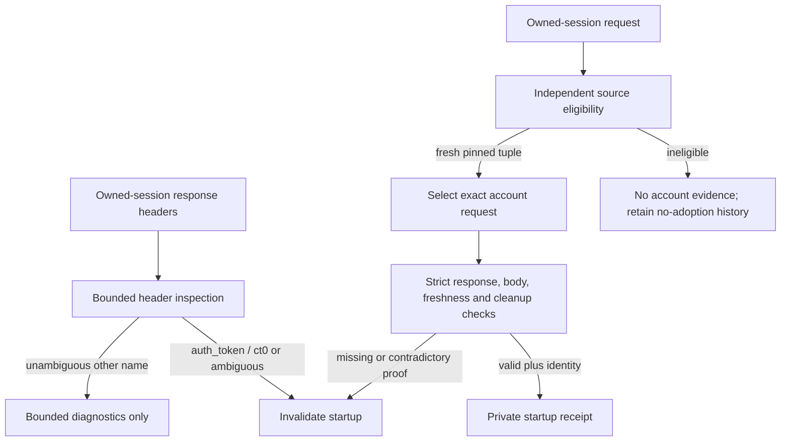

# X native manual startup pilot

Decision: 2026-10-21. Contract: `aku.x.dev-pilot.manual-startup.v2`.

## Manual startup connector: synthetic application wiring (2026-10-24)

Native QA `44ef8548cef144058954d07a7a7308b3` on source `d7c97f5` passed
strict startup for both roles, an additional reader window with the collector
preserved, one in-memory completion, duplicate rejection and owned cleanup in
9.72 seconds. This accepts the bounded QA recipe; it grants no Store or main-dev
activation authority. Reuse this evidence rather than reopening deferred renewal.

The next connector increment exercises that same manual-startup broker and
controller through actual main's early dispatch, the framed reader broker and
the collection Coordinator. The explicit provider is
`--dev --dev-session-reuse=synthetic-x-manual-fixture` in a build carrying both
`auth_session_dev` and `auth_session_fixture`. It exits before configuration,
database, normal provider or app-shell startup. Other builds and native provider
names reject the selection. The default route remains unchanged.

The runtime connector uses distinct reader and collector Managers. Captures use
only the backend pinned to the admitted collector generation. A reader request
borrows the reader Manager and cannot invoke exclusive headless replacement.
Reader/capture operations execute outside the manual controller's local-effect
callbacks; those callbacks remain bounded in-memory admission/completion only.
X is the only supported source. Bootstrap windows count toward reader lifetime.
No source evidence is renewed, no session is transferred, and every report keeps
`canAuthorize`, `nativeQualified` and `storePermit` false.

All adapter owners, account evidence, work and results in this increment are
invented. No Chrome, private native listener, activation target, login, profile,
Store or database is opened. This does not claim that the native transport now
implements the application's capture protocol or foreground activation. Those
connections and Store's guarded claim/result contract remain separate work.
The existing synthetic single-profile and renewal fixtures keep their contracts.

Run `scripts/test-x-manual-runtime-integration.ps1` for the accountless
actual-main gate/scenario checks and Coordinator regressions. Fixtures include
active capture overlap, duplicate completion, expiry, opt-out, parent loss,
owner drift, last-window loss, wrong source, malformed broker request and startup
failure. Missing configuration/database sentinels must remain absent.

Acceptance run `2878529aee234ff89405ba0fc32a022c` passed 15 Go top-level
tests with 33 subcases, all ten actual-main scenarios, four main build variants,
strict input rejection and the absent configuration/database checks. It verifies
same-backend owner binding, source/result/ticket fencing and external operations
outside the controller locks. The owned temporary build root was removed.
Evidence: `runtime/qa/auth-session-sidecar/x-manual-runtime-2878529aee234ff89405ba0fc32a022c.log.txt`.

The current manual-V2 cookie observation boundary is the
[session-local revision](#session-local-cookie-provenance-and-root-only-identity).
It supersedes the root-only cookie scope below; account evidence remains root-only.
The current classification policy is the
[minimum noncandidate revision](#minimum-noncandidate-classification-2026-10-23),
which supersedes the earlier name/path/attribute restrictions for other cookies.

The user explicitly selected a manual pilot of at most 60 seconds with strict
initial account/login verification, instead of renewing identity every five
seconds. This supersedes snapshot V1 renewal as the MVP gate only. V1's synthetic
model/controller/main fixtures and their successful evidence remain unchanged.
This decision does not enable a runtime, enroll an account or authorize another
credential transfer/native QA run.

## Minimum admission evidence

- Explicit opt-in, expected original stable X account ID, private enrollment,
  policy/consent version and acknowledgement of the limitation below.
- Two distinct owned reader/collector profiles, physical directories, processes,
  creation identities, contexts and role bindings under the Sidecar lifetime;
  trusted image/Job ownership and full reader-window inventory, including bootstrap.
- A new private derivation receipt for the exact authorized attempt, pair and
  collector. The previous QA report is evidence about feasibility, never a receipt
  that can be replayed into a new attempt. The two-cookie transfer ceiling is
  unchanged; code preparation does not authorize transfer execution.
- Fresh initial original-string current-self identity in both roles, matching each
  other and the enrolled account. Reuse the qualified startup/bootstrap projection
  recipe from MVP-1; no feed-author/handle inference, numeric ID coercion, stale
  bootstrap reread or promotion of a sanitized QA success boolean.
- Fresh initial protected settings evidence from exactly
  `GET https://api.x.com/1.1/account/settings.json`, with the previously qualified
  semantic predicate and request-local qualification
  `api_v1.cookie-auth-rejection.2026-10-20`.
- One-use challenge and exact owner/context/document/request correlation, direct
  fresh responses and initial samples no older than five seconds. Both roles'
  initial vector must complete in less than two seconds. Clock domains must not
  be compared as if unrelated process monotonic clocks shared an origin.

## Manual permission lifetime

The absolute clock starts before initial acquisition or authorized seeding,
whichever comes first. The attempt ends no later than that start plus 60 seconds
or an explicitly earlier owner/consent/attempt limit. Initial sample freshness
must pass at admission; its five-second timestamp does not secretly shorten the
selected manual window back to five seconds. Conversely, the manual window is
not a claim that account/session evidence stays fresh for 60 seconds.

There is no automatic identity renewal, attempt extension, restart inheritance,
reseed, reverse transfer or automatic exclusive fallback. A later attempt requires
new explicit initiation and fresh initial evidence. Known account/login rejection,
owner/context/policy/consent drift, missing last reader, channel loss/ambiguity,
uncertain cleanup, parent exit or opt-out revoke dependent use. Checks must occur
before dispatch/result publication, with no late result acceptance.

Acknowledged limitation: account/session changes after the initial checkpoint can
remain undetected until an observed invalidation or attempt expiry. Native session
continuity, complete writer/worker coverage, refresh/rotation and instantaneous
revocation detection remain unknown or unqualified. Full renewal is deferred.

## Conservative startup cookie guard V2 (2026-10-22)

Historical classification policy: the
[minimum noncandidate revision](#minimum-noncandidate-classification-2026-10-23)
supersedes the other-cookie rules in this section. Candidate rejection and
request/correlation checks remain in effect.

This is an explicit manual V2 policy change. It does not reinterpret the
historical snapshot V1 allowance for unclassified cookie headers, relax the
ordinary QA guard, or permit deferred-mutation observations to publish startup
receipts. Only the trusted manual startup path uses this classification, after
its separately authorized seed has completed and before startup admission.
The network-provenance revision below defines the current observation boundary;
the provisional-navigation sections retain the history of earlier corrections.

| Observed response cookie header | Manual V2 startup action |
| --- | --- |
| An `auth_token` or `ct0` write/attempt after seed | Reject, including before identity capture, deletion/expiry, blocked attempts and a candidate mixed with other or malformed lines |
| Only clearly classified other cookies with supported, correlated X scope | Keep a bounded diagnostic; this alone does not reject startup |
| Ambiguous name, syntax, scope, unsupported attributes, unresolved provenance or exhausted observation bounds | Reject; bounded response/required ExtraInfo completion may remain pending, independently of JavaScript identity context |

The guard classifies header attempts, not accepted writes or value changes. It
does not read cookie storage, compare values, prove unchanged session lineage or
infer harmlessness from a non-candidate classification. An absent header is not
evidence of complete mutation coverage. Both roles must still pass the same
fresh account/login, owner/context/document, one-use challenge, joint timing and
cleanup checks before a private startup receipt can be published.

Classification is bounded and private. Diagnostics contain fixed categories and
counts, never cookie values, raw headers, unknown cookie names, URLs, account IDs
or arbitrary exceptions. The policy cannot be selected through a public setting,
untrusted RPC payload or a sanitized QA success flag. Default-off gates and the
original absolute 60-second attempt deadline remain unchanged.

This guard covers the startup observation window. Network observation is torn
down at startup completion; it is not continuous cookie monitoring during the
manual attempt. Existing lifecycle invalidations still apply. Post-checkpoint
account/session changes, complete worker coverage and refresh/rotation remain
the acknowledged deferred limitations, rather than new MVP prerequisites.

Offline implementation uses `x-manual-startup-cookie-guard.mjs` through a trusted
bound-observation factory selected for both manual reader and collector startup.
The guard preserves the closed `observed_cookie_write` rejection reason and
adds a value-free category/counter projection. Ordinary QA construction remains
strict; deferred-mutation samples still cannot publish startup receipts.

Run `scripts/prepare-x-manual-retained-qa.ps1` with no switches for offline
regression and default-off preparation only. Run
`9c87833c8ec84c35b9fd95314e54d92e` passed 73 Node tests (13 dedicated guard tests),
three Go top-level tests with three startup subcases, four build tag gates and
standalone Windows compilation. The native entry skipped before lease/profile
access with all four execution gates disabled. No browser, retained profile,
X request, transfer, Store or user runtime was accessed. Evidence:
`runtime/qa/auth-session-sidecar/x-manual-retained-9c87833c8ec84c35b9fd95314e54d92e.prepare.log.txt`.
This is offline acceptance only; native V2 classification remains untested.

### Provisional root-navigation correlation (2026-10-22)

The single authorized run of source `c9e98fb` rejected startup after 9.29 seconds
with `first=cookie_ambiguous terminal=scope_lost early=evaluation_failed`,
`handoff=accepted`, and `extra=complete`. Seed setup passed, admission stayed
closed, and final owned-Job cleanup and retained-lease release were verified.
No retry ran. Evidence:
`runtime/qa/auth-session-sidecar/x-manual-retained-fce1ad89700b4b09b584fdb2ecccdb01.run.log.txt`.

Astra reproduced that exact trace offline with the real bound-observation and
bootstrap-handoff classes. A known synthetic non-candidate header arrived on the
root document before commit, or after commit but before its default context.
The old guard stored an unbound request permanently; later correct document
evidence could not complete correlation. The same header after context creation
passed. This proves a local lifecycle defect, not which native header or event
sequence caused the preceding QA failure.

The correction permits one provisional root `Document` request: `GET` to exactly
`https://x.com/home`, during the trusted startup reload. The driver observes the
previous root loader and arms this boundary immediately before issuing that
reload. Earlier traffic, the previous document, redirects, repeated IDs,
additional provisional roots, foreign frames and contradictory scope are not
adopted as the new document.

Only fully parsed known non-candidate cookie classifications may wait for exact
root frame/loader/default-context correlation and complete response/ExtraInfo.
Pending state is bounded and keeps classifications/counts, not raw headers or
cookie values. An unresolved or contradictory pending record rejects at finish.
Candidate `auth_token`/`ct0` attempts, including blocked/deletion attempts, and
truly ambiguous names/syntax/scope/attributes still reject immediately.

Both reader and collector use this trusted manual-only boundary. Ordinary strict
and deferred QA behavior, private first-cause diagnostics, account/login checks,
receipt schema, admission timing, Store authority and default-off gates remain
unchanged. This increment authorizes offline implementation/regression only;
there is no native run, retained-profile access or transfer authorization.

Canonical offline preparation `7f479c23ec7c4b42ac6f19babfcda73b` passed 91 Node
tests, four Go top-level tests with seven startup bridge subcases, four build tag
gates and standalone Windows compilation. The nine dedicated root-navigation
tests exercise the real bound-observation/bootstrap-handoff classes in both
roles: known non-candidate headers before commit or context now produce
`bound`/`other_only` with one private synthetic receipt. Candidate and unknown
headers still stop identity evaluation and publish no receipt. Pending metadata,
scope drift, old/reused/redirected requests, one-use arming and strict capture
projection remain fenced. Unrelated no-parameter events do not become cookie
ambiguity; the existing request-cap policy is unchanged.

The native entry skipped before lease/profile access with all execution gates
disabled. No browser, retained profile, X request, transfer, Store or user runtime
ran. Evidence:
`runtime/qa/auth-session-sidecar/x-manual-retained-7f479c23ec7c4b42ac6f19babfcda73b.prepare.log.txt`.
This proves the offline ordering correction only; native acceptance remains
unverified.

### Post-commit requests and distinct guard reasons (2026-10-22)

The single authorized run of source `0ee3311` rejected startup after 8.53 seconds
with the same broad `cookie_ambiguous` first cause. Seed setup passed, admission
stayed closed, and final owned-Job cleanup and retained-lease release passed.
The collector/build root was removed and the retained profile preserved. No
retry ran. Evidence:
`runtime/qa/auth-session-sidecar/x-manual-retained-7f479c23ec7c4b42ac6f19babfcda73b.run.log.txt`.

Astra verified that the root correction works offline but is not sufficient to
identify the native cause. A same-document image request registered after commit
but before default-context creation still became permanently unbound. Its known
non-candidate response after context creation reproduced the same failure trace;
the corresponding no-cookie and after-context controls passed. A separate
capacity probe reproduced that trace using foreign requests with no cookie
headers. Unsupported header attributes also reproduced it, as an intentional
conservative policy rejection. These are distinct source paths, not proof of
which one occurred in native QA.

The correction extends pending correlation only to bounded `GET` resource
requests that start after the trusted reload and verified new-root commit,
before its default context exists. Request session, root frame and loader must
match the observed committed document. The resource types are `Image`, `Script`,
`Stylesheet`, `Font`, `Media`, `TextTrack`, `Manifest`, `XHR`, `Fetch` and `Other`;
only HTTPS X/API setter scopes qualify. Earlier resource requests, old documents, redirects,
reused IDs, foreign scope and contradictory metadata are not adopted. Pending
known non-candidate classifications bind only to the actual matching context and
must resolve response/required ExtraInfo before finish. Candidate, unknown or
malformed cookie evidence still rejects immediately; failed pending state cannot
publish a receipt.

Guard diagnostics distinguish request binding, request capacity, header
classification, response correlation, metadata shape, completion and observation
bounds. The first guard rejection is immutable. Private startup output retains
that detail even when a non-guard failure occurred first, without replacing the
original first cause. Closed labels are appended to the existing Node/Go V2
catalogs; previous indices and legacy codes remain supported. Coarse public QA
categories and terminal behavior remain compatible. In particular, a legacy
`observed_cookie_write` terminal label alone is not proof that a cookie header
was observed: request-capacity rejection may have no cookie evidence.

| Private guard reason | Rejection boundary |
| --- | --- |
| `guard_request_unbound` | Request cannot be adopted into the owned document |
| `guard_request_budget` | Existing request-record limit exhausted |
| `guard_header_classification` | Cookie name, syntax, scope or attributes cannot be classified safely |
| `guard_response_correlation` | Response, ExtraInfo or document evidence contradicts the request |
| `guard_metadata_shape` | Observed metadata has an invalid shape |
| `guard_completion_missing` | Pending context, response or required ExtraInfo never completes |
| `guard_header_budget` | Existing header size/count bound exhausted |
| `guard_event_budget` | Existing cookie-header event bound exhausted |

The private `trace.cookie` field carries the first guard reason when available;
the public guard report keeps its existing coarse category and counts. An
observed candidate keeps `cookie_candidate` and immediate rejection behavior.

This increment does not raise limits, discard foreign traffic, broaden the cookie
parser or change Store/admission policy. Default-off gates, startup receipts,
account/login evidence, timing and the original attempt horizon are unchanged.
Implementation and regression are offline only; no new retained-profile access,
credential transfer or user-runtime operation is authorized.

Validation: `scripts/prepare-x-manual-retained-qa.ps1` passed 99 Node tests, four
standalone Go tests with 18 actual Node/Windows-RPC/Go startup-diagnostic subcases,
four build-tag gates and Windows compilation. The actual binder/handoff tests
cover both roles, resource responses before/after context, unchanged candidate
rejection, missing/contradictory completion and request exhaustion without cookie
headers. Private bridge tests retain guard detail after earlier context failure,
preserve the first guard reason across later candidate/budget failures, and
verify legacy V2 indices and Node/Go catalog parity. Native QA was skipped before
lease/profile access. Evidence:
`runtime/qa/auth-session-sidecar/x-manual-retained-047a5b35eb56488fae50dc756e0b3f10.prepare.log.txt`.
This confirms the offline correction and diagnostics; the original native cause
and native acceptance remain unverified.

### Network provenance and explicit post-seed boundary (2026-10-22)

The single authorized run of source `f7fd506` rejected startup after 9.97 seconds.
Seed validation passed; admission remained closed. The immutable initial detail
was `reader/bound_finish/observed_cookie_write`, with
`first=guard_request_unbound terminal=scope_lost early=evaluation_failed`,
`handoff=accepted`, `cookie=guard_request_unbound` and `extra=complete`.
The outer result reported `cleanup-uncertain` during failure handling. Final
test cleanup subsequently verified the owned Job empty and lease release; the
retained manifest was `clean`, the disposable root was removed and the retained
profile preserved. No retry ran. Evidence:
`runtime/qa/auth-session-sidecar/x-manual-retained-047a5b35eb56488fae50dc756e0b3f10.run.log.txt`.

Astra reproduced the exact trace through the actual driver dispatcher,
checkpoint, binder and bootstrap handoff using an offline transport. Separate
cases covered a request before guard creation with a late response, an observed
old-loader request and a new-loader resource before commit. Foreign-origin and
redirect cases also produced the trace, as conservative scope rejections. Clean,
post-commit-resource and unrelated-session controls passed. These results expose
a structural provenance gap; they do not identify the native event that caused
the preceding run.

The former implementation observed target-session responses but retained only
requests admitted by document/context binding. It discarded other records to
`null` and created a fresh request map after enrollment and seed. Consequently,
"never observed" and "observed but disqualified" became indistinguishable.
The root and post-commit exceptions above corrected specific orderings but did
not remove that mismatch.

The network-provenance revision separates two decisions:

| Decision | Required evidence |
| --- | --- |
| Response-cookie safety classification | Bounded request provenance from the exact owned session, a valid request-local frame/loader and supported HTTPS X/API scope, plus consistent response/required ExtraInfo; see the current session-local revision |
| Account/login startup receipt | The existing exact fresh account, new document/default context, owner pins, challenge, joint timing and cleanup checks |

HTTP request provenance does not depend on the availability of a JavaScript
default context. Observed request metadata and closed disqualification reasons
are retained within the existing request limit. Known non-candidate headers on
an older observed request can be classified without granting that request any
identity authority. Missing predecessors, unknown scope, redirects, reused IDs,
contradictions and unsupported headers remain closed; candidate attempts do not
need valid identity binding to cause rejection.

The reader observer starts before the enrollment reload and remains active
through seeding, enrollment cleanup and startup. The collector receives the
corresponding trusted observer before its controlled startup traffic. An
explicit post-seed baseline begins when the permitted seed write is acknowledged,
before asynchronous cleanup. Pre-seed cookie-attempt decisions do not poison the
new decision epoch. Baseline transition preserves request provenance and
structural coverage failures rather than manufacturing completeness. A response
from an older request that attempts a candidate write after baseline still
rejects. A request never observed before observer startup is not reconstructed
or silently accepted from its later response.
The 1,280-record limit spans this continuous observation lifetime; longer
traffic can exhaust it earlier. Such exhaustion remains an explicit closed
`guard_request_budget` failure, not an implicit reset or silent eviction.

Private diagnostics retain the first rejection trigger and distinguish absent
request provenance from an observed disqualified record. Only closed enums cross
the private Node/Go boundary; no request IDs, URLs, cookie names or values, raw
headers, account IDs or arbitrary exceptions are added to reports. Earlier wire
versions remain decodable. Public coarse categories and receipt authority remain
unchanged.

The private V3 diagnostic wire appends `guardTrigger` and `guardProvenance` to
the six existing trace dimensions. Trigger labels identify baseline/arming,
metadata/request/document checks, response/ExtraInfo, redirect or finish.
Provenance labels distinguish `absent`, `scoped`, `origin_scope`, `frame_scope`,
`loader_missing`, `redirect`, `reused` and `root_scope`, with `unknown` retained
when no evidence exists. This is a diagnostic wire revision, not a new admission
policy or a change to receipt schemas. Legacy unversioned and V2 errors remain
supported.

This revision supersedes the document/context-dependent network correlation in
the two preceding provisional sections. It does not raise observation limits,
broaden parser allowlists, discard foreign traffic, change Store policy or extend
monitoring beyond startup. Default-off gates, the absolute 60-second attempt
horizon and acknowledged manual-pilot limitations remain in force. Implementation
and validation are offline only; no new native run or transfer is authorized.

Final canonical offline preparation `a6b8cdd77f6741f4b8f70b80447267d6` passed
113 Node tests, four standalone Go tests with 18 Node/Windows-RPC/Go diagnostic
subcases, four build-tag gates and Windows compilation. The actual-driver tests
exercise provenance across context creation and enrollment/seed/startup, older
observed requests, missing and disqualified predecessors, same-acknowledgment
batch/cleanup candidate attempts, and a single continuous network subscription.
Private V3 discriminator formatting, canonical decoding and legacy V2 indices
are covered. All 34 prepared source fingerprints match the validated inputs.
Native execution skipped before lease/profile access. Evidence:
`runtime/qa/auth-session-sidecar/x-manual-retained-a6b8cdd77f6741f4b8f70b80447267d6.prepare.log.txt`.

Validation also exposed a separate diagnostic-fixture timing collision: the
healthy synthetic peer could sample within the same integer wall-clock tick as
Go's higher-resolution challenge, causing `time_invalid` before the intended
guard fault. The offline fixture now waits for a real wall-clock tick after
challenge release; boundary, rollback and stalled-clock tests cover that wait.
Production clocks, precision and receipt timing checks are unchanged. This does
not establish native timing qualification or identify the prior native branch.

### Declared redirect versus undeclared request reuse (2026-10-23)

The single authorized native run of source `1d1ea0e` rejected startup after
10.02 seconds before admission. Seed validation passed. Its originating private
detail was `collector/bound_finish/observed_cookie_write`, delivered via a peer,
with `first=guard_request_unbound trigger=request provenance=reused`.
Terminal/early/handoff/cookie/ExtraInfo summaries were unknown in that peer
delivery and must not be inferred. The outer failure reported
`cleanup-uncertain`; final owned-Job and retained-lease cleanup passed, the
manifest returned to `clean`, and the disposable root was removed. No retry ran.
Evidence:
`runtime/qa/auth-session-sidecar/x-manual-retained-a6b8cdd77f6741f4b8f70b80447267d6.run.log.txt`.

Astra traced the actual collector decoder, transport dispatcher, passive
observer and checkpoint/binder path offline. Each request envelope reached the
guard exactly once; `Network.enable` ran once. No internal duplicate-delivery
path was demonstrated. However, a same-ID declared redirect without cookie
headers and a same-ID request without a redirect declaration both produced
`request/reused`. The former branch checked ID presence before redirect
metadata. Redirect headers containing known-other or candidate evidence already
rejected earlier, so the previous header-bearing regression missed the collision.
The actual native branch remains unproven because that log omitted the
declaration discriminator.

The correction distinguishes a same-ID declared redirect as
`guard_request_unbound / request / redirect`, and an undeclared same-ID request
as `guard_request_unbound / request / reused`. Both remain rejected. Header
classification still runs first: candidate attempts, unknown/malformed headers
and unqualified redirect evidence cannot be repaired by the later request.
Here `redirect` means the `redirectResponse` field was present, including a
malformed/null declaration; it does not assert a valid redirect or accepted hop.
The first trigger/provenance remains immutable and passes through the private V3
Node/Windows-RPC/Go diagnostic path without raw request or cookie data.

This is a diagnostic correction only. It does not accept redirects, introduce
per-hop correlation, loosen cookie/scope/root checks, change observation bounds
or alter Store/admission authority. Existing default-off gates, startup-only
coverage and the absolute 60-second attempt remain unchanged. This increment
authorizes offline implementation and regression only; no new transfer or
retained-profile execution is authorized.

Canonical offline preparation `b145fe477dac4d919eeaea8c74e90181` passed 120 Node
tests, four standalone Go tests with 21 diagnostic bridge subcases, four build-tag
gates and Windows compilation. Actual collector tests use the production frame
decoder, event dispatcher, passive observer and checkpoint to verify one guard
call per incoming envelope and distinguish declared/undeclared repeats. Header
precedence, malformed declarations and rejection persistence are covered. The
dispatch probe deliberately stops before full startup completion; it does not
claim a successful identity/login observation. All 34 prepared source hashes
match; native execution skipped before lease/profile access. Evidence:
`runtime/qa/auth-session-sidecar/x-manual-retained-b145fe477dac4d919eeaea8c74e90181.prepare.log.txt`.

### Early cache preparation and pre-transfer guard fences (2026-10-23)

The single authorized run of `2f72026` rejected reader startup after 10.49
seconds with `condition=response_cache epoch=before_seed`. Admission never
opened. Final owned Job cleanup and lease release succeeded; the retained
manifest was clean and the disposable root was removed. Evidence:
`runtime/qa/auth-session-sidecar/x-manual-retained-2dacb05a6cc44c9aa2ca927c2e169098.run.log.txt`.
The earlier outer `cleanup-uncertain` result is separate from that final cleanup
proof. The trace does not identify which cache flag rejected or establish a
cookie write. `before_seed` means before the write acknowledgment boundary;
it does not prove that the write command had not yet been sent.

Offline review found that Network observation began before enrollment while
cache disabling occurred only at the later startup checkpoint. It also found
that enrollment checks before cookie export/write did not inspect either
existing cookie guard rejection. The correction preserves the current uncached
acceptance envelope:

- Both exact owned sessions must acknowledge
  `Network.setCacheDisabled({cacheDisabled:true})` before Network enable and
  enrollment traffic. Only the narrowly scoped setup command gate is extended;
  parameters, role/session ownership and one-use setup remain checked. Failure
  or unavailable acknowledgment prevents enrollment and export. No cache
  clearing, service-worker bypass or change to the reload command is added.
- Check both guards after observer setup and enrollment, before export, after
  awaited export/enrollment checks, and around the final write boundary.
  The final guard/enrollment assertion is synchronous and shares a JavaScript
  turn with collector command dispatch. A previous rejection cannot be reset
  by seed, reload, cleanup, a later event or a healthy peer.
- Preserve truthful write status. A failure before dispatch is
  `not_attempted`; an issued command without acknowledgment remains `unknown`.
  The private acknowledgment hook records `acknowledged` before starting both
  post-seed baselines inside CDP reply dispatch. A rejection during reply
  processing, the same pipe batch or cleanup cannot turn that known write into
  a claim that no write occurred, and cannot publish a successful seed DTO.

Private V5 startup diagnostics append `guardDiskCache`, `guardServiceWorker`
and `guardPrefetchCache`. Each is a closed category: `unknown`, `absent`,
`false`, `true` or `malformed`. Descriptor inspection never invokes getters or
exports arbitrary values. The first relevant cache failure owns these fields;
later cache metadata cannot replace an earlier cause. The original rejection
predicate, precedence, scope, budgets and first observation epoch are unchanged.
V2/V3/V4 startup codes remain decodable with missing fields marked unknown.

Private V6 startup diagnostics append `guardRequestFrame`, rendered as
`request_frame` by Go. This is a request-time descriptor projection against
the immutable root frame pin, not a frame identifier or a new admission rule:

- `absent`: an observed request has no own `frameId` property.
- `malformed`: its own property is an accessor, empty, non-string, undefined,
  or longer than the existing 512-character reference bound.
- `different`: a valid reference differs from the root pin.
- `matching`: a valid reference equals the root pin.
- `unknown`: no applicable observed request snapshot owns the first failure,
  or the diagnostic predates V6. An unseen request is not an observed request
  with an absent property.

No getter is invoked and no frame ID is retained in the diagnostic. Candidate
and malformed-header precedence is unchanged. A matching request followed by
a response with a missing or different frame remains a response-correlation
failure with `request_frame=matching`. Redirect predicate failures use the
current request snapshot, except `previous_frame`, which uses the predecessor;
header attempts parsed before that predicate keep their predecessor snapshot.
Document-only failures without an applicable request remain unknown. The
first failure owns this field permanently, including an unknown value: later
events, candidates, budget exhaustion, seed transitions, peer failures and
latch enrichment cannot replace it. The root pin is never rebound.

V6 uses the same closed numeric, 80-character-bounded startup and seed wires.
V2 through V5 keep their exact historical arities and decode the appended
frame field as unknown. Offline regressions cover descriptor categories,
request-versus-response attribution, immutable first failure, redirect order,
raw driver dispatch through binder/latch, wire parity and seed wrapping. These
diagnostics do not establish why native X supplied an unqualified frame;
that remains unverified until a separately authorized QA observation.

Seed failures with a branded first startup trace use a bounded numeric
`manual_seed_v2_...` envelope so an early abort does not discard the original
role, cause, condition, epoch and cache attributes. It includes the existing
closed seed phase/reason/write state; old seed codes remain supported. Raw
headers, URLs, account identifiers, cookie values and arbitrary exception
properties never enter either wire. Diagnostic codes keep the existing
80-character bound.

Regressions exercise either role's cache-control failure, pre-existing
rejection, rejection during export, the last synchronous pre-dispatch check,
write without acknowledgment, rejection before/after acknowledgment, cleanup,
and a healthy control. Cache attributes, accessors, sanitized reports, immutable
first failure and legacy/private Node-to-Go wire compatibility are covered.
All execution for this delta is offline. No retained profile, Chrome process,
native X request, transfer, Store operation or user runtime is accessed.
Early HTTP cache control is preparation, not proof that SW/prefetch provenance
cannot appear or that the last native failure is fixed. Cached/unsupported
redirect chains still reject under the unchanged guard; cache provenance never
grants account/login authority.

Validation passed all 200 Node tests in the ten retained-preparation suites
(33 added regressions), plus all four selected standalone Go diagnostic tests
and 21 startup bridge subcases with no skips. The Go binary was compiled from
the canonical ten-file allowlist, with both development/fixture tags, all
execution gates disabled and no Chrome executable configured. Its owned build
root was removed. Evidence:
`runtime/qa/auth-session-sidecar/cache-seed-final-4355b5e5abb34aedb6ca72db28efb91f.node.log.txt`
and
`runtime/qa/auth-session-sidecar/cache-attribute-diagnostics-verbose-58aab741-20261023.go.log.txt`.

### First failed redirect predicate and observation epoch (2026-10-23)

The authorized `22438ae` retained run still rejected reader startup with
`first=guard_request_unbound`, `trigger=request`, `provenance=redirect` before
admission opened. Its old diagnostic tuple does not identify which redirect
predicate failed or when the first event occurred. Offline reproduction can
produce that entire tuple from an invented foreign resource redirect with no
cookie attempt, before seed. This counterexample does not establish that the
native request was foreign or pre-seed. The previous per-hop change repairs a
correlation limitation, but native remediation remains unproven.

Diagnostic-only V4 appends two closed fields to the private Node/Go trace:

- `guardCondition`: the first false term of the existing redirect acceptance
  predicate, in its existing evaluation order. Categories distinguish missing
  predecessor, redirect shape, preceding response, completed/failed/cached
  chain, predecessor/current resource eligibility, predecessor/current
  origin/frame/loader scope, loader mismatch, redirect URL mismatch, redirect
  status, ExtraInfo flag, header shape and response-cache rejection.
- `guardEpoch`: the guard's observation state at its first rejection:
  `before_seed`, `post_seed`, `reload_armed` or `document_committed`. These are
  lifecycle checkpoints, not timestamps or proof that every setup action was
  successful. Later baseline, arm, commit, cleanup and finish events cannot
  replace this value.

`unknown` means no applicable classified predicate or no known first guard
failure. Earlier candidate/header failures keep their original cause and epoch;
a later redirect must not relabel them. When several redirect terms are false,
the reported term is the first predicate in code order, not an inference about
causal importance. Resource eligibility remains the existing combined
method/type/non-settings check. V2/V3 diagnostics remain decodable with the new
fields marked unknown. V4 transports only catalog indices; Go renders
`condition=... epoch=...`. URLs, IDs, account identifiers, cookie values, raw
headers and exception messages are excluded.

The legacy wrapper `observed_cookie_write` can still represent a structural
guard rejection without a cookie attempt, and `bound_finish` remains a reporting
phase. Use the separate cause, condition and epoch rather than interpreting
either wrapper as evidence of a write at that time. Guard decisions, predicate
order, attempt precedence, budgets, receipts and admission are unchanged.
Unsupported no-cookie redirects still reject; this change neither ignores
foreign traffic nor qualifies broader native traffic coverage.

Regression coverage includes every classified redirect predicate, multiple
simultaneously false terms, immutable first epochs, candidate/header precedence,
sanitized reports, actual reader/collector dispatch, a pre-seed no-cookie
redirect through the real binder/latch, and private Node-to-Go wire compatibility.
All validation for this delta is offline. No new native run, retained-profile
access, session transfer, Store operation or user-runtime activation is
authorized or performed.

Offline validation passed all 167 Node tests in the ten retained-preparation
suites (23 added redirect/epoch regressions), the V4 catalog roundtrip with
V2/V3 defaults, and all 21 standalone Node/Windows-RPC/Go startup diagnostic
subcases. Four source-tag gates and dev/combined Engine builds passed. The
standalone run kept all execution flags disabled and no Chrome executable
configured; its owned staging/build root was removed. Bridge evidence:
`runtime/qa/auth-session-sidecar/native-wire-v4-standalone-318bdcce064c45f1a63ac469e5c96b8e.log.txt`.

### Per-hop resource redirect correlation (2026-10-23)

The last separately authorized run of source `c4d12c8` rejected startup after
8.69 seconds. Its primary reader detail was `bound_finish/observed_cookie_write`,
with `first=guard_request_unbound`, `trigger=request` and
`provenance=redirect`. Admission did not open. The diagnostic proves that the
guard saw a redirect declaration; it does not identify its URL, status, cookie
contents or whether that chain would satisfy the correlation rules below.
Evidence:
`runtime/qa/auth-session-sidecar/x-manual-retained-b145fe477dac4d919eeaea8c74e90181.run.log.txt`.

The preceding discriminator intentionally rejected all same-ID redirects.
The offline correction keeps the security checks and replaces that
single-record request model with bounded per-hop provenance for supported
resource redirects. This does not make a redirected resource an account or
login source.

The [CDP Network contract](https://raw.githubusercontent.com/ChromeDevTools/devtools-protocol/master/pdl/domains/Network.pdl)
distinguishes a network request ID from its individual HTTP requests.
`redirectResponse` and `redirectHasExtraInfo` describe the preceding hop;
`hasExtraInfo` describes the final response. ExtraInfo may precede or follow its
response. The [DevTools frontend implementation](https://raw.githubusercontent.com/ChromeDevTools/devtools-frontend/main/front_end/core/sdk/NetworkManager.ts)
also retains separate redirect-hop and ExtraInfo state. Its ordered-array
strategy is implementation evidence, not permission to guess an ambiguous
security correlation.

The implementation preserves these boundaries:

- Retain the predecessor instead of overwriting it when an owned request ID
  carries a valid redirect declaration. Every supported hop must match its
  observed session, frame, loader, URL, status and required ExtraInfo metadata.
- Assign pending ExtraInfo only when the hop is uniquely established. Missing,
  duplicate, contradictory or ambiguous evidence remains rejected. A later
  response cannot repair an earlier rejection or an unobserved predecessor.
- Inspect candidate, unknown and malformed cookie evidence immediately. An
  `auth_token` or `ct0` attempt in any hop, including blocked evidence, still
  revokes startup. Only existing allowlisted non-session cookie attempts on a
  fully correlated supported resource chain can be classified as known-other.
- Preserve the post-seed observation epoch and first cause. A late post-seed
  candidate on an older request still rejects; deferred correlation must not
  reinterpret a pre-seed header as a newly observed post-seed attempt.
- Count retained hops and pending evidence within the existing observation
  bounds. Redirects cannot reset the 1,280-record lifetime budget or bypass the
  header, line or event limits.
- Root-document and account-settings redirects remain rejected. Identity,
  protected-login evidence, challenge, timing, owner, cleanup, receipt and
  admission checks are unchanged.

The deliberately narrow envelope covers observed `GET` subresources with explicit
supported resource types, supported HTTPS X/API scope, the same owned frame and
loader, and redirect statuses 301, 302, 303, 307 or 308. Only uniquely matching
required ExtraInfo status slots can complete. Repeated-status slots reject
rather than relying on event order. ExtraInfo for the preceding hop can arrive
after the next request, and final-hop ExtraInfo can precede or follow its
response. Before the first redirect declaration, the existing single-hop
duplicate/contradiction checks remain; this does not qualify every possible
future-hop predeclaration ordering. Cached/service-worker redirects, incomplete
headers, completed/failed-chain reuse and inconsistent terminal metadata remain
outside the supported envelope.

Only bounded parsed classifications and necessary correlation metadata may
remain in memory. Raw header/cookie values are not retained for deferred
matching and never enter diagnostic reports. The private diagnostic schema and
its existing closed categories remain unchanged.

This work authorizes offline implementation and regressions only. It grants no
new retained-profile access, native browser run, transfer, Store operation or
user-runtime activation. Native acceptance remains unproven.

Canonical offline preparation `dbae413881e44d21afcff86a32425da7` passed 144 Node
tests, four standalone Go tests with 21 diagnostic bridge subcases, four build-tag
gates and Windows compilation. Sixteen focused redirect tests cover hop matching,
required header metadata, candidate precedence, scope, ordering, cache/lifecycle
contradictions, seed epochs, bounded retention and sanitized reports. Production
reader dispatcher and collector decoder/transport paths accept qualified resource
chains and deny missing evidence or candidate attempts before a private startup
receipt can be published. These use invented events and accounts only; no native
X acceptance or durable authority is claimed.

All 35 prepared source fingerprints match the validated inputs. The execution
plan remains unapproved, and the native entry skipped before lease/profile
access with every execution gate disabled. No browser, X request, transfer,
Store or user-runtime operation ran. Evidence:
`runtime/qa/auth-session-sidecar/x-manual-retained-dbae413881e44d21afcff86a32425da7.prepare.log.txt`.

The preceding offline preparation `c612b2bb8df74839a4a534017e618dc2` failed one
diagnostic assertion: a missing final response was categorized as correlation
failure rather than missing completion. Both outcomes rejected startup. The
comparison now checks terminal status only when a response actually exists;
the final accepted preparation above used the frozen corrected inputs. The
earlier log is retained as failed offline evidence, not native execution.

## Implementation and execution boundary

The minimum dev-only native adapter accepts private typed receipts through trusted
owner/source ports and returns a sealed, attempt-bound validation vector. It does
not relabel native IDs into the V1 synthetic grant or create Store revisions.
Default construction is disabled; ordinary builds exclude it. No producer,
controller provider or activation endpoint is registered by this increment.

The subsequent startup/controller increment below implements those private
components without registering a native main/broker provider. The baseline
adapter acceptance and V1 reference model remain unchanged.

Explicit offline source provenance is distinct from trusted native startup
provenance. An offline vector is never native admission. Closed diagnostic output
keeps `canAuthorize`, `nativeQualified` and `storePermit` false; manual sampled
eligibility, when reported, is a separate value. Native IDs, paths, request values,
raw bodies, credentials and arbitrary exceptions stay out of public diagnostics.

Run `scripts/test-native-manual-pilot-adapter.ps1` for offline adapter regression,
four tag gates and dev/combined Engine compilation. It uses project-owned build
paths and named standard-library source files, executes no Engine/Store package
runtime and opens no browser/profile/login/listener. Producer/controller connection
and a separately authorized QA acceptance run remain necessary before a native
execution claim. Store/durable ingestion and user-runtime activation remain
separate approval boundaries.

## Offline adapter acceptance (2026-10-21)

Canonical run `8c439688d6f64d95be8f6ee85cb9a917` passed 11 top-level tests and
63 subcases, all four source/test tag gates and dev/combined Engine compilation.
The sealed vector rejects wrong account, owner/document/policy drift, replay,
stale or unqualified sources, exact deadline expiry, cancellation and late
publication after revocation. After initial acceptance it remains bounded by the
original attempt horizon rather than resampling or extending sample freshness.
Explicit offline provenance keeps manual native eligibility false. Public
diagnostics and ordinary formatting/JSON exclude private receipt values.

Log: `runtime/qa/auth-session-sidecar/native-manual-adapter-8c439688d6f64d95be8f6ee85cb9a917.log.txt`.
The owned temporary root was removed. No browser, profile, account access,
credential transfer, network listener, Store or user runtime was opened. This
validates the adapter's private receipt boundary; actual native acquisition and
controller/result fencing through the manual V2 path remain untested until those
producers/consumers are connected. Reuse the accepted startup recipe and MVP-1
overlap; full renewal and the parked Home parser are not prerequisites.

## Startup producer and manual controller connection (2026-10-21)

The user authorized connecting startup acquisition to the adapter and manual
controller, retaining the no-main-login, no-Store and no-user-runtime boundaries.
The new dev-only producer runs the two trusted role captures concurrently under
the adapter's joint deadline, then supplies the exact one-use reader/collector
receipts. It does not map native IDs to synthetic grants or manufacture revisions.
The controller checks the sealed vector at startup, dispatch, claim and local
result publication. A fixed collector binding and original 60-second attempt
horizon survive reader inventory changes that retain at least one window.
There is no renewal, retry, reseed or new attempt after cancellation/revocation.

The private Node transport projector receives a new optional startup sink from
`QABoundObservation`. The sink is called only after the fixed bootstrap and
protected-settings recipe succeeds, including source/body/freshness, cleanup and
document/context guards. It is not called for deferred-cookie-mutation samples.
Ordinary QA reports are unchanged and cannot supply receipts. The in-process
`createOwnedManualStartupCaptures` hook (superseded by the two-phase owner hook
below) connects the existing owned reader and
collector recipes with a shared identity rendezvous. It is default-off, requires
an already-owned QA pair and has no RPC command or main activation setting.
It neither seeds credentials nor changes login. Its guard has offline coverage;
its native acquisition branch has not run in this increment.

The inherited private transport request has exactly eight fields: unpredictable
challenge, role, owner/profile/context/target/frame/document references. The
response schema is `aku.x.manual-startup-receipt.v1`, with exactly sixteen fields:
the request fields plus schema, original decimal account ID, separate identity
and settings request IDs, two observation timestamps, local elapsed duration and
the pinned settings qualification. It is capped at 16 KiB. The Go decoder rejects
unknown/duplicate/null fields, malformed UTF-8/surrogates, numeric IDs, replayed or
mismatched scope, reversed observation order and expired timing. No raw body,
headers, credential values or arbitrary exception text crosses this boundary.
Private identities exist transiently on this trusted channel, never in public
reports or logs. Physical directory/process/image/creation/Job, full reader-window
inventory, enrollment/policy/consent and derivation checks remain the trusted Go
owner port's responsibility; echoing transport fields cannot attest OS ownership.

Native context and loader pins are actual observations and must match the
configured startup document. The source does not substitute a newly navigated
document for an expected one. Before native acceptance, the owner/bridge must
bind the actual startup context/document at the appropriate capture phase.
The old reload-based QA choreography alone does not establish that ordering.
No wildcard pin, stale bootstrap reread or new identity investigation is selected.

The controller's effect callbacks are trusted synchronous, local, non-reentrant
atomic commits: returning false means no effect occurred. Its lock orders them
against explicit revocation and cancellation. These are in-memory effects, not
Store transactions, capture-manager wiring or a registered native collection path.
Offline mode must be explicit and match the source's offline provenance. All
native qualification, `canAuthorize` and Store flags remain false. The approved
post-start account/session observation gap remains; no continuity claim is added.

Run `scripts/test-native-manual-pilot-startup.ps1`. Canonical accountless run
`9049d389eb4c4669b5f5ad2546edf043` passed 27 Node tests, 10 Go top-level tests/49
subcases, four source/test tag gates and two Engine builds. The real Node stdio
roundtrip used a fixed synthetic bootstrap plus the actual bounded body projector,
then the strict Go producer, adapter, controller and exactly-once in-memory sink.
A mismatched actual document was rejected. Tests also cover concurrent acquisition,
source cancellation, timeout/expiry, malformed receipts, parent/owner/consent drift,
cancelled work, late startup callbacks and atomic revocation/result ordering.
One later driver-hook-only test passed after adding the default-off hook; the
combined set now has 28 distinct Node tests. Baseline adapter tests were reused.

Evidence is `runtime/qa/auth-session-sidecar/native-manual-startup-9049d389eb4c4669b5f5ad2546edf043.log.txt`
and `runtime/qa/auth-session-sidecar/native-manual-startup-owner-hook-validation.log.txt`.
The disposable build root was removed. No Chrome, profile, account, credential
transfer, Store or user runtime was used. The remaining native connection is the
trusted owner/main-broker instantiation and startup pin choreography, followed by
a separately authorized bounded QA run. Passing this offline path does not claim
that native Chrome or main dev is active.

## Owner/broker startup binding (2026-10-21)

The preceding 15-file startup/controller increment was reviewed and published as
`ebc061ede87451b49c518f97285a5f1e00557894`, with remote main verified. The next
authorized increment connects a private dev-only owner broker and two-phase Node
actors. It fixes the ordering issue without accepting a wildcard document,
relaxing identity, inventing OS ownership or reopening renewal/parser research.

1. Broker construction is default-off. Admission stays closed; initial role
   configuration contains only selected profile/parent references. Old document
   pins are rejected as configuration, rather than overwritten after capture.
   The original attempt clock starts before preparation or authorized seeding.
2. Both owners prepare concurrently. Each driver reaches a verified normal
   startup breakpoint before evaluating current-self. The binder derives actual
   owner/profile/target/frame/loader/execution-context pins and the Node actor
   returns an opaque ready handle while keeping that same pause held.
3. Trusted Go owner ports inspect physical directories, process/image/creation,
   Job/parent and generation, policy/consent and full reader inventory. Both
   ready owners must pass before the exact pair is frozen. Document pins come
   from the prepared startup document, not the old pre-reload document.
4. The existing startup source issues new random challenges and acquires both
   prepared handles concurrently. Acquisition releases the held pauses; there
   is no second reload/navigation after binding. Callframe/context eligibility
   is rechecked before evaluation. A different loader, execution context, role,
   process or handle rejects the observation. Repeated empty bootstrap reads
   remain limited to the same frozen startup context and existing pause budget.
5. Only matching fresh account/login receipts open manual-controller admission.
   The joint two-second evidence deadline begins after both owners are ready;
   preparation still consumes the original absolute 60-second attempt window.
   The existing startup capture retains its shorter five-second observation and
   command deadlines. Reader requests, dispatch, claim and result publication
   pass through the broker and existing manual-controller fences.

The driver hook is now `createOwnedManualStartupOwners`; each role exposes
prepare/acquire/abort rather than the earlier one-shot capture function. It is
still an in-process, explicitly guarded hook with no public RPC or main provider
registration. Trusted private owner/transport ports compose it with the broker.
No cookie transfer, login operation, Store transaction or user-runtime activation
is added. These injected ports must use actual Windows ownership checks for a
native run; a Node ready handle is not an OS attestation or derivation receipt.

Partial startup and invalidation cancel preparation and abort registered owners.
The broker waits for registered and late prepare/abort acknowledgements under an
independent two-second cleanup deadline, without holding its state lock. An
uncooperative callback or failed cleanup yields permanent `cleanup-uncertain`;
a late owner cannot turn it into a successful completion. Opt-out preserves the
reader tree via the trusted owner port; parent exit requests retirement of both
trees. That OS behavior remains the port's responsibility and was not exercised
against Chrome in this increment. Synchronous effect callbacks stay local and
non-reentrant; no native operation is authorized by an offline success flag.

Canonical `scripts/test-native-manual-pilot-broker.ps1` run
`245501fa56f24dd685b21ca51c26da19` passed 44 Node tests, 7 Go top-level tests/20
subcases, four source/test tag gates and dev/combined Engine compilation. It
includes two persistent accountless Node processes: prepare holds each actual
synthetic document, Go freezes returned pins, acquire uses the same actor/handle,
then broker reader admission and exactly-once in-memory result completion pass.
The negative cross-language case rejects a wrong frozen document. Normal-pause
tests reject context loss before identity evaluation. Broker cases cover partial
and late prepare cleanup, uncooperative cleanup, policy/consent/process drift,
original expiry/clock rollback, last reader and parent exit. A three-second
synthetic preparation still requires a fresh sub-two-second acquisition afterward;
it does not reset the original attempt clock.

Log: `runtime/qa/auth-session-sidecar/native-manual-broker-245501fa56f24dd685b21ca51c26da19.log.txt`.
The owned temporary root was removed. OS/process/directory/Job claims in this test
are explicitly invented; actual normal-pause behavior is tested with the local
VM/handoff harness, not Chrome. No browser/profile, account, transfer, Store or
user runtime was used. The owner/broker binding code is connected and verified
offline; native Windows ownership/transport instantiation and bounded native QA
acceptance remain unproven. Main-dev activation still requires its own explicit
authorization, with the existing Store compatibility boundary unchanged.

## Windows/Chrome synthetic ownership checkpoint (2026-10-22)

The preceding 16-file owner/broker increment was reviewed and published as
`80b73a6ca491e8313bf0cac1c500f57f48cec9e5`, with origin/main verified. The next
authorized test instantiates that private broker using real Windows process,
Job, physical-directory and Chrome document checks, while all account/login
evidence remains invented loopback data with explicit offline provenance.

Run `scripts/test-native-manual-pilot-chrome.ps1` for three Node boundary tests,
four build-tag checks and standalone compilation. Add `-VerifyChrome` to run the
two accountless Chrome scenarios. Each scenario creates fresh, distinct reader
and headless profiles, one synthetic loopback login and one invented-cookie seed.
The original bridge and selected process/window functions are staged unchanged
with SHA-256 provenance. Engine initialization, Store and user-runtime dispatch
are excluded from the named-file test binary; unused grant/recovery branches
reject rather than simulate native authority.

Canonical Chrome run `881a30d5861441589ed3ad981adb3819` passed both scenarios
(2.69 seconds total), the three Node tests and four tag checks:

- Actual Node/Chrome executable paths, PID creation identities, parent chain,
  separate Windows Jobs and distinct physical profile directories are checked.
  Node is assigned to its Job before Chrome can launch. Both startup documents
  pause normally, and actual target/frame/loader/context pins are frozen before
  challenge-bound acquisition. The original joint two-second evidence bound,
  five-second initial age and absolute 60-second attempt limit are unchanged.
- Opening another real reader window preserves the collector's process,
  generation, profile and document. Bootstrap remains in the window inventory.
  The in-memory work/result sink accepts exactly one completion and rejects its
  duplicate. Closing the independent window preserves bootstrap; closing the
  final reader window revokes offline admission.
- Destroying the prepared startup target rejects acquisition. Every role tree
  is retired, Node/root exit is observed and owned Jobs are verified empty before
  disposable profile deletion. This tests explicit owned-tree cleanup; it does
  not add a new abrupt Sidecar-parent-death acceptance claim.

Real Chrome exposed one adapter assumption: execution-context IDs are scoped to
their owning process/session, so both roles can legitimately report the bare
value `2`. Distinct PID/owner/profile/physical-directory checks remain mandatory;
per-role receipts still bind the complete owner/context tuple. The new regression
accepts equal bare IDs only in separate owners and rejects wrong-process,
wrong-role and same-process vectors. Canonical adapter run
`bfc987d9ae89473caa9c5dea54ae986c` passed 12 top-level tests/67 subcases, four tag
checks and two Engine compilation modes.

The fixture also had to consume its settings fetch body: discarding the response
left both roles waiting for `Network.loadingFinished`. A fixture-only 1,750 ms
watchdog now returns a fixed phase category before the unchanged Go deadline;
late private receipt buffers are zeroed. Failed runs remain represented by their
bounded logs/provenance, while their disposable roots were removed after owned
cleanup proof or verified rejection before process launch.

Evidence: `runtime/qa/auth-session-sidecar/native-manual-chrome-881a30d5861441589ed3ad981adb3819.log.txt`
and the adjacent `.provenance.json`. No real X request, retained QA profile,
real-session transfer, main login, Store or user runtime was used. All native
qualification, manual eligibility, `canAuthorize` and Store flags remain false.
No main provider or activation endpoint is registered. This closes the fresh
synthetic Windows/Chrome ownership check, not native X evidence or main-dev
activation. The next bounded step is review of the native-X owner-port composition
and its explicit QA authorization boundary; the deferred renewal/rotation work
does not become a prerequisite for this manual policy.

## Private X owner-port composition (2026-10-22)

The 11-file synthetic Windows/Chrome checkpoint was reviewed and published as
`c77dc3a52906da0056b25074c02ac271d68c0357`, with origin/main verified. The next
increment connects the existing X startup recipe to the same manual broker and
controller through a private QA owner port. It registers no main provider,
activation endpoint or persistent setting and remains default-off.

The Windows constructor accepts only already-owned QA role records: pinned
Node/Chrome/parent creation identities, live Chrome handles, actual Job membership
and physical root/profile handles. It launches nothing, acquires no retained
profile lease and seeds no session. Reader and collector must have distinct
Chrome processes and physical profiles; they may share their owned Node and Job.
Native provenance is fixed in the compiled Windows backend. Offline tests use a
different backend that can produce only offline provenance; no request/config
boolean can promote a sanitized QA report into native evidence.

The fixed private stdio operations are `manual_inventory`, `manual_prepare`,
`manual_inspect`, `manual_acquire` and `manual_abort`, each scoped to the existing
reader protocol owner and one exact role. They add no arbitrary URL, expression,
body, cookie or transfer operation. Both prepare/acquire calls can run concurrently
on one Node, preserving the existing identity rendezvous. The Go bridge reuses
its correlated writes/replies without serializing one role behind the other.
Other QA workflows are rejected once this port is selected, except release.

Preparation binds the actual Chrome PID and canonical owned profile, replacing
the old diagnostic-only protocol-owner/profile labels in manual mode only. It
holds the existing verified startup pause, returns the actual document pins and
requires matching live frame/loader/context observations before acquisition.
Each role creates a separate Page/Runtime observer session before release of the
held pause. The startup capture still performs its real cleanup; the observer
retains context/document loss observation afterward. Reader inventory includes
every page window and the original bootstrap window. This is limited lifecycle
observation, not complete cookie/worker/rotation coverage or identity renewal.

The same original attempt clock, initial account/login predicate, five-second
sample age and joint sub-two-second acquisition/publication bound apply. Work
dispatch, claim and result completion still pass through the existing controller.
Lost/malformed PREPARE replies can be cancelled with a null handle through the
trusted role port; cancellation revokes the actor before readiness and emits no
evidence. Uncertain cleanup stays uncertain, including after a later retry.
Reader-preserving cleanup can escalate to full retirement on parent exit.

Run `scripts/test-x-manual-pilot-owner.ps1` for the accountless regression suite,
including one shared real Node stdio process feeding the strict Go source and
manual controller, four tag gates and standalone Windows-backend compilation.
The staged binary excludes Engine initialization and Store. The helper has no
native execution switch and opens no Chrome or retained profile. It does not
perform an X request or transfer a real session. Native X acceptance, including
the additional observer-session behavior, remains unmeasured until a separately
authorized QA run. Main-dev activation remains a separate authorization boundary.

Canonical owner-port run `915ed92f84984779a7bc03704f386617` passed 30 Node tests,
eight Go top-level tests plus ten subcases, all four source tag gates and the
staged Windows-backend compilation. The shared-Node case feeds the real private
stdio protocol through the strict Go startup source, broker and controller,
then verifies dispatch/claim, one result and duplicate rejection. Regressions
cover lost prepare cleanup, role/process/document drift, policy/observer loss,
expiry, null/case-aliased/duplicate JSON fields and post-capture context loss.
The fake backend uses a deterministic whole-second clock to avoid synthetic
epoch-float rounding against one Windows clock tick. The compiled native Windows
backend retains `time.Now`; no timestamp tolerance or production deadline changed.

Evidence: `runtime/qa/auth-session-sidecar/x-manual-owner-915ed92f84984779a7bc03704f386617.log.txt`
and the adjacent `.provenance.json`. The accountless build root was removed.
This run executed neither Chrome nor the native Windows ownership backend;
the earlier synthetic Chrome evidence remains scoped to its original fixture.

## Prepared retained-QA integrated test (2026-10-22)

The 17-file owner-port composition was reviewed and published as
`3847d4a98ba8298305b1c0448a7f37bf58207fb8`, with origin/main verified. One
integrated test was prepared and subsequently attempted once against retained
QA as recorded below. Product activation remains default-off and no main provider
is added.

Run `scripts/prepare-x-manual-retained-qa.ps1` with no arguments to prepare only.
It runs the focused accountless regressions, four tag gates, exact-source staging
and standalone compilation. The resulting test executable is invoked with all
four execution/transfer gates disabled and must skip before acquiring a lease or
accessing the retained manifest/profile. The staged sources contain no Engine
initialization, Store or package TestMain. The exact retained lease implementation
and pin helpers retain source provenance and original runtime.Caller mapping.

Canonical preparation `5d87b8f06d9b46f2be3540998d0904bf` passed 14 Node tests,
four tag gates, compilation and the disabled-entry check. A separate negative
check rejected `-RunPrepared` without fresh transfer authorization before runtime
setup. The now-consumed preparation root was
`runtime/qa/auth-session-sidecar/run-x-qa-source-5d87b8f06d9b46f2be3540998d0904bf/`.
Its `prepared-plan.json` pinned source, Node, Chrome and test-executable SHA-256,
records `executionApproved:false`, and contains no account or credential values.
Superseded prepare-only roots were removed; their bounded logs/provenance remain.

Execution requires a new preparation and fresh explicit one-transfer approval.
The generic invocation is:

```powershell
.\scripts\prepare-x-manual-retained-qa.ps1 -RunPrepared `
  -PreparedRoot '<new-prepared-root>' `
  -TransferAuthorized
```

The helper rejects source/binary drift, existing collector profiles and reused
execution claims before enabling process-scoped gates. This command was not
executed during preparation. The switch records the caller's fresh approval; it
is not approval inferred from a saved plan. No automatic retry is supported.

The prepared test requires an existing clean retained QA lease under this
checkout. Its dedicated existing-only acquisition has no create-profile fallback.
The immutable 60-second attempt starts before lease acquisition and collector
preparation. Home readiness may be polled for at most 15 seconds within that same
attempt; no login, SMS, account switch or new retained profile is attempted.
Node enters its Windows Job before Chrome launch. Both actual Chrome/profile
owners are pinned independently of the subsequent private seed metadata.

One guarded `manual_seed_bootstrap` command obtains an unqualified enrollment
candidate from the existing descriptor-only current-self projection, then copies
only `auth_token` and `ct0` through the previously qualified manifest: direction
reader to fresh disposable headless BrowserContext, domain `.x.com`, path `/`,
exact attributes, at most 8 KiB per tuple and 16 KiB total. Projection and write
validation remain at the bounded CDP boundaries. No value, raw body or account ID
is logged or written by the helper. This candidate and Home UI readiness do not
authorize admission: the two fresh, challenge-bound startup observations must
independently satisfy the existing strict account/login predicate and match it.

The real owner broker then prepares/acquires both roles under the unchanged
five-second age and joint sub-two-second evidence bound. A local controller
reservation is followed by a fixed `manual_open_reader` HOME window action
outside the controller lock, immediate controller recheck and unchanged frozen
collector inspection. CDP inventory retains bootstrap and actual visible Windows
are checked. This is a reserved QA action with a postcheck, not a new atomic
production OS-broker effect. One in-memory claim/result and duplicate rejection
follow; no real batch item or Store is used.

Cleanup retires only owned QA trees, verifies an empty Job, then releases the
retained lease as clean before writing the cleanup marker. Only that proof allows
collector/build-root deletion. Uncertain cleanup keeps its claim/root for review;
it does not trigger a retry. The retained reader profile is preserved. Actual
native identity acquisition, observer sessions and new-window behavior for this
integrated test have not passed native acceptance.

### One authorized attempt and diagnostic follow-up (2026-10-22)

Source `7db821137224cbe09f2a9413ceb7ecfe5c6102c5` was attempted exactly once
with explicit authorization for one bounded transfer. The test failed after
4.41 seconds at `manual-retained-one-seed-unavailable`. Home readiness, collector
preparation and Windows ownership pins had passed; broker startup and the
new-window action were not reached. The original error combined RPC and reply
decoding failures and erased inner setup causes. The failing phase and whether
cookie transfer completed are unknown; elapsed time does not identify a cause.

Owned Job cleanup and clean retained-lease release passed. The disposable
collector/build root was removed and the retained reader profile was preserved.
The authorization was consumed; no retry was performed. Evidence:
`runtime/qa/auth-session-sidecar/x-manual-retained-5d87b8f06d9b46f2be3540998d0904bf.run.log.txt`.
The follow-up scope is safe closed-category seed diagnostics and offline
regression coverage only. It grants no new transfer, profile access, login,
Store access, main-provider activation or user-runtime operation.

Seed failures now carry only closed phase, reason and write-state categories
through the private Node reply and the Go reporting allowlist. Enrollment phases
distinguish frame inspection, evaluation, projection and document recheck; cookie
phases distinguish reading, selection and writing. Arbitrary exception text,
properties, causes, account IDs, cookie values and response bodies are excluded.
The success DTO remains the same seven-field private enrollment record.

Write state is `not_attempted`, `unknown` or `acknowledged`. A failed or lost
write acknowledgement remains `unknown`; a later ownership failure can preserve
an already observed acknowledgement. RPC failure and strict reply-decoding
failure are reported separately. Neither a new diagnostic nor a decode error
can retroactively determine the previous attempt's transfer outcome. The
one-shot latch, default-off gates and 60-second deadline are unchanged.

Offline validation `dfa00d8aa5de44ec8faf3685859e8f33` passed 21 Node tests,
two Go tests (including the accountless Node-to-Go diagnostic reply), four build
tag gates and standalone Windows compilation. The retained native entry was
skipped with all four gates disabled, before any lease/profile access. Regressions
exercise the fixed enrollment command and synthetic projection, phase failures,
document drift, exception/getter suppression, asynchronous reply lifetime,
one-shot replay and uncertain write acknowledgement. No browser, X request,
credential transfer, Store or user-runtime action ran. Evidence:
`runtime/qa/auth-session-sidecar/x-manual-retained-dfa00d8aa5de44ec8faf3685859e8f33.prepare.log.txt`.

### Early enrollment follow-up (2026-10-22)

Source `b41d0b1cb5ce3df55aa5c3c75e9310638cdc29a6` was attempted once under a
new explicit one-transfer authorization. It failed after 2.96 seconds with
`phase=enrollment_project reason=bootstrap_missing write=not_attempted`.
The descriptor-only bootstrap source was absent when enrollment read it after
Home readiness; this does not establish when or why it became absent. Cookie
reading/writing and broker startup were not reached. Cleanup verified an empty
owned Job and a clean retained lease, removed the disposable collector/build
root and preserved the retained QA profile. No retry ran. Evidence:
`runtime/qa/auth-session-sidecar/x-manual-retained-dfa00d8aa5de44ec8faf3685859e8f33.run.log.txt`.

The authorized follow-up is a separate one-shot early-bootstrap enrollment
stage and offline regressions. Reuse the existing instrumentation-to-normal
breakpoint handoff with the fixed side-effect-checked identity projection.
Enrollment must complete with verified cleanup and a matching reader scope
before any cookie read or write. The candidate account is private enrollment
metadata only; after seeding, both roles must still produce the existing fresh,
challenge-bound startup evidence matching that candidate.

The enrollment stage owns separate state. It must not consume or reset the
startup observation gate, reuse a startup challenge, or treat an earlier
enrollment document as the later startup document. All preparation remains
inside the original absolute 60-second attempt. This follow-up authorizes no
browser execution, retained-profile access, credential transfer, Store change,
main-provider activation or user-runtime operation.

The enrollment adapter must retain an independently attached Runtime observer
on the exact owned reader target through the cookie handoff. Capture cleanup
disables its own Runtime session; that cleanup alone cannot establish continued
context observation. The independent observer binds the observed default
context, root frame and loader to the same reader process/profile/target and
rejects replacement, navigation, detach or crash. Scope checks are required
before cookie export, after the awaited read, before seed write and after its
acknowledgement. The observer is then detached; failed teardown is a rejected
outcome even when a write was already acknowledged.

Offline acceptance covers a valid synthetic bootstrap, exactly one reload,
fixed-expression/normal-hit guards, unrelated or changed scope, capture cleanup
failure, mid-handoff invalidation, observer teardown failure, one-shot replay,
safe diagnostics and the unchanged later startup gate. None of these results
constitutes native X acceptance or authorizes another transfer attempt.

Implemented in `x-manual-enrollment-capture.mjs`; the superseded post-Home
`Runtime.evaluate` enrollment route is removed. The shared bootstrap handoff and
capture implementations are reused unchanged. `enrollment_cleanup` is a closed
diagnostic phase in both Node and Go. Successful seed replies still have seven
fields; `homeReady` describes the earlier fixed UI check and does not claim a new
UI-readiness check after the enrollment reload. Both-role startup evidence still
supplies the actual account/login authorization boundary.

Canonical offline preparation `a3a1823152eb4769a12387424cb42294` passed 39 Node
tests, two Go tests (including the accountless Node-to-Go diagnostic bridge),
four build tag gates and standalone Windows compilation. Tests include old
context-clear ordering across the two sessions and cleanup that crosses the
deadline; late success is rejected while preserving acknowledged-write state.
The native entry skipped before lease/profile access with all four gates off.
No browser, X request, credential transfer, Store or user-runtime action ran.
The new native capture timing and dual-session ordering remain unmeasured.
Evidence:
`runtime/qa/auth-session-sidecar/x-manual-retained-a3a1823152eb4769a12387424cb42294.prepare.log.txt`.

### Startup diagnostic follow-up (2026-10-22)

Source `aaa96419b578ace5934b9c98d21500291631818f` was attempted once under
fresh explicit authorization for one bounded retained-QA transfer. Enrollment
and seed setup passed. The test failed after 9.30 seconds at initial controller
startup with `source-unavailable`; admission never opened. Owned Job cleanup and
clean retained-lease release passed, the disposable collector/build root was
removed, and the retained QA profile was preserved. No retry ran. Evidence:
`runtime/qa/auth-session-sidecar/x-manual-retained-a3a1823152eb4769a12387424cb42294.run.log.txt`.

Offline review found diagnostic erasure, not a proven native source defect.
The bound observation already computes fixed identity/settings/freshness/cleanup
categories, but the startup runners discard their return values. Node source,
actor and owner-port wrappers further collapse failures; the Windows transport,
Go source and adapter drop the remaining role and stage. Both roles acquire
concurrently, so neither the outer reader-first loop nor total test duration
identifies the failing browser or establishes a joint timeout.

The authorized follow-up preserves safe closed role/phase/reason diagnostics
end to end and adds offline regressions. Preserve the first observed failure;
report cancellation of its peer separately. Unattributable pair cancellation or
deadline must not be assigned to either browser by inference. Diagnostic details
cannot contain identifiers, cookies, bodies, arbitrary exception text or causes,
and cannot supply authority or weaken any account/login, binding, time, cleanup,
one-shot or default-off requirement. This follow-up authorizes no new transfer,
browser/profile access, Store change, main-provider activation or user-runtime
operation.

Startup details use the private fixed code
`manual_initial_<role>_<phase>_<reason>_<kind>`, with closed catalogs on both
Node and Go. Node errors are branded in a WeakMap; Go accepts exact catalog
combinations and formats only validated categories. Public diagnostic Reason
and all eligibility/permit flags retain their existing behavior. The retained
QA test reads the added detail through a private broker readback.

The originating pair latch freezes the first observed cause before invalidating
the shared port or canceling the rendezvous. A `peer` marker identifies a reply
carrying that latched cause through another role's failure path; the reported
role remains the original cause's role. The Go acquisition loop starts both
roles concurrently and retains this attribution even if that peer reply arrives
first. A joint cancellation/deadline without a recorded role-specific primary
uses `pair/joint`; unqualified transport failures use a closed unknown fallback.

Canonical offline preparation `3d49942164334b6baf4266b2cc8572d4` passed 48 Node
tests, three Go top-level tests with reader/collector/peer-first startup subcases,
four tag gates and standalone Windows compilation. The accountless startup
roundtrip uses the actual correlated bridge and Windows backend RPC method,
then invented OS-owner snapshots through owner ports, source, adapter and broker
readback. It verifies diagnostic transport only; native ownership remains outside
this accountless test. The native QA entry skipped before lease/profile access
with all four execution gates disabled. Evidence:
`runtime/qa/auth-session-sidecar/x-manual-retained-3d49942164334b6baf4266b2cc8572d4.prepare.log.txt`.

The separately authorized one-shot run of source `99af7c1` then failed after
10.51 seconds with `reader/bound_finish/observed_cookie_write` as the primary
startup cause. Enrollment and seed setup passed; admission did not open. This
identifies a post-identity Set-Cookie observation, not a proven `auth_token` or
`ct0` change. The earlier guard did not classify its name/scope. Owned Job cleanup
and clean retained-lease release passed, the disposable root was removed, and
the retained QA profile was preserved. No retry ran. Evidence:
`runtime/qa/auth-session-sidecar/x-manual-retained-3d49942164334b6baf4266b2cc8572d4.run.log.txt`.
The conservative V2 guard above is the subsequent offline policy implementation;
it is not a successful native rerun or permission for another transfer.

Related canonical startup regressions
`3e02bb678c5d403e99c069c0e13ea391` passed 30 Node tests, Go startup/controller
checks, four tag gates and both development Engine builds. Owner regressions
`5da9929ebb8840e0b12fcba99d405493` passed 31 Node tests, nine Go top-level tests
with 12 subcases, four tag gates and Windows compilation. The focused checks
include closed formatting/typed-nil fallback, canceled entry, first-cause
retention, wire scope/time rejection, owner inspection stages, and peer delivery
without attribution changes. No browser, retained profile, X request, credential
transfer, Store or user-runtime action ran. The cause of the earlier native
`source-unavailable` remains unknown until a separately authorized observation.

### First cause and separate startup diagnostics (2026-10-22)

The single authorized run of source `f9d7f1b` completed enrollment/seed setup but
rejected initial admission after 9.83 seconds. Its private detail was
`reader/bound_finish/scope_lost` (`primary`), while the outer broker reason was
`cleanup-uncertain`. Admission never opened. Final owned-Job termination and clean
retained-lease release were verified separately; the disposable collector/build
root was removed and the retained reader profile preserved. No retry ran.
Evidence:
`runtime/qa/auth-session-sidecar/x-manual-retained-9c87833c8ec84c35b9fd95314e54d92e.run.log.txt`.

The subsequent Astra review proved a diagnostic masking path offline, not the
native cause. A cookie rejection before identity makes `startupPins` reject.
The early-capture failure then reaches a generic `invalidate()` call; this can
replace `observed_cookie_write` with `scope_lost`. The old pair latch preserves
the first branded diagnostic it receives, which is not necessarily the first
underlying binder event. Therefore the native log alone proves neither actual
document/context replacement nor resolution of the earlier cookie rejection.

The authorized follow-up retains an immutable private first cause and reports
the terminal rejection separately. Closed categories distinguish actual scope
events, request ordering, ExtraInfo completeness, early-capture/handoff outcome
and the cookie guard category. Later fallback, peer cancellation and cleanup
must not erase the first cause. The outer cleanup result remains separate from
the initial-evidence diagnostic and from final owned-Job cleanup proof.

"First" means the first failure observed by the trusted startup diagnostic path,
not a reconstructed ordering of server events or unsynchronized browser clocks.
Missing events and unobserved worker traffic cannot be inferred from this trace.

The trace has six closed fields: `firstCause`, `terminal`, `early`, `handoff`,
`cookie` and `extra`. A trusted manual callback records the first invalidation
when it is observed. A later snapshot may enrich the same originating failure,
but cannot replace its cause or borrow another role's terminal outcome. Legacy
public QA diagnostics retain their existing terminal behavior; the additional
trace is private and cannot turn a failed observation into startup evidence.

Private transport uses versioned `manual_initial_v2_` codes with bounded catalog
indices and strict Node/Go catalog parity. Catalog order is append-only within
this version; legacy `manual_initial_<role>_<phase>_<reason>_<kind>` codes remain
accepted. Human-readable broker output prints validated labels, not arbitrary
payload text. The startup receipt schema and its authorization checks do not
change.

These fields are diagnostics only. They must survive the private Node/Windows
RPC/Go broker readback without identifiers, URLs, raw headers/bodies, cookie
values or arbitrary exception text. Unknown and unavailable remain explicit;
no diagnostic can supply a receipt, relax rejection or extend the attempt.
Account/login evidence, source and owner/document binding, startup timing,
default-off gates, one-shot transfer rules and Store authority remain unchanged.
This increment authorizes offline implementation/tests only, with no native
execution, retained-profile access, transfer or user-runtime operation.

For example, the synthetic cookie-before-identity regression reports
`first=cookie_candidate terminal=scope_lost early=evaluation_failed`, preserving
both the original guard rejection and the later generic startup fallback. This
is an offline regression result, not a diagnosis of the previous native run.

Canonical offline preparation `fce1ad89700b4b09b584fdb2ecccdb01` passed 82 Node
tests (nine dedicated first-cause tests), four Go top-level tests with seven
startup bridge subcases, four build tag gates and standalone Windows compilation.
The accountless transport tests retain candidate/ambiguous cookie causes for
both roles, preserve the origin on peer-first delivery, and validate closed
Node/Go catalog parity and canonical codes. Late ExtraInfo during an awaited
body projection updates the final summary without repairing an earlier rejected
observation. Legacy strict/deferred QA behavior remains covered.

The native entry skipped before lease/profile access with all four execution
gates disabled. No browser, retained profile, X request, transfer, Store or user
runtime ran. Evidence:
`runtime/qa/auth-session-sidecar/x-manual-retained-fce1ad89700b4b09b584fdb2ecccdb01.prepare.log.txt`.

## Session-local cookie provenance and root-only identity

This approved manual-V2 policy revision separates cookie classification from
account proof. It does not change ordinary QA, enable a runtime or authorize a
native transfer. The root frame pin remains immutable for account evidence.

A known noncandidate cookie attempt may be classified on a previously observed
request in the exact owned CDP session, with a supported HTTPS X/API setter and
valid nonempty private frame and loader references. The response must match that
request's frame, loader, URL, status and ExtraInfo declarations. A nonroot loader
need not equal the identity root's loader. Redirects retain the existing resource,
method, status, cache, completion and unique ExtraInfo restrictions, and must
preserve the request frame and loader across hops. The append-only diagnostic
condition `frame_mismatch` identifies a redirect changing frames. Private frame
references remain in the bounded request ledger only, never in reports or RPC.
Without an exact session pin, the guard cannot grant this nonroot exception.

Candidate `auth_token`/`ct0` attempts still reject immediately before provenance
acceptance, including blocked attempts, deletions and mixed headers. Missing or
malformed frame/loader evidence, unsupported origins, unseen/reused requests,
response contradictions, incomplete/ambiguous ExtraInfo, unknown headers and
budget exhaustion retain their rejection rules and immutable first diagnostics.

For trusted manual-V2 account selection only, a well-formed settings request
positively identified as nonroot is excluded from identity candidate selection
after cookie observation. It cannot increment the root settings candidate count
or trigger a body read. Missing/malformed frame metadata, root requests before
identity or with a stale loader, and reuse of an already selected request ID
remain rejected. Selected response frame/loader and ExtraInfo contradictions
remain rejected. Filtering the whole network stream is forbidden: excluded
identity traffic still reaches cookie classification. Shared ordinary QA capture
behavior is unchanged.

Root navigation/document/default-context, bootstrap current-self, protected root
settings response, owner pins, challenge, initial timing and cleanup are still
required for a startup receipt. Noncandidate cookie classification grants no
identity authority. This is session-local startup observation, not proof of
frame ancestry, all-target/worker coverage or continuous monitoring. Frame
inventories, OOPIF/worker attachment, renewal and rotation qualification remain
deferred under the existing absolute 60-second pilot and its acknowledged
post-checkpoint limitations.

Validation for this revision is offline and synthetic only. The last native
`request_frame=different` trace does not identify frame ancestry, rule out a
stale root pin or prove that this revision completes native startup. No native
run, retained profile, login, transfer, Store or user runtime is accessed.

The manual startup request ledger has a 1,280-record lifetime capacity per role,
increased from 128 by explicit user approval. Request hops and queued ExtraInfo
still share that capacity across preparation, seed and startup; record 1,280 is
allowed and reservation 1,281 rejects with `guard_request_budget`. No reset,
eviction, traffic filtering or change to cookie/account correlation is added.
The 128-header-field bound, 32-line bound, 64-header-event bound, startup timing
and absolute 60-second attempt limit are unchanged. This is a bounded capacity
increase, not a measured RAM/CPU qualification or proof of native MVP readiness.
Offline boundary, mixed-record, seed-continuity, role-isolation, candidate and
first-cause bridge regressions cover the new threshold. Another native transfer
still requires separate one-shot authorization.

## Header rejection diagnostics and minimum-policy review (2026-10-23)

This increment changes diagnostics only. It preserves the current classifier,
candidate precedence, first-cause latch, provenance checks, observation bounds,
startup admission and default-off gates. It authorizes no native run or transfer.

The private trace appends `guardHeaderReason`, rendered by Go as `header_reason`:

| Closed category | Meaning under the current classifier |
| --- | --- |
| `unknown` | The first failure has no header-specific category, or used an older wire version |
| `name_unknown` | A syntactically valid cookie name is outside the fixed QA name list |
| `syntax` | The cookie pair/name/value or line syntax is unsupported or malformed |
| `attribute_unsupported` | An attribute is outside the current supported set, including `Priority` or `Partitioned` |
| `attribute_invalid` | A supported attribute is malformed, duplicated or has an unsupported value |
| `scope_domain` | The declared domain is outside the supported X scope or does not match the request setter |
| `scope_path` | The explicit or effective default path is outside the fixed QA path list |
| `metadata_shape` | The header/blocked-cookie container or value has an invalid shape |
| `capacity` | A header size, attribute, line, field or header-event bound was exceeded |

These are classifier outcomes, not proof that Chrome accepted a write or that
the response was malicious. Multiple failures retain existing evaluation order;
the trace reports the first reason, not an inventory of all rejected lines.
Request-ledger exhaustion remains `guard_request_budget` with no header-specific
reason. Candidate `auth_token`/`ct0` attempts retain `cookie_candidate`, including
blocked/deletion/mixed-header cases, rather than becoming attribute rejections.
Existing structural/size bounds may reject before candidate classification.

The new `manual_initial_v7_` wire has 19 canonical numeric indices, remains within
the existing 80-character bound and also travels through the private seed error
envelope. Go retains exact legacy V2-V6 arities and defaults the appended category
to `unknown`. Unknown/out-of-range/noncanonical indices reject. The failure latch
never replaces or enriches this field after its first observation, even when that
first value is `unknown`. Public cookie-summary schemas remain unchanged.
Only fixed categories cross this boundary; raw headers, values, unknown names,
attribute contents, account IDs, URLs and arbitrary errors are not recorded.

### Review conclusion: proposed minimum for the manual pilot

This is an offline recommendation for a separate policy change, not the policy
implemented by this diagnostic increment. It follows the approved scope: only
two session cookies may be seeded, initial account/login evidence is strict in
both roles, and post-checkpoint continuity/rotation is an acknowledged limitation
of a manual attempt lasting at most 60 seconds.

The minimum startup guard must still:

- Reject every identifiable post-seed `auth_token`/`ct0` attempt in the observed
  stream, regardless of value, expiry/deletion, attributes, scope or blocked state.
  A candidate anywhere in a mixed header must not be hidden by another line.
- Reject malformed or ambiguous line/name separation that prevents determining
  whether either candidate was attempted. Keep bounded plain-data metadata,
  line/header/event/request limits and exact owned-session/request/response and
  required ExtraInfo correlation. No dropping records or adopting foreign traffic.
- Keep account/login evidence in the pinned main document, fresh and matched in
  both roles, plus one-use enrollment/receipt binding, ownership, startup timing,
  default-off opt-in, the absolute 60-second deadline and verified cleanup.
  Noncandidate classification never supplies account or session authority.

The fixed name list for other cookies, seven-path allowlist and complete
attribute/value grammar for other cookies are extra compatibility restrictions.
They are not required merely to recognize attempts to write the two seeded
cookies. The recommended bounded simplification is to classify a line as
`other` once its name is unambiguous and differs from both candidates, within the
same trusted X request/correlation boundary. Do not retain that name or value.
For such lines, an unfamiliar name, a different path, `Priority`, `Partitioned`,
or an expiry/attribute form alone should not revoke the pilot. Do not attempt to
reimplement the browser's full cookie acceptance rules. Ambiguity that can hide a
candidate, input overflow and provenance/correlation failures must still reject.

This simplification would explicitly stop treating changes to every other cookie
as grounds for rejection. It would not prove that those cookies are irrelevant to
X authentication or that the session remains unchanged. Fresh initial checks and
the already acknowledged post-checkpoint limitation remain necessary. Keep the
transfer manifest for `auth_token`/`ct0` unchanged; the proposed broader `other`
classification is not permission to transfer additional cookies or broaden their
scope. Ordinary QA and Store policy are outside this proposed change.

The preceding native run's `guard_header_classification` has no category field.
It cannot establish which of these restrictions fired. This offline review does
not claim that simplifying the classifier will make native MVP startup pass.

Offline validation passed 255 Node tests, four standalone Go top-level tests
including 21 startup diagnostic subcases, four build-tag gates and Windows
standalone compilation. Coverage includes each rejection category, candidate
precedence, immutable first causes, accessor/privacy rejection, deferred scope
checks, V7 Node-to-Go/seed propagation and strict legacy decoding. The first Go
run exposed two outdated seed-format expectations; those test expectations were
corrected and the complete standalone diagnostic selection passed. Logs are
`runtime/qa/auth-session-sidecar/header-reason-full.node.log.txt` and
`runtime/qa/auth-session-sidecar/header-reason-standalone-final.go.log.txt`.
No Chrome, retained QA profile, native transfer, login, Store or user runtime was
accessed. Temporary standalone build roots were removed after validation.

## Historical minimum noncandidate classification (2026-10-23)

The request-correlation rules in this intermediate implementation are historical.
The current policy is specified in "Manual V2 header/evidence noninterference"
below. Historical results remain evidence for their exact source revisions only.

The user approved implementing the preceding minimum-policy recommendation after
publication of the diagnostic increment as `da18849`. This revision changes only
the trusted manual-V2 startup classifier and its offline regression fixtures.
It does not enable main dev, authorize a native run or transfer, modify the
ordinary QA classifier, change Store policy, or touch a retained/main profile.

| Observed bounded header | Historical manual startup action |
| --- | --- |
| An identifiable `auth_token` or `ct0` attempt | Reject, including blocked, deletion/expiry, mixed-line and arbitrary-attribute cases |
| An unambiguous other cookie name, correlated to the supported owned X request | Classify as `other`; name-list membership, cookie domain/path and complete attribute/value validation are not admission requirements |
| Malformed or ambiguous cookie-line/name separation that can hide a candidate | Reject with the closed syntax diagnostic |
| Invalid metadata or exhausted header/request/event bounds | Reject with the existing closed cause/category |
| Missing/foreign/contradictory request, response or required ExtraInfo correlation | Reject under the existing provenance/correlation rules |

The classifier distinguishes candidate names from other names. It does not
reimplement Chrome's cookie acceptance rules. An unfamiliar noncandidate name,
an unusual or duplicated attribute, `Priority`, `Partitioned`, a different
declared/effective path, or a different declared domain alone does not invalidate
startup. Cookie attributes do not expand the permitted request setter: traffic
must still belong to the exact owned CDP session and supported HTTPS X/API origin,
with the same bounded request/response and required ExtraInfo completion. A
noncandidate classification provides no account, login or continuity evidence.

The structural inspection caps still take precedence when the input cannot be
classified within bounds: 128 header fields, 16 KiB per header value, 4,096
characters per cookie line, 32 line parts, and 32 cookie lines per message.
Candidate detection must not be bypassed by mixing a candidate with another
cookie or a malformed line.
Ambiguous combined-cookie representations remain rejected rather than silently
treated as an unknown attribute or a harmless value.

Diagnostic capacity is separate from security coverage. A valid owned-session
Recognized ordinary HTTP methods/resource types with a qualified X or known
outside HTTPS URL can enter a 256-request diagnostic queue. Optional absent
frame and absent/empty loader references stay unavailable, as described below. Account
settings and root documents cannot. An ordinary single-hop response and
its one pending ExtraInfo projection remain diagnostic correlation. Redirects,
reused IDs, repeated ExtraInfo, malformed/unqualified requests, root documents,
and account settings retain the independent 1,280 lifetime security-record cap.
Promotion reserves existing records before adding security-required metadata;
those records are never evicted. Security headers retain the 64-event/32-line
cumulative bound. All observed headers are still inspected for candidates and
ambiguous syntax before cumulative counters, including after diagnostic eviction.

The 256-entry queue bounds retained diagnostic tuples and pending projections.
Eviction drops only diagnostic correlation and increments an explicit counter.
A separate exact-ID registry keeps up to 16,384 lifetime diagnostic request IDs
per role so a discarded ID cannot be adopted as a new settings/root request or
redirect. Exhausting that registry is genuine provenance coverage loss and
rejects; this is not an unlimited-traffic guarantee. Known discarded ordinary
headers cannot supply a correlated `other` result or any account/login evidence;
unknown orphan or malformed headers still reject. Diagnostic header counters
also saturate independently at 64 events/32 lines, with later observations
counted as dropped diagnostics. The public guard summary reports
`diagnosticCoverage: partial`, `diagnosticRecordsDropped`, and
`diagnosticHeadersDropped`, without names, values, IDs, or URLs. Partial
diagnostics do not imply a healthy observer, complete coverage, or authority.

Manual V2 counts owned lifecycle/identity and selected settings traffic against
the binder's 4,096-event security budget. The guard independently inspects every
owned-session network header; unrelated network diagnostics and foreign-session
events cannot consume that binder budget. Ordinary and deferred QA keep their
existing total-event cap. Transport framing, ownership and deadlines still bound
both flows, and loss of common transport/security coverage remains fatal.

Classification now precedes optional correlation for a previously observed,
unique owned-session ordinary request with a bounded valid HTTPS nonprotected
URL. Recognized methods are GET, HEAD, POST, OPTIONS, PUT, PATCH and DELETE;
resource types include the existing non-Document list plus Ping, Preflight,
EventSource and Prefetch. An actually absent `frameId` and absent/empty loader
are unavailable metadata, not evidence of an account relationship. Present
undefined, numeric, oversized or accessor references remain malformed. The
exception does not broaden identity/setter eligibility or downgrade Home,
Document, protected settings, unknown methods/types, orphan metadata or redirects.
Home/settings exclusions apply to framed and unframed diagnostic admission.
Later well-formed references are diagnostic metadata only and cannot rebind
the request. Missing ordinary response/required ExtraInfo completion marks
partial diagnostics without rejecting an independently valid account receipt;
the outcome for that omission does not depend on diagnostic record eviction.
Concrete response URL/status/loader/frame contradictions, malformed metadata,
duplicates, root/settings/redirect completion and all header inspection bounds
remain fail-closed. This is an explicit ordinary-diagnostic policy revision,
not proof that an incomplete record had correlated provenance. The
summary reports `diagnosticCoverage: partial` and
`diagnosticMissingFrameRequests` separately from dropped-record counters.
Candidates, blocked/deletion attempts and ambiguous headers still reject before
ordinary routing, including after diagnostic eviction. Selected settings and
private account proof retain their mandatory root-frame correlation. This
offline policy correction does not identify the native request or authorize a
new retained QA transfer. The prior trace can be reproduced by both a request
with an empty loader and a POST/Ping request; it cannot distinguish those cases.
Closed conditions now report the first excluded request-shape, URL,
protected-source, type, method, session, malformed-frame or malformed-loader
predicate (or absent predecessor) through the existing private V7 wire.
Catalog entries are append-only in Node and Go; no URL, cookie value, token,
account identifier or raw request metadata is added to reports.

At revision `284d5e4`, offline acceptance passed 295 Node tests, four Go top-level tests
including 21 startup diagnostic subcases, all four build-tag gates and Windows
standalone compilation. The real retained QA entry was skipped before profile
or lease access. Evidence:
`runtime/qa/auth-session-sidecar/x-manual-retained-e262bd8796474b6e84c4fb21b4078337.prepare.log.txt`.
The accountless regressions reproduce the prior ambiguous trace with both an
empty loader and POST/Ping, prove optional-completion admission is stable before
and after diagnostic eviction, and preserve candidate, no-adoption, protected
source, first-cause and Node/Go wire checks. Native acceptance remains pending.

Minimal name parsing still requires a bounded token name followed by `=`. It
rejects control characters, a comma in the initial cookie pair, or a comma
followed by another token-name/`=` pair later in the line. Ordinary expiry-date
commas alone do not imply an additional cookie. Semicolon-separated attribute
text mentioning a candidate name is not itself a second cookie pair. The
classifier neither validates the remaining value/attribute grammar nor records
that text. Candidate names are recognized before this noncandidate ambiguity
check; exceeding the unchanged outer size/shape bounds still rejects first.

No raw line, cookie value, unfamiliar name, attribute contents or URL is added to
pending state or diagnostics. The closed V7 diagnostic catalog is append-only:
older name/attribute/domain/path categories remain valid for historical decoding,
without forcing the new classifier to emit those obsolete rejection reasons.
First-cause immutability, candidate priority, public summaries and private wire
arity are unchanged.

Both roles still require fresh account/login proof from their pinned main
document, exact enrollment/receipt/owner binding and initial joint timing. Only
`auth_token` and `ct0` are eligible for the separately authorized seed manifest;
this revision permits no additional transfer or scope widening. Default-off
gates, the absolute 60-second manual deadline, invalidation and cleanup remain
unchanged. Changes to other cookies may affect X behavior; this pilot explicitly
does not establish unchanged session lineage or post-checkpoint identity.

Offline validation passed 249 Node tests, four standalone Go top-level tests
including 21 startup diagnostic subcases, four build-tag gates and Windows
standalone compilation. Positive regressions cover unfamiliar names, arbitrary
attributes/domain/path, duplicate attributes, space-containing values and an
unlisted effective default path. Negative regressions retain mixed/blocked and
deletion candidates, folded-cookie ambiguity, metadata/capacity limits and exact
request/response/ExtraInfo correlation. Both real reader/collector driver stubs,
main-document identity selection, privacy projections, first-cause propagation
and ordinary strict/deferred QA behavior remain covered. One initially failing
test fixture omitted its declared required ExtraInfo; the fixture was corrected
without weakening completion checks, and the complete selection then passed.

Evidence: `runtime/qa/auth-session-sidecar/manual-other-minimum-20261023-02.node.log.txt`
and `runtime/qa/auth-session-sidecar/manual-other-minimum-20261023.go.log.txt`.
No browser, retained QA profile, X request, native transfer, main login, Store or
user runtime was accessed. The standalone build root was removed after validation.
Native startup under this policy remains untested; offline acceptance does not
establish that the preceding X failure is resolved or that MVP is enabled.

## Manual V2 header/evidence noninterference (2026-10-23)

This section supersedes the generic request-correlation policies above. The
native run at `284d5e4` stopped on an ordinary-cookie header associated with
`protected_source`, without a request frame. It did not prove a candidate-cookie
mutation. Earlier origin/frame predicate exceptions had left account-source
eligibility coupled to the fate of ordinary headers. The current mechanism
removes that dependency rather than adding another protected-source exception.



**Header safety.** Every observed header from the exact owned CDP session is
inspected before diagnostic or request-eligibility decisions. Candidate writes,
deletions, blocked attempts, mixed/folded ambiguity, malformed header shapes and
per-message inspection exhaustion remain fatal. An unambiguous other name
contributes only a bounded observed-line counter. Its request origin, type,
method, frame, loader, redirect, orphan/reuse status or completion cannot turn
that ordinary header into a session-mutation failure. Unknown request metadata
does not waive header inspection. Foreign sessions cannot supply account proof.

**Account evidence.** A candidate settings GET must independently match the
allowed route, live owner/session, pinned main frame/document loader, ready
default context and fresh identity. Its ID must represent a first eligible
request observed by the guard. Requests before readiness or with missing/foreign
metadata remain non-evidence; their IDs cannot later be adopted as fresh proof.
Once selected, all events on the exact ID retain strict duplicate, frame,
loader, status, cache, required ExtraInfo and body checks. Missing identity or
login, stale evidence and cleanup failure still prevent a private receipt.
The explicitly armed main-document navigation separately retains its root
request/response/commit checks; an armed observation missing its root request
fails completion. Ignoring an unselected settings candidate never ignores
a contradiction in an already selected account request or pinned root document.

**Bounded state.** A 256-entry diagnostic cache supplies explanatory frame
metadata only. Its eviction does not affect candidate/ambiguity inspection or
evidence eligibility. A separate 16,384-entry exact-ID history per role survives
diagnostic eviction and the seed boundary. An ID first seen in an orphan event,
redirect or prior request is ineligible for new account adoption; history
exhaustion remains fatal coverage loss. The former generic 1,280 request-hop/
ExtraInfo correlation model is retired. Selected evidence and the one pinned
root have explicit checks instead of requiring all browser requests to satisfy
that account-correlation model. Header diagnostic totals saturate independently;
per-message header inspection, transport framing, ownership, lifecycle and
absolute deadlines remain bounded and authoritative.

`otherAttempts` counts observed noncandidate lines and may include the same
line represented in both response and ExtraInfo. It is not a count of unique
cookie writes, proof of correlated response scope or session continuity.
Public diagnostics exclude cookie names/values, URLs and account identifiers.
Any observed cookie-header attempt marks `diagnosticCoverage: partial`, since header safety
inspection does not claim complete request correlation or full session coverage.
The top-level reason distinguishes pinned root-proof failure (`scope_lost`)
from header safety/inspection coverage rejection (`observed_cookie_write`).
The latter is a legacy rejection label, not proof of an accepted cookie write.
First-cause identity and existing private wire fields are preserved. Legacy
`ambiguousAttempts` and guard-category names still include structural root-proof
ambiguity; they must not be presented as a count of actual session mutations.
Closed diagnostic catalog entries remain decodable for historical failures;
obsolete generic provenance predicates need not be emitted by the new guard.

This is an explicit manual-pilot policy revision. Ordinary strict/deferred QA,
Store policy, default-off gates, the maximum 60-second manual attempt, approved
two-cookie seed manifest, owner lifetime and cleanup contract are unchanged.
This work is offline only; it does not authorize a native transfer or establish
that the integrated X pilot has passed.

Offline acceptance passed 247 Node tests and four Go top-level tests including
21 startup diagnostic subcases, all four build-tag gates, source-pinned Windows
compilation, default-off entry rejection and Node/Windows-RPC/Go parity. The
proof/noninterference matrices replace obsolete generic redirect-predicate
expectations; they include protected sources without frames, candidate and
ambiguous headers, ignored-ID adoption before/after eviction, selected-source
failures, sticky typed reasons and 5,000 unqualified settings requests alongside
independent valid proof. The real retained QA entry was skipped before lease or
profile access; owned offline preparation roots were removed. Evidence:
`runtime/qa/auth-session-sidecar/x-manual-retained-56c1baa125934c43a967e0063367963c.prepare.log.txt`.

### Root predicate diagnostics and freshness design

The root guard now reports a closed first-failed predicate across arm, request,
response, commit, ExtraInfo, cache/loading events, and completion. Response failures
project all three cache flags; later root failures use only the already-observed
closed cache snapshot. A first failure is never enriched by later metadata.
`guardRequestFrame` remains request-time metadata; `root_response_frame_*`
conditions identify a distinct response-frame failure. V7 field count, bounded
numeric encoding, and legacy V2–V7 decoding are unchanged; catalogs are append-only.
No acceptance rule is changed from `691875d`, including absent/undefined cache
attributes and ordinary-header noninterference.

[Identity freshness and cache design](x-identity-freshness-cache-design.md) documents
the implemented owner-local immutable ledger under the existing versioned policy.
The Manual V2 binder uses its freshness verdict and the production startup owner
requires its private one-use publication. No new cache policy, freshness refresh,
reload, recovery, or network operation is activated. The earlier root cache strengthening and its relationship
to identity freshness remain an explicit policy question. Historical traces with
unknown root predicates cannot be reconstructed from the new diagnostics.

The ledger implementation passed 269 Node tests, four build-tag gates,
source-pinned Windows compilation, and Go/RPC checks. Twelve differential binder
cases matched complete public reports and publication presence against `d33bfdb`.
Preparation evidence:
`runtime/qa/auth-session-sidecar/x-manual-retained-fad333f8489b49d296a40f97aeee1b8a.prepare.log.txt`.

One explicitly authorized retained QA attempt then rejected after 10.37 seconds.
The first failure was reader/root response correlation during `reload_armed`:
`root_response_service_worker`, with disk cache false, service worker true,
prefetch cache false, and request frame matching. This identifies an observed
service-worker response rejected by the current root policy; it does not prove
that the response was stale, nor establish every other predicate or collector
readiness. The ledger does not override this existing policy. The intermediate
`cleanup-uncertain` result was secondary: final Job/lease cleanup was verified,
the disposable root was removed, the retained manifest was clean, and its
exclusive lock was released. No retry occurred. Evidence:
`runtime/qa/auth-session-sidecar/x-manual-retained-fad333f8489b49d296a40f97aeee1b8a.run.log.txt`.

### Startup responsibility and producer/consumer alignment

The current implementation contract separates header safety, root structure,
bound account/login observations, source policy, browser effects, and permit
issuance. The cookie component must not decide whether a root source is fresh,
and a root rejection must not increment cookie attempt counters. A startup
orchestrator may fan out events and preserve the first cause, but it must keep
those domains distinct.

One immutable root-source policy supplies both the ledger verdict and the
required driver recipe. Strict source eligibility remains intact; the recipe
adds scoped startup service-worker bypass to the existing cache control instead
of accepting every service-worker response. Controls belong to fresh owned QA
startup sessions, including the original reader and collector sessions, never
the later lifecycle-observer session or an arbitrary borrowed user target.

Successful startup requires acknowledged control restoration before the driver
returns and before an external receipt can authorize the pair. Apply, timeout,
cancellation, or uncertain restoration must remain closed; owned resources are
retired when restoration cannot be established. There is no implicit retry,
login, reseed, or alternate source.

The account projections, exact context/document binding, settings validation,
two-role account comparison, and ten/five/two/sixty-second boundaries retain their
existing owners. Default-off gating, the Store boundary, and user runtime remain
unchanged. See [the responsibility contract](x-identity-freshness-cache-design.md)
for interfaces and the acceptance matrix. Historical 269-test parity evidence
applies to the preceding ledger change; it is not evidence for this refactor.

Canonical offline preparation `28265789e76c4982bfa9b42f459d2678` completed with
277 Node tests, four tag gates, Windows compilation, and Go/diagnostic/RPC checks.
All 47 prepared source hashes matched. Tests exercise the actual reader/collector
recipe and owner-port preservation/retirement path with synthetic transports,
including pre-enrollment cache effects, each control failure, and rejection of a
receipt after internal publication when restoration fails. Closed failure domains
are visible in the actual Go-formatted diagnostic path. No native test or session
transfer was run; the new recipe still requires native qualification. Evidence:
`runtime/qa/auth-session-sidecar/x-manual-retained-28265789e76c4982bfa9b42f459d2678.prepare.log.txt`.
